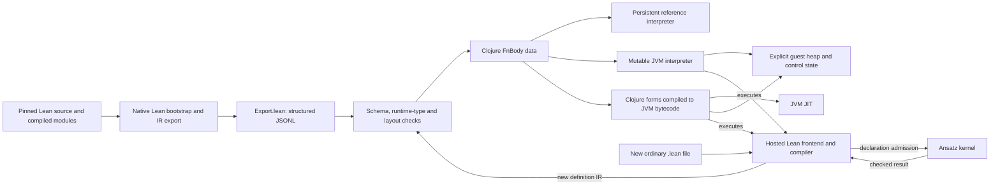
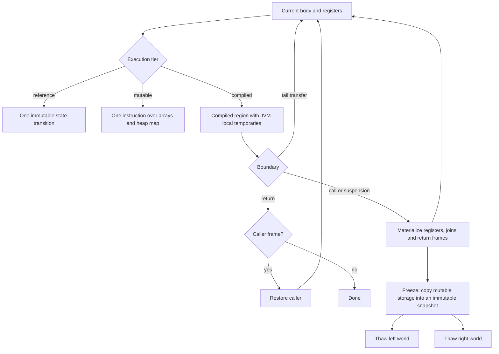
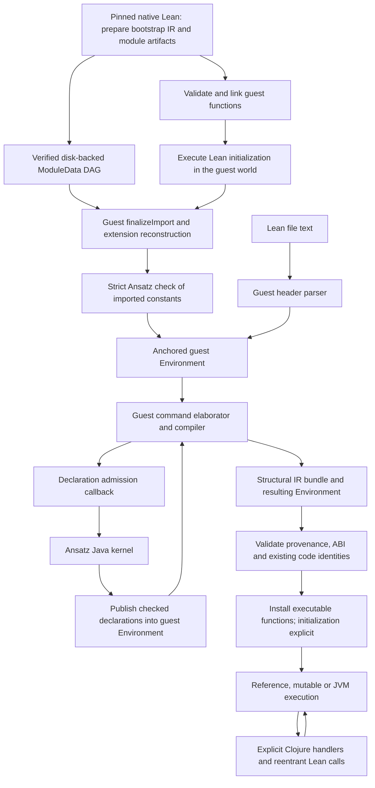
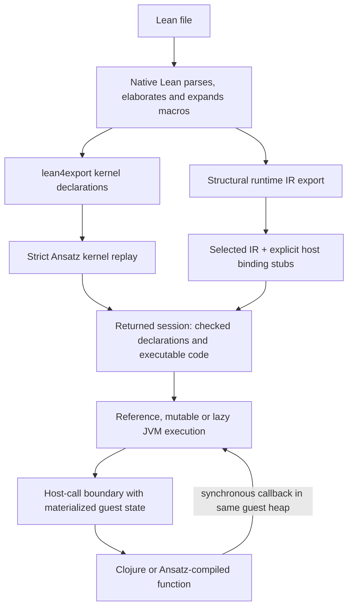
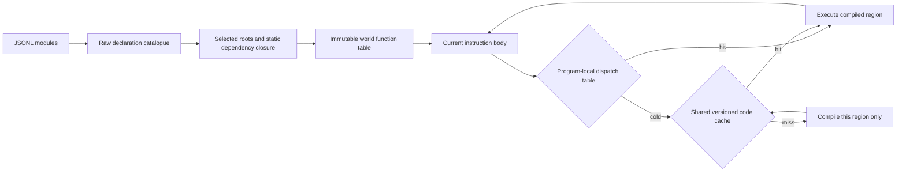
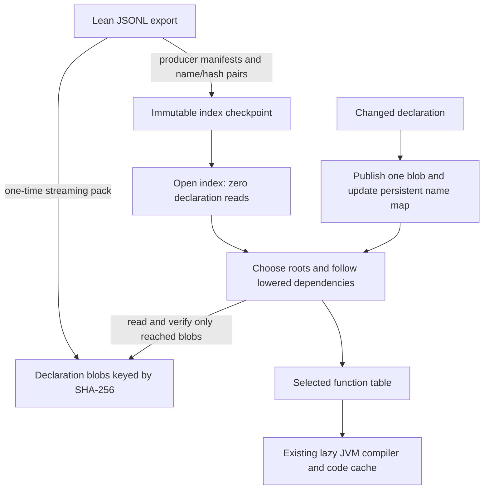
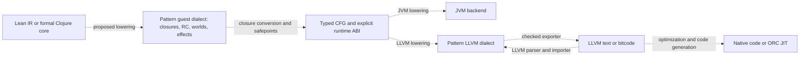
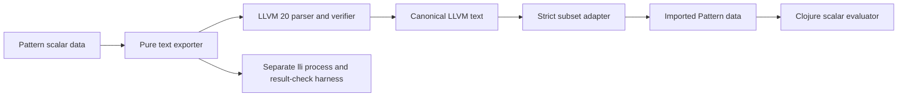

# Lean IR runtime REPL experiment

The draft [typed IR and Pattern design](research/TYPED_IR_PATTERN_DESIGN.md)
maps a proposed typed compiler pipeline, pass contracts and snapshot boundaries.
Its [executable instruction fragment](research/typed-ir-pattern-example.clj)
checks one UInt64 lowering with Pattern; the bounded scalar region path below
implements part of that pipeline.
The [implementation contract](research/TYPED_IR_IMPLEMENTATION_SPEC.md) fixes
kernel/interop boundaries and acceptance gates. Its first step adds opt-in
typed companions for selected declarations; ordinary lowering does not prepare
them eagerly. Bounded scalar [block preparation](measurements/typed-block-preparation.json)
now validates selected control flow and reconstructs canonical interpreter bodies.
These blocks feed the optional scalar region path below. Opt-in
[unsigned wrapper specialization](measurements/scalar-wrapper-specialization.json)
now compiles selected UInt64/USize add/sub wrapper instructions on the existing
JVM backends; guest calls and returns remain explicit. The optional
[typed tail-region preparation](measurements/typed-tail-preparation.json) now uses
Pattern to build validated graph, trace and carrier data. Optional
[typed tail-region execution](measurements/typed-tail-execution.json) emits primitive
scalar loops with exact fuel and snapshot materialization on existing JVM drivers;
joins and general non-tail source calls still fall back.

The additive [session compiler selection contract](research/TYPED_IR_IMPLEMENTATION_SPEC.md#session-compiler-selection)
threads explicit `:compiler-options` through existing interop sessions and frontend
reopens. Its [focused boundary tests](measurements/session-compiler-options.json)
cover selected scalar execution, callbacks and retained caches; genuine hosted
frontend and Java compiler-tier acceptance remain separate.

Data-only [Nat preparation](measurements/nat-preparation.json) additionally retains
object-family numeric literals and exact RC annotations, with directional boxed
representation compatibility. It does not compile Nat or alter MPZ ownership.

[RAW casesOn construction](research/RAW_CASES_ON.md) adds an explicit guest-code
constructor and preseal redirect with portable native-oracle regressions.
Construction and preparation remain separate from kernel admission and whole
hosted frontend acceptance.

The [manifest-pinned coherent consumer infrastructure](research/COHERENT_CONSUMER.md)
separates the original producer from a complete current source/class cohort and
its controller/helper composition. Constructor, protocol and CI gates passed;
fresh full-run acceptance remains pending after a host-memory preflight refusal.

[Explicit managed-operation abandonment](research/OPERATION_DISPOSAL.md) is an
optional lifecycle API with focused regression coverage.
[Project failure disposal](research/PROJECT_FAILURE_DISPOSAL.md) extends it to
issued terminal failure capsules and their failed load aliases.

The optional [closed application consumer](research/HOSTED_APPLICATION_CONSUMER.md)
adds a distinct source/class inventory for helper protection, managed disposal,
ordinary inductive preparation and typed EIO adapters. Its compatibility tests
remain separate from genuine hosted frontend acceptance.
Its additive [control-preserving encoder revision](research/HOSTED_APPLICATION_CONTROL_CONSUMER.md)
retains that member domain and class cohort under a separately named /2 policy.

An Ansatz experiment, outside the library's normal source/AOT paths. Its optional
consumer APIs and fixtures support the hosted frontend campaign; a production
runtime API and package split remain undecided.

The optional [typed EIO controller](research/TYPED_EIO_HOST_VALUES.md) supports
explicit synchronous String services with declared String errors and bounded
invocation permission. Its fixtures exercise actual emitted Lean IR on all three
backends; fresh hosted source/Project IO acceptance remains a separate gate.

The [latest component record](measurements/hosted-component-acceptance.json)
accepts genuine Nat/String callbacks and public P1/P2 native reset with retained
versions. A later chain harness error ended that capture with exit 1; complete
chain cleanup, diamond/edit reloads and whole-session cleanup remain unproven.
The [earlier standalone P1](measurements/public-project-p1.json) passed separately
with exit 0. See [current campaign status](research/CAMPAIGN_CONTINUATION_2026-10-23.md).
These are experimental profile results, not production or competitive-performance claims.

The JVM experiment now also includes a mutable interpreter, a numeric compiler
and a constructor/closure block compiler. These are experimental alternatives to the portable reference machine,
not changes to Ansatz's production lowering or library runtime.

## Mutable primitive operations table

The mutable interpreter reuses its machine-independent primitive operations map.
Machine-dependent operations receive the current machine; five directly stored function values
retain their original call-entry redefinition behavior through a guarded fallback.
The [paired primitive microbenchmark](measurements/runtime-ops-table.json) observed
median 491.7 ms before and 337.2 ms after for 100,000 primitive calls, with current-thread
allocations falling from 341.4 MB to 75.0 MB. These are isolated primitive measurements;
cold frontend, compilation, import and REPL edit latency were not measured.
Checkpoint consumers use the separately named
`make-runtime-ops-reconstruction-factory` and its exact ops-table mutable source pin.
The original globals and reconstruction profile IDs keep their original pins.

The [net-zero heap fix](research/HEAP_OVERLAY_NET_DIRTY.md) has a separate consumer:
`make-heap-net-dirty-reconstruction-factory`, with profile
`ansatz-producer50f-heap-net-dirty-reconstruction-consumer/1`. It adds only the
exact reviewed `HeapOverlay.java` source substitution to the existing ops and
reconstruction contract. All three older profiles retain their original heap
source requirement. Actual outer/nested class bytes still require an externally
accepted consumer digest and a fresh trusted launcher's loaded-code attestation.
Modeled compatibility regressions do not replace that genuine constructor gate.
The separate [fresh captured campaign](measurements/source-reconstruction-retention-runtime.json)
now passes this constructor gate with zero guest steps, native leases and archive
invocations; strict Init checking is recorded separately.
The [validation record](measurements/heap-consumer-compatibility.json) records the
focused and comprehensive suite results and their exact source/class hashes.

The fixed fifth consumer uses `make-source-graph-reconstruction-factory` and
`ansatz-producer50f-source-graph-reconstruction-consumer/1`. Its closed 257-row
inventory requires exact reviewed `source_import.clj` and `source_graph_plan.clj`
bytes, retaining the fourth consumer's heap/ops requirements. All four prior
contracts remain unchanged. The [compatibility record](measurements/source-graph-consumer-compatibility.json)
records 26 tests / 1,104 assertions: modeled inventory and restore-profile
boundaries, existing Java/class checks, and authentication of the two actual
frozen graph resources. This does not establish whole-consumer loaded-code
attestation, helper admission or a completed source graph import. The complete
optional runtime suite also passes 944 tests / 92,219 assertions. The record
preserves the first preflight rejection and the separately reviewed resource
policy used for the completed run.

The sixth consumer, `make-source-graph-frontend-reconstruction-factory`, keeps
that 257-row inventory and adds one exact `frontend.clj` substitution under
`ansatz-producer50f-source-graph-frontend-reconstruction-consumer/1`. All five
older contracts retain their original frontend requirement and option sets.
The frontend records the returned Environment owner before releasing its IO
wrapper, saves later installation checkpoints with their matching sessions, and
preserves an installed candidate separately if opening its new session fails.
The [frontend compatibility record](measurements/graph-frontend-consumer-compatibility.json)
records 17 frontend tests / 289 assertions across three backends and 32 focused
compatibility tests / 1,489 assertions. The latter cover modeled inventories,
all 30 ordered profile mismatches, and authentication of three actual resource
files. These checks do not establish a fresh whole-consumer constructor or a
genuine multi-module frontend run. The complete optional runtime suite passes
952 tests / 92,680 assertions with this frontend and compatibility change.

From this directory, reproduce with the normal experiment classpath after preparing
the Java classes described below:

```sh
clojure -J-Xmx384m -J-Xss8m -M scripts/benchmark-runtime-ops.clj
```

The driver runs focused runtime tests, loads the exact renamed historical baseline
from `scripts/benchmarks/runtime-ops-baseline.clj` into its isolated JVM, then writes
raw paired trials to `target/runtime-ops-benchmark.json`. Use a separate process;
this driver is not a live frontend command. Five warmups precede seven alternating
paired trials; it reports current-thread allocations and does not force GC.
A [separate portable reproduction](measurements/runtime-ops-table-portable-reproduction.json)
passes the exact tracked driver starting without an experiment `target` directory.

## Native source graph module identity

The native graph driver now supplies explicit Lean module roots: `lean` for the
helper/oracle package and `lean/source-graph-fixtures` for the fixture package.
The oracle run uses the same helper root. This keeps private declaration names
consistent with the existing source-import helpers; export `--local` alone cannot
repair names already compiled into an `.olean` file.
The [rooted native validation](measurements/source-graph-module-roots.json) passes
all 15 native/oracle commands and a bounded static reconciliation of all 73
required overlapping helper declarations. The new candidate preserves the four
existing canonical runtime rows and has 173 local names absent from the scanned
native index and archived function inventory. Graph helper tests cover strict
lowering and transport; genuine whole-frontend helper admission remains a
separate pending gate. Historical
exports remain unchanged; no runtime permission or performance claim follows.

## Completed source graph runtime

The optional resident graph APIs separate source publication from completed
import authority. The fixed profile supplies both eval and frontend installation
options. Each import checks the complete selected native/source union, creates
fresh local Java projections, and activates all per-node receipts only after
successful adoption. Retained input Contexts keep their previous checked state.

The [runtime protocol and limits](research/SOURCE_GRAPH_RUNTIME.md) distinguish
the staged integration tests from genuine frontend execution. The corrected
chain gate passes 3 tests / 94 assertions, including real kernel admission and
file installation for B importing A across all three backends. Compiler output
serialization and finalization are modeled in that gate. Genuine graph-chain
compilation, general project loading and shared-A diamond execution remain
separate acceptance work.
The [original G2 optional validation](measurements/source-graph-runtime.json) records
978 tests / 93,234 assertions. Its first full run stopped at the RSS limit; a
separately reviewed 1280 MiB RSS ceiling passed with the same 512 MiB heap,
deadline, free-memory floor and unchanged runtime/test code.

The experimental [Project discovery coordinator](research/PROJECT_DISCOVERY.md) captures source once per module and threads updated header packets through an ordered dependency walk. It returns descriptive data without importing or compiling. The [validation record](measurements/project-discovery.json) reports 997 optional tests / 93,591 assertions with modeled header transport.

The optional [Project loader](research/PROJECT_LOADING.md) composes captured discovery, native-only preparation, checked parent imports, source publication and explicit export invocation. Its [focused integration record](measurements/project-loader.json) reports 3 tests / 264 assertions across reference, mutable and JVM backends, including actual kernel admission, installation, registration, FileHandle issuance and Project calls. Header/compiler/export/witness/finalizer transport and producer authentication remain models. The composed current-source optional suite passes 1,029 tests / 94,230 assertions with freshly built Java classes and no historical support source/class fallback; genuine single-file frontend acceptance is now recorded separately in [public P1](measurements/public-project-p1.json).

The experimental [native Init base operation](research/NATIVE_INIT_BASE.md) prepares a fresh checked native-only view in the current persistent lineage while retaining published source registries. A separate opt-in factory supplies source-bound readiness provenance; the operation issues no source receipts. Its [validation record](measurements/native-init-base.json) reports 1008 optional tests / 93,772 assertions and separates tiny-Source and staged models from genuine restored-frontend acceptance, which remains pending.

## Explicit source capture

The optional [source capture API](research/SOURCE_CAPTURE.md) selects a package
root with Lean's first-package precedence and captures bounded immutable UTF-8
text once. Its digest describes the captured bytes; it grants no import authority.
A future loader must parse and compile that same text, enforce aggregate project
limits, and schedule dependencies through the checked graph runtime. General
project loading remains pending.
The experimental [bounded classic header discovery API](research/SOURCE_HEADER_DISCOVERY.md) returns updated prepared packets and descriptive headers; it does not provide Project loading or import authority. The [header validation record](measurements/classic-header-discovery.json) reports 991 passing optional runtime tests / 93,460 assertions after combining the source capture and header test registrations; fixed-helper header transport is modeled in those tests.

## Imported kernel dependency graph

Strict imported checking builds its reverse dependency map with an invocation-local
transient outer map, then persists it before checking. Dependency traversal and
immutable adjacency-vector order stay unchanged. The [bounded allocation comparison](measurements/kernel-check-graph-allocation.json)
passes the existing 12-test / 63-assertion imported-kernel suite and nine graph
comparisons. Its synthetic 16,384-group case allocates 84.3 MB with the historical
construction and 12.2 MB with the candidate. This measures graph construction;
retained heap, full checking and hosted frontend performance were not measured.

A separate [checking-plan lifetime change](measurements/kernel-check-plan-lifetime.json)
keeps full group records and their name/dependency sets inside a private preparation
frame. The checking loop receives only original members, reverse edges, degrees,
ready keys and a count. Its 15-test / 168-assertion run includes historical-plan
ordering comparisons and deterministic forbidden-container identity checks.
This establishes return-graph reachability, not retained bytes or GC timing;
the build still constructs the same blockers and group records.

## Architecture: loading and execution

The producer is native Lean, which imports compiled modules and exposes their
compiler IR through `IR.findEnvDecl`. `lean/Export.lean` exports declarations as
structured JSONL under a pinned schema. The prototype reads this export, not
Lean's binary `.ir` files or its human-readable pretty printer. Native Lean
prepares the pinned bootstrap artifacts. The hosted path executes Lean's parser,
command elaborator and compiler as guest code, routing kernel admission to
Ansatz. Fresh safety-validated evidence covers genuine standalone import,
checkpoint restoration and resident source/interop execution; see the
[current small-profile scope](research/KERNEL_PROBE_GENUINE_SOURCE.md) and
[checked preparation adapter](measurements/checked-resident-provider-acceptance.json).

The subsequent [fresh full-Init profile](measurements/full-init-strict-resident-acceptance.json)
passes strict checking of all 65,994 declarations under its 15 recorded assumptions,
resident ordinary-file execution, macro Nat/Unicode, isolated diagnostics and two
host callbacks through `open-checked`. A separate fresh source-module branch also
finalizes Init+A and strictly checks 65,995 declarations with A's exact receipt.
Its B gate uncovered an archived JSON witness missing module origin; the
[explicit typed FILE profile](measurements/source-file-typed-witness-validation.json)
now passes the fresh full A-to-B gate: B returns Nat42 and Unicode without
diagnostics, and the actual guest witness identifies imported A. A separate
[fresh prelude fork campaign](measurements/prelude-semantic-forks.json) now passes
real A-body edits, identical B imports and retained old-B behavior through a shared
JVM output cache. Ordinary full-Init dependency edits, package coverage, packaging
and independent native-map parity remain open.
The full campaign currently uses mutable execution. See the
[fresh execution-mode comparison](research/EXECUTION_PERFORMANCE.md) for measured
native/interpreter/JVM kernel timings and their limits.

The optional [resident source publication consumer](research/RESIDENT_SOURCE_PUBLICATION.md)
adds `load-and-publish` for explicit initializer-free standalone/over-Init profiles.
It uses public resident APIs and leaves the authenticated runtime unchanged.
Its focused ownership/failure tests, full prototype suite and separate actual
standalone frontend acceptance pass: publish A, strictly finalize its import,
load/call B and retain A's earlier Context. Full-Init acceptance of this new
consumer remains separate. The optional [import-preparation consumer](research/RESIDENT_IMPORT_PREPARATION.md)
now supports genuine import finalization and fresh checking. Together with
publication and `resident/load-source`, it composes the two-file workflow through
public APIs. Its separate standalone frontend acceptance passes; it does
not yet provide a general dependency resolver. The separate
[resident Init-prefix consumer](research/RESIDENT_INIT_IMPORT.md) provides staged
over-Init import preparation, finalization and fresh checking. Its distinct
[reconstruction profile](research/SOURCE_RECONSTRUCTION_PLAN.md) authenticates an
original checked source publication for callbacks during finalization, before the
completed target receipt exists. Focused tests use actual raw evalConst transport
and small real Java checks with modeled frontend/finalizer bodies. A separate
[earlier hosted receipt](measurements/source-reconstruction-hosted-runtime.json)
passes the original macro A→B branch; its edited import stops at the controller's
128-slice limit and its process later exits 0. That evidence remains unchanged.
A [fresh authenticated campaign](measurements/source-reconstruction-retention-runtime.json)
uses the distinct heap consumer, successful-control compaction, consistent session
fuel and a predeclared 1,024-slice bound. It passes fresh checking of all 65,994
Init declarations, the actual helper/prefix gate, original initializer-free macro
publication, callbacks before finalizer completion, fresh source checking and
B Nat41/Unicode calls with retained A behavior. The edited sibling also completes
import and fresh checking; byte-identical B returns Nat42 and doubled Unicode
with zero diagnostics. Twenty calls include retained old/new/old A and B handles,
with both branch inputs unchanged. Both successful controls are compacted. The
process exits 0 without a guard stop; its roughly 86-minute lifetime includes
retained REPL idle and checking/GC work, so this is not a speed measurement.
Backend comparison remains unexecuted because its postpass resource gates fail.
No Source close or guest-owner cleanup is inferred from process disposal.
Existing completed-import authorization keeps its receipt requirement.

The historical 2026-10-17 low-level hosted-file campaign used a long-lived,
resumed world and its then-loaded checker, before the later definition-safety
fix. In that campaign, the full implicit-Init path completed guest finalization and
strict kernel association for 65,994 constants, with 15 explicit axioms under
the recorded policy. After adding the native-tested expression ordering primitive, an ordinary
implicit-Init file compiled and returned `42`, with no diagnostics or pending
initializers. A source-defined macro also compiled, expanded and returned `42` after a
reviewed compiler-boundary recovery; its timing covers only that resumed
segment. A fresh ordinary file then passed Lean–Clojure round trips for a Nat
and a Unicode String with explicit ownership checks. See the
[ordinary-file](measurements/hosted-ordinary-answer.json),
[macro](measurements/hosted-ordinary-macro.json), and
[interop](measurements/hosted-ordinary-interop.json) observations. The bounded
ordinary A→B path also passed: A's actual owned ModuleData was combined with the
verified Init prefix, the whole 65,995-constant hybrid map was strictly rechecked,
and B's genuine imported-source witness was accepted before returning 42 and
Unicode String. See the [hybrid kernel](measurements/hosted-ordinary-hybrid-kernel.json)
and [B completion](measurements/hosted-ordinary-library-b.json) records. B's timing
covers reviewed completion only; neither guest compilation nor finalization was
replayed. This establishes the observed two-source-module case. General package
imports, complete runtime coverage, and competitive performance remain unproven.
These historical observations do not establish ordinary-Init acceptance through
the new provider or reproduction under the fresh bounded callback profile.
See the [Init measurement](measurements/hosted-full-init-kernel.json) and
[current gate notes](research/hosted-frontend-next.md).



The JSON manifest records producer version, modules and initialization metadata.
Names preserve both string and numeric components. `load-bundle` validates and
lowers all rows eagerly. The newer `index-bundles` retains raw declarations and
`load-closure` lowers selected roots and their static dependencies. Direct calls
and closure constructors determine those dependencies from the lowered body;
producer dependency lists are not trusted for execution linking. Indirect targets
supplied from outside this closure require additional explicit roots or host
functions. The module runtime executes recorded initialization actions in guest order with
world-local once guards. Its full Lean bootstrap completes 8,052 actions. The
strict importer rejects unbound extern declarations; runtime-enabled loading
links reviewed primitives and explicit host handlers. Research loading may
retain an explicit trap for a missing primitive; reaching that trap fails.
The optional declaration store described below avoids decoding all declaration
bodies on subsequent reloads: it opens a smaller immutable index and resolves
selected bodies from separately hashed files.

Our instruction language is ordinary immutable data. For example:

```clojure
{:params [0]
 :body [:let 1 [:prim :inc [[:var 0]]]
        [:return [:var 1]]]}
```

`:let` binds a register; `:call` saves a continuation; `:tail` replaces the current
activation; `:return` delivers a value. `:join`/`:jump` describe local control flow
with arguments and captured lexical bindings. Constructors, projections, cases,
closures, explicit RC and unique-field stores implement the heap portion. Proof
terms are not interpreted by this machine. The `:suspend` operation is an explicit
prototype extension used for continuation/fork experiments.



The mutable machine stores registers and constructor fields in object arrays,
return frames in an explicit deque, and guest nodes in an ID-to-node heap map.
Read-only array size/index operations borrow the current storage. Element stores
in uniquely owned local arrays update it directly after releasing the old field;
shared, persistent and imported arrays retain the copy-on-write path. These fast
paths do not change frozen snapshots or expose mutable arrays to host handlers.
Calls and tail transfers return to a host dispatch loop, so guest tail recursion
does not grow the JVM stack. Compiled regions are generated Clojure forms passed
to `eval`; Clojure emits bytecode and the JVM optimizes that code. This is not a
native LLVM backend. Calls into runtime helpers still handle heap/control effects.

Guest RC governs constructor reuse and logical release. The JVM GC manages the
physical host objects. Frozen worlds copy writable field arrays; thawed children
share immutable field vectors and materialize private arrays on a validated
mutation. Defensive normalization copies non-vector input storage. Persistent
references and tasks replace their storage when updated, preserving fork isolation.
Each child can therefore have guest RC 1 without sharing writable fields with its
sibling. Freezing tracks changed heap IDs and shares unchanged immutable map
entries; dense updates use a full reconstruction. Thawing uses a private heap
overlay over the immutable base instead of copying every map entry. A warm
identity-scoped storage-shape hint skips heap validation; cold unknown or external
heaps still undergo normalization/key checks. This hint proves only the map/vector
storage shape required by COW, not deep payload immutability or kernel authority.
Globals, frames, locals and join restoration still cost work; the entire fork is
not O(1). The [adoption observations](research/REGISTER_LAYOUTS.md#restoring-live-continuations-and-warm-heap-storage)
preserve exact state and runtime identities without a paired speed benchmark.
Native resource rollback and arbitrary JVM stack capture are not implemented. Exact-fuel pauses
use interpreter fallback when a complete compiled region cannot fit the budget.

## Reproduce

From the Ansatz worktree root, compile the Java kernel once:

```sh
clojure -Srepro -T:build javac
cd experiments/lean-ir
mkdir -p target/compact-projection-classes
javac --release 11 -d target/compact-projection-classes java/prototype/TypedLongMemo.java
clojure -Srepro -J-Xmx1g -Sdeps '{:paths ["src" "test" "target/compact-projection-classes"]}' -M:test
clojure -Srepro -M:nrepl
```

Use JDK 17 or newer for this optional experiment: its source helpers use
`java.util.HexFormat`. The Java compilation target of 11 is a bytecode/language
setting, not the host runtime requirement. Validation currently uses JDK 25.
The optional runtime suite includes the compact projector, so it needs the
additional `TypedLongMemo` class above as well as the normal Java kernel/runtime
classes. These sources and the checkpoint wire/function verifier are tracked;
no historical `consumer-support/src` overlay is required. Checkpoint source
availability does not authenticate a historical capture or authorize a restore.
See the [portable checkpoint support contract](research/PORTABLE_CHECKPOINT_SUPPORT.md).

Connect to the printed loopback nREPL port. A plain terminal REPL is also available
with `clojure -Srepro -M:repl`.

```clojure
(require '[ansatz.core :as a]
         '[prototype.examples :as ex]
         '[prototype.machine :as m]
         '[prototype.lean-ir-test]
         '[clojure.test :as t])
(a/init!)
(a/defn ^Nat prototype-inc [^Nat n] (+ n 1))
(= (mapv prototype-inc [1 2 3 4]) (:values (ex/list-demo false)))
(t/run-tests 'prototype.lean-ir-test)
(def lab {:tail (ex/tail-demo 100000)
          :unique (ex/list-demo false)
          :shared (ex/list-demo true)
          :fork (ex/fork-demo)})
(ex/summary)
```

`a/init!` uses the bundled medium tier in trust mode. The DSL definition above is
admitted through Ansatz; comparing its result with the guest is an execution check,
not a proof of correctness of the guest machine.

## What runs

`fixtures/list-map.jsonl` contains actual final Lean 4.33.1 IR exported for
`List.map` and `List.map._redArg`. The importer maps its instruction subset into
explicit register/frame instructions, recognizing a call followed immediately by
return of its result as a tail transfer. It does not substitute Clojure's `map`.

The portable `.cljc` machine executes that program, including joins, dynamic
application, constructor cases/projections, RC and uniqueness-sensitive stores.
The callback is an explicitly limited scalar increment intrinsic. Guest closures
with owned captures are tested separately using a synthetic program.

The mutual tail-call program and `:suspend` instruction are experimental extensions,
not claims that Lean IR already implements multi-shot continuations. A suspended
state includes the guest instruction, locals, join definitions, return frames and
logical heap. Resuming the same immutable snapshot creates independent guest worlds.
References are relative to their explicit guest state and must not be mixed between
unrelated worlds. The prototype does not accept arbitrary host mutable state as a
forkable resource model.

Observed results:

| Case | Result |
| --- | --- |
| 100,000 mutual tail transfers | Result 0; maximum guest return frames 0 |
| Unique four-element list | Mapped values `[2 3 4 5]`; same root identity; four guest allocations total |
| Shared four-element list | Original `[1 2 3 4]` preserved; fresh result; eight guest allocations total |
| Resume one suspended state twice | Results 10 and 20; original snapshot unchanged |
| Resource-bearing closure | Last owner drops its synthetic resource exactly once |

Allocation counters count **guest nodes**, not Java/JavaScript allocations.
Unique stores preserve guest identity but still update persistent host maps.
This is a semantics/inspection prototype, not an allocation-free runtime or a
performance benchmark. Resource finalizers append simulated release events; real
handles, native RC/FFI, threads and external-effect rollback are not implemented.

Guest uniqueness and physical storage uniqueness differ across snapshots. Two
branches can each see guest RC 1 while sharing host storage. Persistent host maps
make the current stores safe. A mutable backend will need world-level ownership,
snapshot copy-on-write or an equivalent guard before turning those stores into raw
host mutation. The tests include forking during non-tail map execution and resuming
both branches through the unique-store path.

Arithmetic intrinsics are intentionally limited to exact small integers within
JavaScript's safe range and reject out-of-range arithmetic. This does not implement
general Lean Nat/Int/UInt64 arithmetic. Integer scalar storage and boxing are now
supported under the explicit profile below. Most externs, float layouts,
reset/reuse instructions, general partial/overapplication, exception unwinding, module initialization,
live frontend kernel adapters remain unsupported. The native-assisted bootstrap
can now check exported declarations and link their IR as described below. Unsupported
imported operations fail explicitly. There is no verified compiler or production JIT.

## Frontend milestones and bidirectional calls

The four frontend milestones now have concrete bounded hosted observations:
source loading/elaboration, strict Ansatz admission, macro execution and
bidirectional calls. They do not establish arbitrary Lean-file, tactic, native
ABI or package compatibility.

The ordinary-Init, macro and A→B observations below are historical low-level
results from a long-lived, resumed development world and its earlier checker.
They predate the later definition-safety fix. The current fresh-launch evidence
and its narrower guarantees are recorded in the
[genuine import/checkpoint campaign](research/KERNEL_PROBE_GENUINE_SOURCE.md).
Runtime bootstrap initialization and finalization of an imported Environment are
separate operations.

| Milestone | Evidence and status |
| --- | --- |
| Fresh standalone import and checkpoint to resident execution | Genuine KernelImportProbe finalization, separate-JVM restoration, fresh strict17/native equality and producer CI-byte comparison, same-Environment markers/fresh20 check, Nat/Unicode calls, two host callbacks and expected diagnostic. This covers the pinned small fixture, not ordinary Init |
| Bidirectional calls for a small Lean module | Actual ordinary-file Nat/Unicode String callbacks pass; an already compiled function returns the same owned heap String Ref at RC1 in two independent forks, with isolated releases |
| Real Lean parser on the JVM | All 3,190 parser initialization actions complete; seven header summaries and all 12 complete syntax/diagnostic observations match native Lean |
| Hosted elaboration with Ansatz admission | All 8,052 full Lean initialization actions complete across 2,322 modules. The actual Init import passes strict checking of 65,994 constants with 15 explicit axioms; an ordinary implicit-Init definition returns 42. The bounded Init-plus-A import also passes a 65,995-constant whole-map check and B's actual imported-source witness/calls |
| Hosted file defining and invoking a macro/tactic | The actual ordinary source-defined macro expands, compiles and returns 42 after reviewed staged recovery, without guest compilation replay. This is macro evidence; general hosted tactics remain unproven |

The hosted path keeps native artifact preparation separate from per-file work.
See the [Init check](measurements/hosted-full-init-kernel.json),
[ordinary definition](measurements/hosted-ordinary-answer.json),
[macro completion](measurements/hosted-ordinary-macro.json),
[fresh-file interop](measurements/hosted-ordinary-interop.json),
[heap-fork interop](measurements/hosted-ordinary-interop-heap-forks.json), and
[bounded source A→B result](measurements/hosted-ordinary-library-b.json).
Macro/B completion timings exclude their earlier guest work and are not fresh
whole-file benchmarks. Ordinary classic imports here use an explicitly prepared
verified Init prefix; general dependency/package loading is not established.
Missing runtime operations still trap explicitly.



The native-assisted bootstrap remains useful independently:



`prototype.bootstrap/load-file!` is explicitly a native bootstrap. It compiles one
module with pinned Lean 4.33.1 and exports requested roots. Dependencies must
already be installed or compiled; it does not replace Lake. If a matching
`lean4export` executable is supplied, declarations are checked from an empty
Ansatz environment before the session is returned. Without that executable the
session is marked `:kernel-status :unchecked`. The helper never installs a global
Ansatz context. This gate checks declarations; it does not prove the IR compiler,
host bindings or their correspondence to those declarations correct.

```clojure
(require '[prototype.bootstrap :as bootstrap]
         '[prototype.interop :as interop]
         '[prototype.frontend-smoke :as smoke])
(def session
  (bootstrap/load-file!
   {:module "InteropProbe"
    :roots ["InteropProbe.identity" "InteropProbe.callHost"
            "InteropProbe.roundTrip" "InteropProbe.applyCallback"]
    :bindings smoke/bindings
    :kernel-exporter (System/getenv "LEAN4EXPORT_BIN")}))

(def identity-fn (interop/function session "InteropProbe.identity"))
(identity-fn 42) ; 42
((interop/function session "InteropProbe.callHost") 42) ; 43
((interop/function session "InteropProbe.roundTrip") 42) ; 84: host invokes Lean closure twice
((interop/function session "InteropProbe.applyCallback")
 (interop/function-ref "InteropProbe.hostTransform") 42) ; 43
```

The Lean file declares host entry points normally:

```lean
@[extern "ansatz_host_transform"] opaque hostTransform : Nat → Nat
@[extern "ansatz_host_apply"] opaque hostApply : (Nat → Nat) → Nat → Nat
```

The corresponding binding entry has `:arguments`, `:result` and `:fn`, for example
`{:arguments [:nat] :result :nat :fn (fn [_ x] (inc x))}`. A closure handler receives
an invocation context: `(fn [{:keys [invoke]} f x] (+ (invoke f [x]) (invoke f [x])))`.
Runtime types and ownership signatures are checked against the binding profile.
Bindings currently return small Nat and accept small Nat or guest closures;
general inductives, strings, arbitrary-size integers and returned callbacks are
not marshalled. `function-ref` creates a guest wrapper for an already linked
Lean definition or host extern; arbitrary Clojure functions are not passed as
raw guest objects.

`:host` is an explicit instruction that stops execution with a serializable
request containing the symbol, argument values and result register. The driver
resumes after handling it. Nested callbacks borrow the closure, execute in the
same guest heap, restore the outer continuation and discharge transferred
argument ownership when the handler returns. One instruction budget covers
nested calls. Host implementations stay outside snapshots and compiled code;
sessions can share a code cache without capturing another session's bindings.
Pass `:code-cache (lazy/code-cache)` to repeated bootstrap loads to share it.

Callbacks are synchronous, restricted to the calling thread and invalid after
the handler returns. Host JVM stacks, arbitrary host state and effects are not
forked or rolled back. Guest state can be snapshotted at the host-call boundary;
this does not make an executing Clojure callback resumable. Exceptions abort the
call rather than implement Lean exception unwinding.

`prototype.ansatz-interop-test` demonstrates both calling directions using the
existing Ansatz compiler: a verified Ansatz definition calls the checked Lean
`InteropProbe.identity` through an arity-registry binding, and a verified Ansatz
identity serves as a Lean host implementation. These are scoped test/REPL
registry bindings, not a finished concurrent-session DSL API. No replacement
axiom is introduced for the imported identity definition.

`FrontendProbe.lean` defines and uses a custom `keepValue` macro. Its expanded
`answer` definition is checked by Ansatz and returns 43 through the JVM host
binding. Expansion runs in native Lean. Native elaboration-time macros, tactics
and `#eval` cannot use the JVM binding registry through this bootstrap; that
requires the hosted frontend or a separate native callback bridge.

The [native bootstrap record](measurements/frontend-bootstrap.json) pins sources
and artifacts and records 16 accepted declarations for the interop module and 12
for the macro example. The current live REPL retains `interop-lab`,
`ansatz-interop-lab`, `bootstrap-lab`, `frontend-smoke`, `parser-audit` and
`parser-link-attempt`. Reproduce the native-assisted end-to-end check with:

```clojure
;; In the REPL, use experiment rather than CLI -main.
(smoke/experiment (System/getenv "LEAN4EXPORT_BIN"))
```

```sh
clojure -Srepro -J-Xmx1g -M -m prototype.frontend-smoke "$LEAN4EXPORT_BIN"
```

### Hosted parser: measured compatibility gaps

The [parseHeader audit](measurements/parser-header-audit.json) inventories 985
statically reachable declarations: 889 functions and 96 extern declarations
covering 89 symbols. The initial importer admitted 461 declarations; the scalar
checkpoint below admits 573. These are raw lowering counts, not executable
admission or runnable coverage percentages. Initializers and
dynamically registered callbacks need additional roots.

The closure includes uint32/uint64/usize/void types, scalar constructor storage,
boxing/unboxing, scalar projections/stores, tag mutation and shell deletion.
It contains 487 persistent-RC operations and three functions whose IR is
`unreachable` because their values come from initialization: `parserExtension`,
`categoryParserFnExtension` and `envExtensionsRef`. Treating those bodies or
persistent flags as ordinary functions/RC would be incorrect.

The exporter manifest covers 604 loaded modules with 1,595 builtin and two
regular initializer entries. This is the exporter's complete imported-module
inventory, not a claim that all these initializers are necessary for parseHeader.
The extern inventory includes arrays, UTF-8 string operations, arithmetic and
hashing, references and tasks. Each needs an explicit semantic implementation,
including ownership; substituting Java string indices or hashes is insufficient.

`lean/ParserOracle.lean` captures native syntax structure, byte positions,
recovery state and diagnostics for five header inputs in
[the oracle fixture](fixtures/parser-header-oracle.jsonl). SourceInfo annotations
are omitted from that structural oracle; a complete parser compatibility test
must cover them too. The later imported-initialization campaign below now executes the JVM parser and extends the comparison to SourceInfo.

```sh
lean +leanprover/lean4:v4.33.1 --run lean/Export.lean --closure \
  Lean.Parser.Module Lean.Parser.parseHeader > target/parser-header.jsonl
clojure -Srepro -J-Xmx1g -M -m prototype.runtime-audit target/parser-header.jsonl
lean +leanprover/lean4:v4.33.1 --run lean/ParserOracle.lean
```

Continue in this order: implement typed scalar/heap layouts and the reached
primitive families; provide world-local initialized globals and extension state;
match the parser oracle; implement expression/environment adapters for kernel
externs such as `lean_add_decl`; then connect newly elaborated code to runtime
compilation and `evalConst`. Macro/tactic registration and invocation are the
final hosted test, not something established by native macro expansion. LLVM
is not required by any of these steps.

The [milestone checkpoint](measurements/frontend-progress.json) records the
incomplete hosted objective and pins the source/fixture versions. Validation at
this checkpoint passes 63 tests / 10,498 assertions in both CLI and live REPL,
five SCI tests / 14 assertions, and 20 Node checks including host-boundary
resumption. Native file-loading smoke and the five-case parser oracle also pass.
Production source, AOT JAR and optional LLVM suites were not rerun; production
code and packaging are unchanged.

### Typed integer storage and boxing checkpoint

The scalar implementation was checked against the sibling Lean checkout's IR
definitions, C emitter and runtime header, and against the pinned 4.33.1 release
header and native executables. The [scalar record](measurements/scalar-runtime.json)
pins the reviewed source files separately: the checkout and installed producer
need not have identical compiler pipelines. Native results from the pinned
producer define the tested ABI here.

The new runtime supports `uint8`, `uint16`, `uint32`, `uint64`, `usize` and the
erased `void` type. It lowers `uproj`, `sproj`, `uset`, `sset`, `box` and `unbox`,
and allocates constructors containing both object and scalar fields. This adds
storage and transfers, not the corresponding arithmetic extern implementations.
Floats and struct/union return types remain unsupported.

| Type | Scalar width | Boxed representation in the tested 64-bit ABI |
| --- | --- | --- |
| UInt8 / UInt16 / UInt32 | 1 / 2 / 4 bytes | Immediate value |
| UInt64 / USize | 8 bytes | Heap constructor containing an eight-byte scalar tail |

Object slots precede the scalar tail. An IR scalar address is
`8 * index + byteOffset`; `uproj`/`uset` use word indices. The usize count
contributes to allocation size but does not make a separate physical region:
both access forms can view the same bytes. The direct C ABI probe verifies
that UInt64 and USize boxes can be read through either accessor.

Scalar bytes are stored in an immutable sparse map alongside each constructor's
object fields. Missing bytes remain uninitialized; reads reject them rather than
invent padding values. Writes require unique ownership, stay inside the scalar
tail and use naturally aligned addresses. Snapshots can share these immutable
byte maps while object/register arrays still use the existing full-copy scheme.
The reference machine, mutable machine, eager compiler and demand compiler agree
at every tested instruction-fuel boundary, including pauses inside updates and
boxed closure calls.

New exports carry `runtimeProfile.wordBits` and `runtimeProfile.target`.
Executable scalar loading requires an explicit supported 64-bit x86 profile;
32-bit and other producer profiles are rejected. Legacy object-only fixtures
continue to load. Mixed catalogues with unprofiled manifests are conservatively
rejected for scalar execution until declaration-level provenance is tracked.
Raw `lower-declaration` remains available to static audits, so its success alone
does not establish ABI admission. This metadata adds no LLVM dependency.

JVM storage covers the complete unsigned UInt64/USize range. JavaScript currently
supports exact Number values through `2^53-1` and rejects larger scalar values;
full-width JS storage still needs BigInt or an equivalent representation.
The public small-Nat/closure interop driver has not been generalized to these
integer types.

`ScalarProbe.lean` checks mixed fields, a shared record update and a boxed
higher-order UInt64 call. Native Lean and a compiled C executable both return:

```text
4294967297,255,4294967295,18446744073709551615
255,3,4294967295,18446744073709551615
18446744073709551615
```

`native/ScalarABI.c` separately checks word width, endianness, boxing allocation
and aliasing against Lean's runtime functions. Reproduce from this directory:

```sh
lean +leanprover/lean4:v4.33.1 --root=lean -o target/ScalarProbe.olean \
  -c target/ScalarProbe.c lean/ScalarProbe.lean
lean +leanprover/lean4:v4.33.1 --run lean/ScalarProbe.lean
leanc +leanprover/lean4:v4.33.1 -O2 -o target/scalar-native target/ScalarProbe.c
./target/scalar-native
leanc +leanprover/lean4:v4.33.1 -O2 -o target/scalar-abi native/ScalarABI.c
./target/scalar-abi
```

Refresh the checked-in scalar fixture with the profiled exporter:

```sh
LEAN_PATH=target lean +leanprover/lean4:v4.33.1 --run lean/Export.lean --closure ScalarProbe \
  ScalarProbe.makePacket ScalarProbe.readWord ScalarProbe.readSmall ScalarProbe.readMedium \
  ScalarProbe.readWide ScalarProbe.replaceSmall ScalarProbe.identity8._boxed \
  ScalarProbe.identity16._boxed ScalarProbe.identity32._boxed ScalarProbe.identity64._boxed \
  ScalarProbe.identitySize._boxed ScalarProbe.apply64 > fixtures/scalar.jsonl
```

The historical [scalar-checkpoint parser audit](measurements/parser-header-scalars.json)
used a fresh export with explicit ABI metadata. At that checkpoint it lowered
573 declarations, up by 112, and next failed on persistent RC. Its remaining
first-failure groups were 304 declarations
with persistent RC, 96 extern declarations and 12 with other unsupported
instructions. That classification can mask later failures and does not account
for initialization or dynamic callback roots. These historical counts precede the imported-initialization campaign below;
the later campaign now establishes successful JVM parser comparisons.
The source review confirms that persistent RC cannot simply be ignored: global
values must be initialized and made non-exclusive under Lean's ownership rules.
Lean uses RC zero for persistent objects; marking persistence traverses their
children, and persistent objects are never eligible for unique stores. Closed
thunks and initializer-produced values must be classified from the producer's
environment metadata rather than guessed from names. Their values and
initialization state need to belong to the guest world and its snapshots.

Validation passes 68 tests / 11,335 assertions in both CLI and live REPL, five
SCI tests / 14 assertions and 25 Node checks. Native Lean, compiled C and the
direct C ABI probe pass. No throughput comparison is claimed. The live REPL
retains `scalar-lab`, `scalar-full-tests`, `scalar-parser-audit` and
`scalar-parser-link`; record classes and old frozen values were preserved.

## ClojureScript / Node

The same interpreter core runs on both hosts. The importer/compiler currently runs
on the JVM and emits data; there is no browser-hosted Pattern compiler yet.

```sh
clojure -Srepro -M -e "(require '[prototype.examples :as ex]) (ex/export-portable!)"
clojure -Srepro -J-Xmx1g -M:cljs -m cljs.main \
  -co '{:target :nodejs :output-to "target/portable.js" :output-dir "target/cljs" :optimizations :none}' \
  -c prototype.portable
node target/portable.js
```

The Node runner checks imported map execution/sharing, deep mutual tail calls and
multi-shot state isolation. `package.json` scopes this standalone Node harness as
CommonJS, independent of any containing project's module setting.

## Validation checkpoint

The reference, mutable, numeric-compiler and block-compiler JVM suites together pass
28 tests / 779 assertions (`clojure -M:test`). The Node reference runner passes
17 checks. The optional SCI bridge passes 3 tests / 7 assertions. Native Lean's
list oracle returns `[2, 3, 4, 5]`, matching the imported guest execution.
The surrounding Ansatz source and AOT JAR suites each pass 713 tests / 2417 assertions using
an empty optional store root and the required medium Init fixture. Full Init and
Mathlib fixtures were not provisioned in this worktree. The experiment namespaces
are absent from the production AOT JAR.
The source suite was rerun for the constructor experiment. Production sources and
packaging have not changed; the JAR result is the preceding checkpoint's validation.

## Refresh the native fixture

The checked-in fixture makes the experiment runnable without native Lean. To
refresh it with the explicitly pinned installed toolchain:

```sh
lean +leanprover/lean4:v4.33.1 --run lean/Export.lean --closure Init.Prelude List.map > fixtures/list-map.jsonl
lean +leanprover/lean4:v4.33.1 --run lean/Oracle.lean
```

The exporter and the Lean compiler/runtime are distinct from the guest machine.
Exported algorithm bodies originate in Lean, distributed under Apache-2.0;
the selected producer is Lean 4.33.1, commit
`819816b2e0a3bf405af45ae5c7af2491d8f5bee6`.

## Consolidation boundary

Keep interpreter/ownership semantics separate from JSON import, Ansatz kernel
integration and eventual Pattern nanopasses. That leaves both an internal Ansatz
module and a separately packaged portable runtime possible. The interpreter and
block compiler now share an experimental heap/control ABI. Kernel/native services,
module initialization and admission-to-executable linking remain separate gates
before deciding the package boundary.

## SCI world integration

The optional adapter uses the same released SCI version pinned by Simmis:

```sh
clojure -Srepro -J-Xmx1g -M:sci
```

It stores a suspended guest state in an SCI-created atom, forks the SCI context
between evaluations, and resumes the children to different results. The parent
and each child's simulated resource events remain isolated. The host `guest/resume`
function runs the machine directly; SCI does not interpret each guest instruction.
`(branch-demo :mutable)` restores a private mutable machine for each resume and
freezes its result before returning to SCI; the complete returned snapshots match
the persistent path. No mutable machine is stored in an SCI world cell.
`(branch-demo :blocks)` shares compiled code between the children and returns only
immutable snapshots to SCI. All three execution paths produce equal worlds.
The machine's explicit frames supply guest continuations, not SCI or JVM stack capture.

This is an in-memory integration check, not a durable snapshot codec. Ordinary
SCI forks do not capture an active dynamic binding frame; asynchronous integration
must explicitly convey and retarget the SCI continuation context. Forking from
inside an active evaluation of that same source world is unsupported.

## Mutable execution and baseline compilation

```sh
clojure -Srepro -J-Xmx1g -M -m prototype.mutable-test
clojure -Srepro -J-Xmx1g -M -m prototype.numeric-compile-test
python3 bench.py
```

`prototype.mutable/thaw` restores a reference snapshot into mutable register
arrays, a frame deque, join tables and a heap table with mutable constructor
fields. Tail transfers reuse the current register array. `freeze` copies these
back to the reference representation. Both operations copy live state: there is
no paged copy-on-write implementation yet. A mutable machine belongs to one
execution and must not be accessed concurrently or shared between branches.
Separate `thaw` calls produce independent mutable worlds. RC metadata still
uses small persistent maps, and argument/frame/dispatch operations still allocate.

The tests compare complete reference and mutable states after every instruction
of selected imported and synthetic programs. They cover list reuse/sharing,
closures, resource drops, mutual tail calls and forking with active return frames.
These are differential checks, not a formal refinement proof.

`prototype.numeric-compile/compile-program` translates the numeric tail-only
subset into a Clojure form, which the ordinary Clojure compiler turns into JVM
bytecode. The generated code uses primitive long loop registers and a function
selector for mutual tail transfers. Each arithmetic operation retains the
prototype's exact-small-integer guard. Unsupported heap instructions, callbacks,
joins and suspension reject at compilation; there is no automatic tier promotion,
deoptimization or fallback to arbitrary-precision arithmetic. The generated form
is returned for inspection.

The benchmark compares imported generic `List.map._redArg` on the two interpreters,
a synthetic numeric mutual-tail loop on both interpreters and the numeric compiler,
and equivalent workloads compiled by pinned Lean 4.33.1. Native Lean's map includes
its own specialization and optimized `mapTR` implementation, so this is an
end-to-end execution comparison, not an isolated comparison of heap layouts.
The native Nat loop supports arbitrary precision; a separate native UInt64 loop
provides a bounded-machine-word comparison. Agreement is checked only on the
sampled safe inputs, where all numeric profiles coincide.

Execution timers exclude input construction, mutable restoration and result
inspection. Native IO call boundaries prevent Lean from moving pure work outside
the clock reads; the generated C was inspected for their ordering. The numeric
JVM entry wrapper, argument checks and register preparation are included in its
execution time. Checkpoint timers measure full copying separately. JVM allocation
counts use the current thread's allocation counter and exclude setup; native
allocation is not measured. Native result destruction occurs after the clock read;
JVM GC may occur inside a timed region. No GC suppression or CPU pinning is used.

The runner stores raw samples, toolchain/JVM/CPU details, build/process timings and
source hashes in ignored `target/benchmark.json`. Native Lean is built through its
normal C backend and `leanc -O2`; the run does not compare an LLVM backend.
Cold JVM process time includes namespace loading, setup and every benchmark.
The recorded warm Clojure compile latency is for the small numeric program;
native build timings include the whole Lean benchmark module and linking. They
are different compilation tasks and must not be presented as a compiler speed ratio.

### Retained baseline

[Raw measurements and source hashes](measurements/baseline.json) record one
exploratory run on an Intel Core Ultra 7 258V, OpenJDK 25.0.1 and Clojure 1.12.0.
Times below are medians of 11 samples after 20 warmup invocations; the compiled
numeric loop receives 200 warmup invocations. These are single-process,
single-machine microbenchmarks, with no confidence interval or isolated CPU.

This historical run predates two corrections. `freeze` now explicitly clones
constructor field arrays: `vec` could adopt the old arrays, allowing a continuing
parent to alter a captured snapshot. Native unique-list setup now crosses an IO
boundary, because Lean could move its pure construction inside the clock reads.
Use the newer heap run below for corrected checkpoint and native heap timings;
the historical freeze timing did not establish snapshot isolation.

| Backend | 20,000 numeric tail transfers | Map 1,000 unique nodes | Map 1,000 shared nodes |
| --- | ---: | ---: | ---: |
| Persistent interpreter | 82.93 ms | 23.51 ms | 23.66 ms |
| Mutable interpreter | 32.52 ms | 7.58 ms | 6.58 ms |
| Compiled numeric subset | 0.051 ms | unsupported | unsupported |
| Native Lean Nat | 0.683 ms | 0.0108 ms | 0.0098 ms |
| Native Lean UInt64 | 0.0064 ms | not measured | not measured |

The compiled subset is restricted to exact small integers and rejects overflow;
native Nat is arbitrary precision, while UInt64 wraps outside its range. Their
times describe these implementations on common safe inputs, not interchangeable
numeric semantics. The shared/unique map ordering is noisy and should not be
interpreted as a general advantage of sharing.

The numeric compiler's first invocation took 10.53 ms; repeated compilation of
the small program had a 4.16 ms median. Its timed execution allocated 1,296 host
bytes per invocation, including argument setup; the mutable interpreter allocated
59.2 MB on that loop and the persistent interpreter 163.0 MB. Mutation alone has
not removed boxed values, instruction dispatch, temporary arguments and metadata.
The native module's Lean-to-C and C/link steps took 0.85 s and 1.24 s respectively,
for a different and larger compilation task.

The older path took 4.52 ms to freeze and 4.06 ms to restore 10,000 live nodes and
two return frames. As noted above, it could alias field arrays, so this is not a
valid full-copy snapshot baseline. The heap benchmark below measures the corrected
path. A native allocation or checkpoint comparison is not implemented.

The evidence supports keeping a persistent reference, running private mutable
regions, and compiling useful hot code. It does not establish competitive Lean
frontend execution: the heap workload is still hundreds of times slower than
native, and the compiled numeric example is about eight times slower than the
native word loop. This motivated the constructor and safepoint experiment below.
A cold/edit-to-result benchmark for a growing imported program remains needed.
Keep execution available before hot
regions compile; do not eagerly compile the entire Lean frontend into JVM classes.

## Constructor blocks, snapshots and warm edits

```sh
clojure -Srepro -J-Xmx1g -M:test
clojure -Srepro -J-Xmx1g -M:sci
python3 heap_bench.py
python3 profile_heap.py
```

`prototype.block-compile` emits JVM code for straight-line instructions and case
branches over the mutable runtime ABI. Calls, returns, jumps and explicit
suspension end blocks. Guest return frames remain data; guest calls do not grow
the JVM stack. Constructors, projections, RC, uniqueness-sensitive stores,
closures and joins are supported within the reference instruction subset.

Transfer boundaries expose complete reference states, including guest steps,
ownership counts and return frames. Instruction budgets that end inside a block
use interpreter steps; paused worlds can continue in either tier. This is a
materialized-register baseline, not deoptimization from unboxed native frames.
Snapshots copy all live state; page sharing, asynchronous snapshot requests,
native resources, general externs and exception unwinding remain unsupported.

New fixtures contain actual Lean 4.33.1 IR for `List.foldl`, `List.reverse` and
`HeapProbe.mirror`. The [tree source](lean/HeapProbe.lean) defines a structural
mirror traversal. Tests cover shared/unique nodes, empty inputs, guest closures,
synthetic resource drops, branching, pauses at every tested map instruction budget
and continuing a mutable parent after freezing it. The bounded exact `:add`
primitive supports the fold callback; it is not general Lean Nat addition.

Pass an existing program to `compile-program` when a guest definition changes.
Unchanged blocks are reused. Calls resolve through the machine's function table
rather than inlining callees, so a changed callback does not invalidate callers.
Old programs retain their guest definitions. The cache distinguishes compiler
reload generations and runtime linking options; it is not a durable code cache.

The optional Clojure `:direct-linking` profile links generated blocks to runtime
helpers statically. Guest callees still resolve through the world. Keep the runtime
ABI compatible and reload the block compiler after changing helpers. This profile
did not consistently improve every retained workload and did not materially
reduce allocation.

[Heap measurements](measurements/heap-blocks.json) retain 11 samples after
20 warmups per case on Oracle GraalVM JDK 25.0.1. Lists have 1,000 nodes; the
depth-nine tree has 1,023 nodes. Medians for unique inputs:

| Operation | Persistent | Mutable | JVM blocks | Static runtime calls | Native Lean |
| --- | ---: | ---: | ---: | ---: | ---: |
| Map | 29.73 ms | 25.64 ms | 6.89 ms | 6.06 ms | 0.0081 ms |
| Fold | 24.74 ms | 8.21 ms | 5.09 ms | 4.59 ms | 0.0102 ms |
| Reverse | 12.86 ms | 5.02 ms | 3.17 ms | 3.63 ms | 0.0029 ms |
| Mirror | 10.75 ms | 3.68 ms | 2.85 ms | 3.90 ms | 0.0040 ms |

The matrix runs sequentially in one JVM; JIT compilation, GC and scheduling
affect timings. Modest differences and linking-profile rankings are not established.
Native map also receives Lean's specialization and `mapTR` rewrite. Independent
process forks and sustained-throughput measurements are needed for reliable
rankings. The large native gap is visible across the experiments.

Compiling all 21 blocks for ten guest definitions took 55.3 ms initially and a
74.4 ms median on repeat. Changing increment to decrement rebuilt one block,
reused twenty and returned `[0 1 2 3]` in a 3.33 ms median. This warm IR-edit
measurement includes compilation, restoration, execution, freezing and result
inspection. It excludes Lean parsing/elaboration, kernel admission and IR export.

Corrected full-copy snapshot costs at 10,000 nodes and two return frames were
3.10 ms to freeze and 3.56 ms to restore. The compiled map kernel allocated about
4.0 MB per invocation, versus 29.3 MB for the reference; construction, restoration
and result freezing are outside that kernel timer. Native allocation was not measured.

The [JFR summary](measurements/heap-profile.json) samples 200 compiled map runs.
Object arrays, boxed longs and persistent vectors dominate selected allocation
sample weights. These are not total allocation counts; truncated stacks can be
omitted. Raw recordings stay in `target/`. The next representation experiment
should target compact call frames and live-register spills, joins as control
flow, and Ref-to-map heap indirection. The block compiler retains interpreter
bookkeeping that a closed compiled region should eventually avoid.

### Compact frame experiment

The mutable backend now stores return frames and join descriptors in fixed-layout
object arrays. Parameter transfers use indexed binding, and RC drops skip scalar
values before allocating a release worklist. Snapshots still contain the same
immutable maps and vectors as the reference machine. Join capture still copies
the complete register array; these changes do not implement live-register spills,
lexical compiled joins or direct heap references.

Compare the previous runtime with this one using the same reference snapshots:

```sh
git show 719bdcf:experiments/lean-ir/src/prototype/mutable.clj > target/mutable-before-compact.clj
clojure -Srepro -J-Xmx1g -J-XX:-UsePerfData -M -m prototype.compact-bench target/mutable-before-compact.clj > target/compact-comparison.json
```

The runner refreshes function definitions in baseline/compact/compact/baseline
order, builds fresh normally linked blocks per phase, and checks complete result
snapshots outside each kernel timer. It measures copying and warm edits separately.
Source hashes identify both runtime versions. This is one JVM with shared JIT and
GC history; the order reduces a simple warmup bias but does not establish precise
speed ratios. Allocation counters cover the executing thread, excluding setup and
snapshot materialization.

[Retained ABBA results](measurements/compact-frames.json) use 40 warmups and 15
samples per phase/case. Compiled unique-input allocation medians across the two
phases for each implementation were:

| Operation | Previous runtime | Compact runtime |
| --- | ---: | ---: |
| Map, 1,000 elements | 3.85–3.98 MB | 2.73 MB |
| Fold, 1,000 elements | 3.74–3.88 MB | 2.62 MB |
| Reverse, 1,000 elements | 2.91–3.00 MB | 1.19–1.24 MB |
| Mirror, 1,023 nodes | 1.92–2.12 MB | 1.40 MB |

MB here means decimal megabytes allocated on the executing JVM thread. Timing
results are mixed: compiled map medians were 5.85/6.77 ms before and 5.64/8.72 ms
after. Reverse was 3.47/2.94 ms before and 2.47/2.29 ms after. This supports an
allocation reduction, not a general throughput claim. Warm callback edit-to-result
medians remained around 3.3 ms. Full-copy 10,000-node snapshots remained around
3–4 ms; compact frames do not remove heap copying.

The live REPL's `compact-lab` resumes a snapshot captured before this change,
checks two matching fork results and the unchanged parent list, and runs the
one-block callback edit. The sparse-register suspension regression also restores
a caller's captured lexical join after executing and forking its suspended callee.

Validation for this change: prototype 29 tests / 794 assertions, SCI 3 / 7, and
the surrounding Ansatz source suite 713 / 2,417, all passing. Optional full Init
and Mathlib fixtures remain unavailable. Production/AOT and portable CLJS source
are unchanged; the JAR and Node checks were not rerun for this JVM-only experiment.

Before refreshing across this representation change, freeze every retained mutable
machine with its existing runtime and restore it after refreshing. Function-only
refresh preserves record identities, but cannot migrate an old frame layout.
Rebuild compiled programs after the change, especially direct-linked programs.

Further reducing call-frame spills needs stack maps at calls, suspension and
supported fork boundaries. There is a semantic comparison to settle first:
current differential checks include dead
register bindings. Spilling only live registers needs either reconstruction of
that diagnostic state or an explicit refinement relation that ignores dead
bindings while checking control, heap ownership, effects and results. Register
liveness alone must not replace the IR's explicit RC operations. Keep the current
machine as the fallback until these boundaries can be materialized correctly.

### Lexical region experiment

Opt into bounded lexical join inlining and JVM local temporaries:

```clojure
(def region-code (blocks/compile-program functions nil {:lexical-joins true}))
(def result (u/freeze (blocks/run! region-code (u/thaw initial))))
```

The compiler keeps the entry register array unchanged while a region executes.
New bindings become JVM locals; join captures are compiler environments over
these locals and the entry array. An inlined jump binds all arguments before
entering its target. No join-table lookup or register-array copy occurs on that
edge. Recursive/shadowed join cycles and paths exceeding the inlining budget
materialize and use the existing runtime. This is bounded inlining, not a general
compiler for cyclic control-flow graphs.

Calls, suspension, final returns and fallback jumps materialize complete locals
and pending joins. All captured environments are copied before current registers
are written, preserving older bindings of overwritten registers. Direct guest
tail calls replace the current frame, and returns to an existing caller discard
it; both can omit that materialization. Guest RC instructions still execute in
order. The full immutable snapshot schema, including diagnostic dead registers,
is unchanged. **Live-only call-frame spills are not implemented**; this step
establishes lexical execution and exact materialization boundaries first.

The fuel runner enters a region only when its maximum path cost fits the remaining
budget. Otherwise the interpreter executes the exact remaining instruction count.
Tests compare complete state at region boundaries and every tested fuel value,
then resume or fork through either tier. This is differential validation, not a
refinement proof. General Lean exceptions and native externs remain outside the
supported execution profile.

Cache identity includes region mode, runtime linking profile and callee arities.
Skipping a guest tail frame depends on callee existence/arity. Changing a body
without changing arity can still reuse callers; adding/removing functions or
changing an arity conservatively invalidates the region cache. Reloading the
compiler also invalidates it. Pass the same region option on an incremental edit:

```clojure
(def edited-code (blocks/compile-program edited-functions region-code {:lexical-joins true}))
```

Run the comparison with:

```sh
clojure -Srepro -J-Xmx1g -J-XX:-UsePerfData -M -m prototype.region-bench > target/region-comparison.json
```

[Retained results](measurements/lexical-regions.json) use ABBA order, 60 warmups
and 21 samples per phase/case in one JVM. For unique inputs, the range of the two
phase medians was:

| Operation | Blocks, ms | Regions, ms | Blocks, MB | Regions, MB |
| --- | ---: | ---: | ---: | ---: |
| Map, 1,000 elements | 3.04–9.92 | 2.25–2.30 | 2.59–2.78 | 1.91–2.06 |
| Fold, 1,000 elements | 2.97–3.08 | 3.09–3.19 | 2.42–2.57 | 2.48–2.62 |
| Reverse, 1,000 elements | 1.81–1.99 | 0.95–1.00 | 1.08–1.19 | 0.44–0.48 |
| Mirror, 1,023 nodes | 2.03–2.03 | 1.58–2.23 | 1.34–1.45 | 1.08–1.18 |

Execution excludes restoration and freezing; complete reference equality is checked
after each measured run. JVM allocation is executing-thread allocation, in decimal
MB. These timings share JIT/GC history and are not isolated throughput estimates.
The first block-map phase is particularly noisy. Fold does not improve: guest
callback dispatch and full call-frame materialization remain. Native Lean was not
remeasured, and the earlier large native gap remains unresolved.

One callback body edit rebuilt one block and reused twenty in both profiles.
Edit/restore/execute/freeze medians were 3.09–3.18 ms for blocks and 3.33–3.63 ms
for regions. Whole-program compilation measured 53–54 ms for regions and
107–180 ms for blocks in this order; those observations do not establish cold
compile-cost rankings. Full-copy 10,000-node freeze/restore medians remained
around 3.1–3.4 ms. No cheap persistent-page fork is implemented.

The live REPL exposes `region-code`, `region-edit-code` and `region-lab`; the latter
resumes an older captured world through regions and checks unchanged parent data
and equal child results. SCI also accepts `branch-demo :regions`; its tests cover
world-local suspension roots, an inlined join and synthetic resource release.

Validation: prototype 36 tests / 3,317 assertions, SCI 4 / 11, and surrounding
Ansatz source 713 / 2,417, all passing. Optional full Init and Mathlib fixtures
remain unavailable. JAR and Node checks were not rerun: production/AOT and
portable CLJS sources are unchanged by this JVM experiment.

### Guarded scalar calls and per-function registers

The next opt-in profile specializes calls to small scalar guest functions:

```clojure
(def call-options {:lexical-joins true :leaf-calls true :compact-registers true})
(def call-code (blocks/compile-program functions nil call-options))
(def edited-code (blocks/compile-program edited-functions call-code call-options))
```

`prototype.leaf-compile` accepts at most eight guest instructions: scalar
literal/primitive bindings and a return. It excludes heap operations, RC,
branches, calls, suspension and effects. Runtime guards check closure kind,
current definition, arity and exact small-integer arguments. Arithmetic overflow
also takes the normal call path. A guard miss leaves guest state unchanged.
Successful calls consume the closure with the normal ownership rules, execute
the scalar leaf and continue through JVM locals without constructing a return
frame. Logical guest step counts and maximum stack depth still include the call.
The existing pure host `Builtin :inc` also has a guarded path, with zero guest
callee instructions. Arbitrary host callbacks and native resources remain
outside this evaluator. Known direct non-leaf calls do not receive a guard site.

Compiled regions reserve the worst-case leaf instruction budget before entering
this path. Each block has at most four specialization sites. With insufficient
fuel the interpreter can pause inside the callee and expose its complete frame.
Unsupported callees, argument types and stale plans use ordinary calls. These
checks preserve the reference machine's successful execution and pause semantics;
general exception-state fidelity remains outside the prototype's contract.

Leaf plans belong to the program's execution context rather than caller constant
pools. Reused caller blocks therefore see newly compiled callback bodies. Plans
are reused when their definition is unchanged, and checked against the machine's
function table before use. A mismatched plan falls back. Execution context is
machine-local metadata and is excluded from immutable guest snapshots. It does
not change the program registry or require a global code mutation on edits.
Compiler reloads and linking-profile changes rebuild both blocks and leaf plans.

The independent `:compact-registers` option sizes new callee register arrays for
that function instead of the largest function in the world. Tail transfers grow
an array when necessary and otherwise reuse it. Saved frames still retain every
bound register for exact snapshot inspection. **This is per-function register
storage, not live-only frame spilling.** Leaf specialization can eliminate a
frame entirely; general dead-register omission and reconstruction remain future
work. Neither option changes the snapshot schema.

Run the profiles and ablations with:

```sh
clojure -Srepro -J-Xmx1g -J-XX:-UsePerfData -M -m prototype.call-bench > target/call-comparison.json
```

The runner compares regions and the combined profile twice, with separate
register-only and leaf-only phases between them. It includes both host and guest
map callbacks, fold, reverse and mirror with unique/shared inputs. Every measured
result is compared against the complete reference snapshot outside the kernel
timer. Compilation, warm edits and full-copy snapshots are timed separately.

[Retained results](measurements/guarded-calls.json) use 60 warmups and 21 samples
per case/phase. Unique-input allocation medians across the two repeated phases:

| Operation | Regions | Combined profile |
| --- | ---: | ---: |
| Map with host callback, 1,000 elements | 1.94–1.99 MB | 1.55–1.60 MB |
| Map with guest callback, 1,000 elements | 2.71–2.90 MB | 2.04 MB |
| Fold, 1,000 elements | 2.47–2.61 MB | 1.88–1.94 MB |

The combined profile's execution medians were 2.33–2.34 ms for host map,
3.23–6.54 ms for guest map and 4.42–6.11 ms for fold. Region medians were
2.91–4.68, 3.25–4.62 and 4.51–4.67 ms respectively. Later combined-phase reverse
also slowed markedly despite equal allocation. This one-JVM run has shared
JIT/GC/scheduling history; it supports callback allocation reductions, not a
general throughput improvement. Per-function layouts alone did not show a clear
benefit on this small world, whose function widths range from two to fifteen.

Warm callback edit/restore/execute/freeze medians were 9.53–10.22 ms combined,
versus 3.48–6.14 ms for regions. The single leaf-only phase measured 4.34 ms and
register-only 4.35 ms. Both combined edits still rebuilt one block and reused
twenty, but leaf compilation and layout analysis add work. Given a turnover
priority, keep both flags opt-in and investigate leaf-only execution first.
Independent-process measurements are needed to rank these profiles reliably.
The combined profile's 10,000-node full-copy freeze/restore medians stayed near
2.9–3.3 ms. Native Lean was not remeasured; competitive performance is unproven.

The live REPL provides `call-code`, `call-edit-code`, `call-options` and `call-lab`.
The latter checks a 1,000-element fold, an older captured world and a callback
edit. SCI accepts `branch-demo :calls`; a dedicated test forks a suspended world,
executes a scalar callback and releases a synthetic resource independently in
each child.

When changing array allocation paths, check reflection warnings as well as tests:

```sh
clojure -Srepro -M -e '(binding [*warn-on-reflection* true] (require (quote prototype.mutable)))'
```

An explicit array type on the resized local binding keeps `Arrays/fill` a direct
call. The benchmark caught substantial allocation from reflective dispatch before
that binding was corrected.

Validation: prototype 43 tests / 9,152 assertions, SCI 5 / 14, and surrounding
Ansatz source 713 / 2,417, all passing. Coverage includes every tested fuel value,
the eight-instruction leaf limit, longer-callee fallback, stale plans, scalar and
resource captures, shared closures, wide tail transfers, suspended frames and
direct-linked runtime helpers. The reflection check emits no warnings. Optional
full Init/Mathlib fixtures remain unavailable; unchanged production JAR and
portable Node paths were not rerun.

### Demand compilation and selective module lowering

The demand compiler is a separate opt-in driver over the same mutable machine:

```clojure
(require '[prototype.import-ir :as ir] '[prototype.lazy-runtime :as lazy])
(def catalogue (ir/index-bundles ["fixtures/list-map.jsonl"]))
(def roots [["str" ["str" ["str" ["anonymous"] "List"] "map"] "_redArg"]])
(def selected (ir/load-closure catalogue roots))
(def shared-code (lazy/code-cache))
(def program (lazy/open-program selected {} shared-code))
;; No bytecode has been compiled yet.
(lazy/summary program)
```



Cache keys contain the body, compiler generation, runtime-linking/region options
and the existence/arity of directly called tail targets on which materialization
elision depends. They do not contain the complete module. Ordinary callee body
edits reuse caller code and resolve the callee through that world's function
table. Unrelated declaration additions do not invalidate touched regions. A
compiler reload requires reopening the lazy program; it produces different cache
keys. Concurrent cache misses are serialized before publishing a compiled block.
There is no durable machine-code cache or eviction policy yet.

This driver currently supports plain blocks and lexical regions. It rejects the
leaf-call and compact-register profiles rather than scanning all declarations to
prepare their whole-program plans. Worlds and snapshots retain the existing
semantic format; dispatch tables and compiled functions live outside snapshots.
At low fuel it uses the instruction interpreter. An unsupported unused declaration
can stay in the raw catalogue; selecting it still fails the importer checks.

Raw JSON decoding/indexing remains eager, and `thaw` still scans every function
in its supplied table. Supplying the selected table is therefore part of the
experiment, not an optional cosmetic change. This does not implement demand-loaded
native Lean modules, initializer execution or admission-to-executable linking.

```sh
clojure -Srepro -J-Xmx1g -J-XX:-UsePerfData -M -m prototype.module-bench 100 1000 10000 > target/module-comparison.json
```

The benchmark uses explicitly synthetic module corpora, with two reachable
functions and distinct cold declarations. It times JSON indexing, selected/all
lowering, machine restoration, lazy opening, first execution, warmed execution and
edits separately. The real Lean list/tree fixtures remain differential tests.
An edit changes a callee, compiles one region and reuses two caller regions; both
old and new worlds retain their own results.

The live REPL exposes `lazy-code`, `lazy-lab` and `lazy-edit-lab`. It executes
the selectively loaded real `List.map._redArg`, forks a paused world into equal
results, and retains an unchanged parent. The edit lab returns 42 from the old
world and 43 from the new one, while reusing two caller regions and compiling one.

[Retained module measurements](measurements/lazy-modules.json) show:

| Synthetic declarations | Eager blocks / compilation | Reached blocks / first execution | Selected warm edit |
| --- | ---: | ---: | ---: |
| 102 | 103 / 0.94 s | 3 / 17.2 ms | 6.83 ms |
| 1,002 | 1,003 / 4.12 s | 3 / 16.2 ms | 4.57 ms |
| 10,002 | 10,003 / 19.74 s | 3 / 11.3 ms | 1.95 ms |

The reached-block first-execution timer excludes machine restoration. In the
10,002-declaration case, JSON parse/index took 317 ms, selected lowering 0.15 ms,
and full-registry restoration 545 ms. The selected pipeline's first
lower/open/restore/run/freeze took 8.88 ms after indexing. Full-registry warm edits
cost 196 ms, compared with 1.95 ms using the selected table. Each of eleven edits
compiled one block and reused two. Source-level Lean compilation, kernel admission,
IR export and raw JSON reindexing are excluded from the edit timer. Complete
reference checks run outside the execution/edit timers.

These are sequential sizes in a shared JVM, with compiler warmup, JIT, GC and
scheduling effects. An optional Pattern smoke process also ran at the beginning.
The decreasing selected-edit times are not evidence that larger modules run
faster. The firm structural result is three reached blocks and two lowered
declarations, independent of the unused declaration count. Full Lean frontend
modules and their initializer/native-primitive surface remain untested here.

Validation: prototype 48 tests / 10,410 assertions, SCI 5 / 14 and surrounding
Ansatz source 713 / 2,417 all pass. Actual Lean list execution is checked after
selective loading, alongside exact-fuel resumes, suspension forks, old/new world
edits and dependency-sensitive cache keys. Optional full Init/Mathlib fixtures
remain unavailable. Production JAR and portable Node paths were not rerun because
their sources are unchanged.

### Content-addressed declaration loading

`prototype.declaration-store` removes full-body JSON decoding from the reload
path. `pack!` streams existing exports once, publishes one canonical JSON blob
per declaration and preserves producer manifests. SHA-256 identities cover bytes;
they are integrity checks, not proof admission or semantic equivalence checks.
Names retain their numeric and string components. Unsupported declarations may
be stored; selecting them still goes through the ordinary lowering checks.



The importer accepts a declaration resolver alongside its existing in-memory
catalogue. Dependency discovery still examines the admitted body, rather than
trusting exported dependency lists. Each selected file is hash-checked before
decoding, and its name must match the index. Corrupted indexes/blobs are rejected;
missing or unsupported unused blobs do not prevent another closure from running.

`with-declaration!` publishes one blob and returns a new catalogue with a changed
name-to-hash map. Existing catalogues and executable worlds keep their old
versions. `checkpoint!` explicitly saves a complete immutable index, identified
by its own hash. Opening and saving that index remain O(N); ordinary in-memory
edits do not rewrite it. There is no blob collection, lowered-body cache or
fsync durability guarantee. Publishing uses temporary files and an atomic move
on the local filesystem. Repeated loads currently reread selected blobs.

```clojure
(require '[prototype.declaration-store :as store])
(def packed (store/pack! "target/ir-store" ["fixtures/list-map.jsonl"]))
(def index-hash (store/checkpoint! packed))
(def opened (store/open-index "target/ir-store" index-hash))
(:blob-reads (store/stats opened)) ; 0
(def root (first (filter #(= "List.map._redArg" (ir/name-label %))
                         (keys (:declarations opened)))))
(def functions (ir/load-closure opened [root]))
(:blob-reads (store/stats opened)) ; 1: self-recursive List.map._redArg
;; (store/with-declaration! opened replacement-producer-row) returns a new version.
```

The live REPL also retains `store-parent`, `store-child`, `store-cache`,
`store-results` and `store-lab`. The parent returns 42, the edited child returns
99, and rerunning the parent returns 42. The child compiles one region and reuses
two. Real List.map execution agrees with the reference machine; integrity,
selectivity, name-component distinctions and version retention have dedicated
tests.

The [store measurements](measurements/declaration-store.json) compare raw JSON
reopening and index reopening in alternating order, with seven samples at each
synthetic module size. Opening reads zero bodies; selecting the two-function
closure reads exactly two blobs at 102, 1,002 and 10,002 declarations. Each edit
publishes one blob, reads two, compiles one region and reuses two. Pack and full
checkpoint costs are reported separately. Edit timings include publication,
selected loading, execution and snapshot creation; they exclude full index
checkpointing, Lean elaboration, export and proof admission. These are shared-JVM,
warm-filesystem measurements, not isolated cold-start results.

```sh
clojure -Srepro -J-Xmx1g -M -m prototype.store-bench 100 1000 10000
```

In the REPL use `(store-bench/experiment)` and retain its return value; the CLI
`-main` shuts down agent pools. The store introduces no LLVM or Pattern dependency.

### Pattern and LLVM direction

The proposed LLVM bridge belongs below the semantic guest IR. Pattern already
contains immutable-data rewrites, nanopass dialects and SSA/CPS examples. Our
current importer/emitter uses direct Clojure functions; it has not been rewritten
as Pattern passes.



Use LLVM's parser and verifier, with an LLVM-version-pinned adapter to immutable
data. Its C API exposes `LLVMParseIRInContext`; MLIR's LLVM dialect/import-export
interfaces are another reference design. Pattern passes can then transform typed
data without operating on native LLVM object pointers. Initial support should be
small and explicit: integer SSA, blocks/phis, branches, direct calls and returns.
Unsupported constructs must be rejected or retained opaquely outside semantic
rewrites. There is no general LLVM importer/exporter in this experiment yet;
the optional scalar bridge below implements a deliberately restricted subset.
See [LLVM IR reader](https://llvm.org/doxygen/group__LLVMCCoreIRReader.html) and
[MLIR's LLVM translation](https://mlir.llvm.org/docs/TargetLLVMIR/).

The low-level dialect must preserve target/data layout, calling conventions,
integer widths, attributes, alignment, address spaces, atomics and poison/undef
semantics wherever supported. An LLVM `add i64` is not the prototype's checked
53-bit arithmetic or Lean's arbitrary Nat. LLVM input does not recover dependent
types, proof terms, persistent ownership or world semantics automatically.
Tail calls need the appropriate ABI and verifier conditions; `musttail` has
specific signature/placement restrictions. See the
[LLVM language reference](https://llvm.org/docs/LangRef.html#call-instruction).

Native regions would need explicit handles for host values, effect boundaries,
GC/RC cooperation and state materialization before a fork or deoptimization.
LLVM stack maps expose locations; they do not supply our reconstruction policy.
ORC supplies useful lazy compilation/linking infrastructure, while specialization,
profiling and world/version guards remain our responsibility. Keep native
compilation an optional tier for hot regions and measure its latency separately.
See [stack maps](https://llvm.org/docs/StackMaps.html) and
[ORC](https://llvm.org/docs/ORCv2.html).

The original plumbing probes accompany this proposal:

* `prototype.pattern-probe` defines and validates a small LLVM-shaped Pattern
  dialect. It checks grammar shape, not SSA dominance or semantic equivalence.
  Supply the Pattern checkout as an optional dependency; normal prototype tests
  do not acquire this dependency.
* `llvm/TailProbe.ll` is independently checked with LLVM's own tools. It exercises
  200,000 `musttail` transfers and checks the result. It uses i64 arithmetic and
  no guest heap. The new bridge exports Pattern data directly; this older fixture
  remains an independent test, not the bridge's generated output.

The [probe record](measurements/llvm-pattern-probes.json) pins the Pattern commit,
fixture hashes and LLVM commands. The optional Pattern probe passes against the
local checkout, and LLVM 20.1.8
assembles, verifies and executes the tail fixture successfully. Pattern's test
checks two grammar outcomes; LLVM's verifier checks the separate native module.
Neither result proves the future import/export lowering correct.

```sh
llvm-as llvm/TailProbe.ll -o target/TailProbe.bc
opt -passes=verify target/TailProbe.bc -o target/TailProbe.verified.bc
lli target/TailProbe.verified.bc
```

With `PATTERN_DIR` set before starting the experiment REPL, the optional probe is:

```clojure
(require '[clojure.repl.deps :as deps])
(deps/add-lib 'com.github.pangloss/pattern {:local/root (System/getenv "PATTERN_DIR")})
(require '[prototype.pattern-probe :as pp])
(pp/check!)
```

#### Optional scalar bridge: REPL round trip

LLVM is optional. The guest interpreter, Clojure/JVM compiler, explicit tail-call
loop, snapshots and lazy compilation do not call LLVM or require Pattern. The
bridge is outside normal source/AOT paths and is not registered in the default
test runner. The local Lean checkout also makes LLVM support optional; its C
backend does not require the optional LLVM backend. Hosting more of Lean still
requires module initialization, extern implementations and runtime semantics;
adding LLVM does not supply those facilities.

`prototype.llvm-bridge` now connects the scalar Pattern dialect to LLVM:



This adapter supports named `tailcc` functions, i1/i32/i64 arithmetic, equality,
named blocks, conditional/unconditional branches, returns and direct `musttail`
calls. The Clojure evaluator uses an explicit loop for tail transfers and modulo
integer arithmetic. It assumes verified, in-profile input; it is not the Lean
guest machine or a proof of LLVM semantics.

`import-text` first uses `llvm-as`, `opt -passes=verify` and `llvm-dis`; only then
does it adapt the canonical text using anchored, restricted forms. This is a
bounded prototype adapter, not a general text parser. LLVM 20 is required for
this adapter, independently of Lean's optional backend version. Unsupported
attributes, target/data layout, pointers, loads/stores, phis, poison and other
constructs are rejected. Comments and source filename metadata are discarded.
Bitcode input and arbitrary optimized LLVM modules are not supported. A broader
adapter should use LLVM's structured API rather than extend these text rules.

After adding the optional Pattern dependency as above, these forms work in the
existing REPL and leave the ordinary guest runtime intact:

```clojure
(require '[prototype.llvm-bridge :as llvm])
(def llvm-export (llvm/export-text pp/sample))
(def llvm-import (llvm/import-text llvm-export))
(= pp/sample llvm-import) ; true
(llvm/evaluate llvm-import 'count [200000 0]) ; 200000N, no LLVM invocation
(llvm/native-check! llvm-import 'count [200000 0] 200000) ; :exit 0

;; Use run-tests here, never the CLI -main that shuts down agent pools.
(require '[prototype.llvm-bridge-test] '[clojure.test :as test])
(test/run-tests 'prototype.llvm-bridge-test)
```

The native harness compares the complete scalar result inside LLVM and returns
a success/failure exit status; it does not truncate the result to an exit byte.
Tests cover structural round trips, 200,000 tail transfers, calls between
functions, branches, i1/i32/i64 wraparound and verifier/subset rejection.
The [scalar bridge record](measurements/llvm-scalar-bridge.json) pins the sources,
tool version and successful REPL/CLI results: 7 tests and 34 assertions. The
unchanged baseline suite also passes: 48 tests and 10,410 assertions.
These programs have no heap or host bindings: there is no native-region ABI,
ORC integration or Lean-IR-to-LLVM lowering yet. No performance comparison is
claimed; each native check includes tool and process startup.

Run the optional suite from this directory, with `PATTERN_DIR` pointing to the
Pattern checkout:

```sh
clojure -Srepro -J-Xmx1g \
  -Sdeps "{:deps {com.github.pangloss/pattern {:local/root \"$PATTERN_DIR\"}}}" \
  -M -m prototype.llvm-bridge-test
```

Keep the fast JVM path as the default. The next LLVM step is a small semantic
guest-IR-to-CFG lowering with differential checks; heap-bearing native regions
must wait for explicit ownership, handle and state-materialization contracts.

### REPL

```clojure
(require '[prototype.heap-examples :as heap]
         '[prototype.block-compile :as blocks]
         '[prototype.mutable :as u]
         '[prototype.machine :as m])
(def functions (heap/functions))
(def code (blocks/compile-program functions))
(def initial (:initial (heap/prepare functions :map [1 2 3 4] false true)))
(def parent (blocks/run! code (u/thaw initial) 20))
(def captured (u/freeze parent))
(def left (u/freeze (blocks/run! code (u/resume! parent nil))))
(def right (u/freeze (blocks/run! code (u/resume! (u/thaw captured) nil))))
(= left right)
```

`prototype.repl/refresh-functions!` refreshes function definitions in already-loaded
machine namespaces while preserving record classes, sentinel objects and resident
values. It intentionally leaves imports, constants and types unchanged. Reload
the block compiler normally to invalidate its cache generation. Do not reload
guest record classes while retaining old values.

`prototype.bootstrap-archive` consolidates the campaign's streaming archive
format. `write!` writes a completed bootstrap world atomically and checks each
serialized row against the original world without restoring another heap.
`restore` requires an explicit expected SHA256 and the pinned Lean commit;
record readers accept only the guest Ref, Tag and Builtin carriers. Function
metadata, guest RC, globals and inactive completed control data survive restore.
Native ModuleData sources, Java kernel associations, executable identity
capabilities and opaque resources are outside this bootstrap-only format.

```clojure
(require '[prototype.bootstrap-archive :as archive])
(def restored
  (archive/restore "target/frontend-full-world-archive.edn"
    {:expected-sha256 "21acd0e8e735f46232dcb64ea3071600a2b2b0973167d46517e91b0db58b8129"
     :expected-lean-commit "819816b2e0a3bf405af45ae5c7af2491d8f5bee6"}))
```

This optional archive is a local campaign artifact, not a checked-in dependency.
Reattach explicit host bindings and the verified declaration catalogue before
using its world. Tiny archive tests cover round trips, malformed records,
metadata and ownership; the consolidated API has not yet been rerun on the
large archive. The earlier scratch reader restored that archive successfully.

Refresh the extra fixtures with the pinned toolchain:

```sh
lean +leanprover/lean4:v4.33.1 --run lean/Export.lean --closure Init.Prelude List.foldl > fixtures/list-fold.jsonl
lean +leanprover/lean4:v4.33.1 --run lean/Export.lean --closure Init.Data.List.Basic List.reverse > fixtures/list-reverse.jsonl
lean +leanprover/lean4:v4.33.1 --root=lean -o target/HeapProbe.olean -c target/HeapProbe.c lean/HeapProbe.lean
LEAN_PATH=target lean +leanprover/lean4:v4.33.1 --run lean/Export.lean --closure HeapProbe HeapProbe.mirror > fixtures/tree-mirror.jsonl
```

## Execution speed and persistence

The persistent machine is a semantic reference and an inspection tool. Competitive
execution requires another representation; translating these map updates literally
into generated bytecode would preserve much of their overhead.

Use mutable register arrays, frame storage and constructor fields between explicit
safepoints. At a checkpoint, seal or copy the live execution state into a world
snapshot. Descendants may share sealed pages; the first write to a page shared with
another world must copy it. Guest RC and world/page ownership remain separate.
SCI already uses dense world-local slots rather than a persistent map update on
every atom write. Its current fork copies allocated slots, so that operation is
not constant time; paging is an optimization to investigate after measuring.

The next tiers should share an explicit runtime ABI:

1. A mutable interpreter, checked against the persistent machine at safepoints.
2. Baseline JVM compilation of blocks, direct calls and loops, retaining explicit
   suspension/deoptimization records at supported boundaries.
3. Guarded specialization of hot regions, with materialization of their live
   state before returning to the general interpreter or taking a snapshot.

Persistence need not be visible on every arithmetic operation. Escape analysis
can keep temporary objects private and unboxed while their region runs. A request
to fork inside such a region must either wait for a safepoint or materialize its
state. Neither arbitrary instant stack capture nor allocation-free snapshots is
provided by this prototype. Native externs and callbacks need defined boundaries.

Benchmark cold startup, warm edit-to-result latency, compilation latency, execution
throughput, host bytes allocated, checkpoint latency and first-write costs separately.
Compare pinned native Lean with the persistent interpreter, a mutable interpreter
and generated code on arithmetic loops, constructor/list reuse, arrays, closures,
tail calls and increasing fork frequency. Include end-to-end elaborator workloads
once the runtime surface exists. The current functional checks establish no speed
ratio or competitive performance claim.

Datahike should hold retained world/code/proof identities, database branch roots
and checkpoint metadata, rather than every register write or RC instruction.
Spindel/Yggdrasil already provide branch and resource policies. A future snapshot
envelope must identify its schema, semantic profile, primitive ABI, program hash,
machine state, database commit roots and effect/resource policy. Durable chunks
need explicit GC roots: IDs hidden inside a serialized blob do not automatically
retain the referenced store objects.

## Formalized Clojure core

Start with an explicit operational core: lexical bindings, strict calls, closures,
conditionals, loop/recur, exact numeric operations and persistent collection
operations. Specify equality/hash, iteration order and numeric behavior instead of
inheriting accidental JVM/JavaScript differences. Add world-relative Vars/ref cells,
dynamic binding frames and explicit effect transitions as a separate layer.
Macro expansion produces this core; arbitrary host interop crosses named primitive
boundaries. Lazy sequences, concurrent state and host exceptions require their own
contracts before admission to the formalized subset.

Lean can specify the core and prove selected passes/refinements. Pattern nanopasses
can implement transformations against it, with differential execution as an early
check. Compiling SCI or checking Ansatz declarations alone does not prove compiler,
runtime, storage or host-interop correctness. The formal specification and backend
refinement proofs remain future work.

## Persistent globals and producer-time initialization plans

The guest heap now implements Lean's persistent RC convention: RC zero prevents
collection and constructor reuse. Marking a graph covers its constructor fields
and closure captures. Persistent `inc`/`dec` annotations are checked at execution;
they cannot silently make an ordinary owned object immortal. Constructor deletion
frees the shell while preserving transferred child ownership. Tag updates require
an exclusive constructor. These operations run in the reference interpreter,
mutable machine, and eager/lazy JVM compilers, including exact-fuel pauses.

Globals belong to a guest world. Frozen worlds include their cached values and
initialization state; mutable restores clone that state. Pure value declarations
use a cache and recursively mark object results persistent. IO-initialized globals
reject reads before explicit initialization. Initializers return Lean's actual IO
result constructor; successful object results become persistent before the result
wrapper is released. Scalar results are unboxed before releasing that wrapper.
Initialization errors are not converted into successful cached values.

Imported artifacts lose the compiler's closed-term cache and declaration-order
environment extensions. The exporter therefore identifies imported zero-parameter
values structurally, without recognizing generated name suffixes. Exact local
initialization order requires compilation from source:

```sh
LEAN_PATH=target lean +leanprover/lean4:v4.33.1 --run lean/Export.lean \
  --source lean/GlobalProbe.lean --closure GlobalProbe \
  readInitialized GlobalProbe.readValues > target/source-plan-probe.jsonl
```

The producer runs `Lean.Elab.runFrontend`, reads the final local LCNF declaration
indices, and records the actions selected by the native emitter: eager values,
IO-backed values, and anonymous IO registrations. Action roots and IR come from
the same environment, preserving generated private names. Imported private bodies
come from a separate full-visibility import environment; local IR takes priority.
The plan lives in the manifest under `initializationPlan`.

`prototype.initialization/link-local-plan` links every local action and its static
dependencies. `run-local-plan` executes the explicit action order. The fixture
checks Nat, full-range UInt64, list, and anonymous IO initialization, repeated
execution, persistence, and ownership. `GlobalProbe.main` must be run through an
importing module or compiled executable: Lean does not evaluate an initialized
value inside the module that defines it using its source interpreter.

This is **local initialization**, not a complete hosted Lean environment. Import
plans must be supplied separately. Module-system runtime/comptime phase selection
is rejected until modeled. The ordinary imported initializer attributes preserve
their separate orders but do not recover their combined native order. Treating
builtin and regular attributes as two arbitrary passes would be insufficient.
Parser tables also depend on anonymous builtin registrations, not merely the
initializers referenced by ordinary calls. A matching header parse alone would
not establish that these registries were correctly initialized.

The source-time producer was also exercised on pinned `Lean.Parser.Module.Syntax`:
24 local actions pull in a much larger dependency closure than the header parser
alone. This is export coverage, not JVM execution coverage. Remaining work includes
the runtime extern ABI, UTF-8 and exact hashes, ordered imported initialization,
dynamic constant loading, and the environment/kernel bridge.

## Hosted elaboration and kernel adapter boundary

The real guest frontend now initializes and creates empty environments. The
`KernelDefinitionProbe` also checks and publishes a safe polymorphic identity
through `prototype.kernel-host` and the guest `KernelBridgeShim`; its result is 1,
matching native Lean. This probe constructs the declaration directly and does not
establish source elaboration or execution of the new definition. The acceptance
path uses pinned `Lean.Elab.process`, including its incremental tasks and collected
diagnostics. The older synchronous command loop can hide asynchronous diagnostic
failures and is not an acceptance substitute. The first end-to-end hosted source file now passes:
[`PreludeIdentity.lean`](fixtures/hosted/PreludeIdentity.lean) is read, elaborated,
strictly checked by Ansatz, compiled by the guest Lean compiler, installed and
called, returning 42 with no diagnostics or pending initializers. The
[observation](measurements/hosted-prelude-file.json) pins the source and actual
[guest output IR](fixtures/hosted/PreludeIdentity.ir.jsonl). Native artifact
preparation precedes this run; no native frontend compiles this input.

The same returned Environment passes genuine guest `Lean.mkModuleData` export,
including persistent extension/IR entries, four kernel constants and three extra
compiler names. Its owned ModuleData also passes genuine guest import finalization
and strict checking of all four constants in a fresh environment.
[`PreludeSecond.lean`](fixtures/hosted/PreludeSecond.lean) then imports it, compiles
through the guest frontend, installs with actual interpreter-witness provenance,
and returns 42. The [owned source-import observation](measurements/hosted-source-import.json)
records this dependency-free classic-module profile; it has no initializer actions.

[`PreludeInterop.lean`](fixtures/hosted/PreludeInterop.lean) independently passes
fresh guest source compilation and a Clojure → Lean → Clojure host binding → Lean
→ Clojure round trip, returning 42. Two forks also return the same owned heap
payload with reference counts intact. Its [observation](measurements/hosted-prelude-interop.json)
and [actual output IR](fixtures/hosted/PreludeInterop.ir.jsonl) record this bounded
polymorphic identity case. Subsequent ordinary implicit-Init gates passed a
[Nat definition](measurements/hosted-ordinary-answer.json), a
[source-defined macro](measurements/hosted-ordinary-macro.json) completed through
reviewed staged recovery, and fresh-file
[Nat/String host round trips](measurements/hosted-ordinary-interop.json).
The already compiled ordinary wrapper also returned the exact same owned heap
String Ref with RC1 in two independent forks; releasing either result left the
other fork and seed unchanged ([heap ownership observation](measurements/hosted-ordinary-interop-heap-forks.json)).
This second probe performs no new source compilation. General source imports and
broader effectful/native interop remain separate integration work. The current
regression suite now passes **691 tests / 58,784 assertions**
([source-pinned validation](measurements/hosted-source-header-regression.json)); these
regressions do not establish arbitrary Lean-file compatibility.
The separate [parent source and AOT jar validation](research/PARENT_VALIDATION.md)
passes 602 tests / 2,067 assertions in each 66-namespace partition, with the
baseline-reproduced Omega heap failure, missing Init fixtures, and incomplete
Mathlib checks recorded explicitly.

The [prepared hosted file runner](research/HOSTED_FILE_RUNNER.md) exposes reusable
file compilation, explicit initialization, boxed calls and guest module export;
bootstrap preparation and import capabilities are supplied explicitly. The
[experimental resident frontend](research/RESIDENT_FRONTEND_API.md) implements
explicit persistent Context/File operations over that lifecycle. The separately
packaged [optional `ansatz.lean` facade](../../modules/lean/README.md) supplies
Clojure and Java convenience APIs around a caller-provided checked preparation.
It does not distribute the bootstrap/provider or expose a general source-import
DAG. The resident API and optional facade are distinct layers.

The [selective JVM compiler](research/ADAPTIVE_COMPILATION.md) keeps cold IR in
the interpreter and promotes repeated blocks, preserving exact guest fuel and
ownership. The [initializer runtime contract](research/INITIALIZER_RUNTIME_CONTRACT.md)
distinguishes direct initializer evaluation from Lean's guest once-only guards.
The [direct Json witness transport](research/WITNESS_JSON_VALUE.md) avoids guest
string printing while retaining the same full IR and executable-identity checks.

Keep full guest `Name`, `Level`, `Expr`, `Declaration` and `Environment` values.
Translate closed declarations through a memoized DAG projection into Ansatz's
Java checker, associate immutable guest kernel environments with immutable Java
`Env` versions, and preserve the guest originals. Do not substitute Java kernel
objects for generic guest constructors: numeric Name components are arbitrary Nat
in Lean but Java `Name` uses `long`; guest local/metavariable IDs wrap Names while
Java uses numeric IDs; guest `letE.nondep` is absent from Java `Expr.mkLet`; raw
universe constructors and Lean-visible hashes also differ. Reject unrepresentable
values explicitly. The durable kernel codec is not a complete live frontend codec.

The main host admission seam is `lean_elab_add_decl`, whose pinned 4.33.1 ABI
includes heartbeat and recursion limits plus a cancellation token. Decode the
guest declaration, use `TypeChecker.checkConstant` for a supported ordinary closed
definition, reconstruct the admitted guest constant and kernel environment, then
run the guest `lean_elab_environment_update_base_after_kernel_add` path. Let guest
`Environment.addDeclCore` maintain frontend constant maps. Return a guest `Except`
with a mapped `Kernel.Exception` on failure, not a host boolean. Initially reject
unsupported declaration kinds; mutual definitions, inductives, quotients and their
generated declarations require their own complete admission paths. Heartbeat/fuel,
recursion and cancellation mappings need explicit contracts rather than assuming
identical units. `TypeChecker.inferType` is deliberately lenient; admission must
use full checking. Do not use the REPL's replace-existing-definition path here.

Distinguish real kernel services (`lean_kernel_check`, `lean_kernel_whnf`,
`lean_kernel_is_def_eq`) from MetaM services. The symbols `lean_whnf`,
`lean_infer_type`, `lean_is_expr_def_eq`, `lean_is_level_def_eq`,
`lean_checked_assign` and `lean_synth_pending` have exported implementations in
Lean itself. Execute those guest implementations with their metavariable context
and elaboration state. Replacing them with Java kernel calls would change semantics.
The metadata-only producer `lean/ExportAliases.lean` inventories all visible
`@[export]` symbol mappings from a full-visibility `Lean` import. Its manifest has
zero IR declaration rows and supplies no initialization plan; an alias does not
establish that its target body has been linked. Resolve an alias only after checking
target availability and ABI compatibility.

Reproduce the separate alias inventory with the pinned toolchain:

```sh
LEAN_SYSROOT="$(lean +leanprover/lean4:v4.33.1 --print-prefix)" \
  lean +leanprover/lean4:v4.33.1 --run lean/ExportAliases.lean \
  > target/lean-export-aliases.jsonl
```

The observed `Lean` inventory has 224 unique exported symbols. The producer checks
seven bootstrap canaries, including all six MetaM symbols above and
`lean_eval_check_meta`, and records the actual Lean build commit. This is complete
for the imported `Lean` constant environment, not for arbitrary downstream packages
or every symbol exported by native libraries.

After declaration admission, install newly compiled executable IR into the current
world before claiming that the new definition runs. The next gate is a guest macro
declaration followed by use in a later command: this requires compilation of the
macro implementation, registration and current-world `evalConst` lookup. The
native-assisted `FrontendProbe` remains a baseline, not evidence of that hosted path.
Require completed checking, clean diagnostics and the configured axiom/sorry policy
before publishing a candidate; Lean's provisional declarations and diagnostic
fallback axioms cannot serve as acceptance signals.

Source map, pinned to Lean 4.33.1:

- [Frontend process loop](https://github.com/leanprover/lean4/blob/819816b2e0a3bf405af45ae5c7af2491d8f5bee6/src/Lean/Elab/Frontend.lean): `processCommands` and `process`.
- [Guest environment and kernel ABI](https://github.com/leanprover/lean4/blob/819816b2e0a3bf405af45ae5c7af2491d8f5bee6/src/Lean/Environment.lean): `addDeclCheck`, `addDeclCore`, `updateBaseAfterKernelAdd` and `evalConst`.
- [Admission and provisional publication](https://github.com/leanprover/lean4/blob/819816b2e0a3bf405af45ae5c7af2491d8f5bee6/src/Lean/AddDecl.lean).
- [Strict replay](../../src/ansatz/export/replay.clj), [environment wrappers](../../src/ansatz/kernel/env.clj), [Java checker](../../src-java/ansatz/kernel/TypeChecker.java) and [durable codec](../../src/ansatz/export/codec.clj).

## Imported initialization campaign

The source-time producer now records local initialization actions in the pinned
compiler's declaration order. `prototype.module-plan` expands native module
runtime/comptime import phases and once guards; `prototype.module-runtime`
executes the resulting actions in one guest world. This includes anonymous
registrations, rather than initializing only named global values.

The current collected graph for `Lean.Parser.Module` plus implicit `Init` has
828 modules, 97,401 declarations, and 3,190 initialization actions. Collection
and packing are artifact preparation using native Lean, not hosted elaboration.
The full HeaderProbe graph links to 62,298 runtime functions. All 3,190 actions
complete, producing 18,710 globals and 64,029 heap objects after 17,293,770
interpreter steps. Seven header summaries match native Lean, including malformed
input and Unicode byte positions. The stronger `ParserOracle.observeFull`
comparison additionally matches complete syntax, SourceInfo and identifier
metadata and diagnostics on all 12 inputs. The real file loader exports only
source-local declarations and resolves imported bodies from their producer
catalogue; re-exporting installed import bodies had correctly failed the strict
artifact-drift check. Full file elaboration is still pending; the later full
Lean bootstrap completes all 8,052 actions and handles empty input and a
namespace command without diagnostics.

[The hosted-parser measurement](measurements/parser-hosted.json) records the
fixture hash and timings. After collecting the pinned artifacts, reproduce the
complete file-loader and parser comparison with:

```sh
clojure -J-Xss32m -J-Xmx2g -M scripts/parser-conformance.clj
```

A weak identity cache avoids rescanning the immutable program for register sizing
on every call. The pre-cache scan alone took 4.0–4.4 seconds; the second full
syntax observation after the change took 2.3 seconds. These are development REPL
observations, not a competitive performance claim. Artifact collection and
initialization remain separate from per-input parser execution.

Reproduce the pinned source artifacts from this experiment directory:

```sh
scripts/build-exporter.sh
python3 scripts/collect-init-plans.py Lean.Parser.Module Init
clojure -J-Xss32m -J-Xmx4g -M scripts/pack-module-plans.clj
clojure -M scripts/update-runtime-signatures.clj
```

The collector verifies source/exporter/output hashes before reusing bundles.
The packer writes an immutable declaration index and checks that reopening it
reads zero declaration blobs. The signature update is an explicit admission
step: review its diff against the pinned native ABI before accepting it.
Deep JSON decoding currently needs the larger packing stack; lowering and IR
traversal use explicit work stacks.

Runtime additions include world-local initialized globals, persistent RC flags,
constructor shell deletion, arrays and refs, UTF-8 string positions and hashes,
Name equality, ByteArray operations, exact scalar Float/Float32 storage,
public float bitcasts with native NaN canonicalization, integer operations,
Expr/Level cache packing and structural equality. These primitives remain an
explicit subset. Unimplemented paths trap when reached.

A clean initialization checkpoint contains the world after a completed action
group. Failures preserve that checkpoint and report the failed partial world
separately. `module-runtime/resume` restores the clean world and validates its
plans, phases, action sequence, and ABI. Explicit implementation upgrades can
replace a trapped extern while retaining those contracts. An interval of one
captures every completed action; larger intervals replay the discarded portion
of the guest world. This is an explicit rollback, not native Lean's retry behavior
with sticky once guards.

Entropy and environment variables are captured inputs. The host seeds an entropy
tape with secure random bytes before execution; snapshots carry its cursor and
forks replay the remaining bytes. This does not produce independent random
streams after a fork. Environment lookup uses an immutable snapshot. The runtime
primitives do not read process-global randomness or environment state during
execution. Exhausted or missing inputs fail explicitly. General OS effects and
rollback of external side effects remain unimplemented.

The native `HeaderProbe.headerSummary` observations cover seven inputs, including
module imports, malformed headers, Unicode comments, and command boundaries.
They match guest execution, alongside all 12 full syntax/diagnostic cases. Exact scalar/integer/float,
Expr/Level, entropy, and environment primitive tests include pinned native oracle
comparisons; these tests do not establish full parser or elaborator hosting.


Ordinary source inductive helper extension has an explicit host-only
[pre-profile preparation API](research/SOURCE_INDUCTIVE_PREPARATION.md). It requires
authenticated helper artifacts and independently inspected full ABI, preserves the
original binding's effective kernel policy, and precedes new graph profile/Context/
prefix construction. Model preparation is distinct from actual helper/public Project
acceptance; existing captured profiles are not enabled or modified implicitly.
