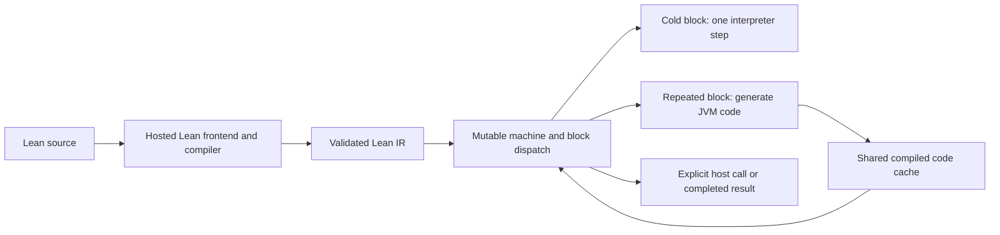

# Selective JVM compilation

The hosted frontend can run through the reference interpreter, the mutable
interpreter, or lazily generated JVM code. LLVM is not required for this path.

`raw/open-functions` accepts `:compile-threshold`, a positive integer with default
1. At threshold 64, an uncached body executes one interpreter step on its first
63 visits within that program. The next visit compiles a region. A compatible
shared cached region can be used immediately for the identical body. An
independently parsed equivalent body consults the structural cache on promotion.
This policy changes host dispatch
and compilation work, not guest IR fuel, reference ownership, or snapshot state.
Program extensions retain the cache and threshold, but reopen local dispatch and
hotness tables. Ordinary helper calls reuse their active program.

Generated forms have a bounded emission budget, including branches, literal
arguments and lexical join captures. Large regions are shortened before JVM
compilation. An unavoidable oversized root uses a cached single-step interpreter
boundary. Focused regressions cover exact fuel pauses, joins, ownership, forks,
and the large continuation observed in the actual frontend.

The initial compile-every-block hosted file experiment returned 42 after roughly
212 seconds and generated 18,721 blocks. Its warm run stopped at the available
memory guard. These are single functional observations under a heavily loaded
host, not benchmark results. A first threshold-64 version still computed cold
structural keys; it was stopped before its next instruction after more than six
minutes without completing the cold file. It has no completed timing result.

The corrected threshold-64 version returned 42 in both runs: 16,078.7 ms cold and
9,581.2 ms warm, with 758 compiled blocks and the same 1,219,155 guest steps.
The [observation](../measurements/hosted-adaptive-compilation.json) preserves
per-run counts. Cold means an empty experiment code cache within the existing
REPL; bootstrap preparation is excluded. These are functional observations, not
competitive benchmarks.

Thresholding does not bound cache memory. Cold bodies now avoid structural
fingerprints and tail scans. A bounded advisory index holds only weak references
to body identities and canonical cache keys; it validates compiler generation,
options, and callee arities, and retrieves code from the current cache. Clearing
the cache invalidates reuse. Content keys are computed on promotion. Repeated
promotion after program extension and cache growth still need broader measurement.

A previous full `Init` continuation was preserved at 512,913,549 guest steps
and resumed, but the REPL process subsequently exited with code 137. That
continuation was not durably archived. The verified completed bootstrap archive
survived and was restored into a fresh REPL.

The recovered import used direct guest Json witnesses and threshold 64, reached
237,596,253 steps, and paused before an unexecuted outer `lean_eval_const` handler.
It then resumed from that exact snapshot with typed IR witnesses. No completed
handler or initializer effect was replayed. Full guest completion and strict
constant-map verification remain required. See
[typed witnesses](WITNESS_IR_VALUE.md) for transport validation and scope.
