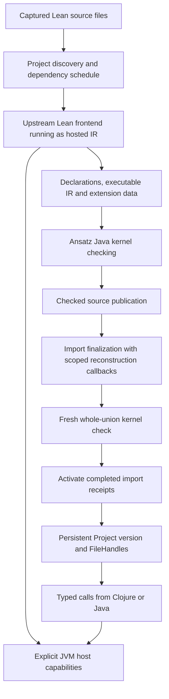

# Hosted Lean campaign continuation, 2026-10-23

This is the continuation plan for the original Lean-on-Ansatz campaign. It is
research and acceptance planning, not a shipped feature ledger. The priorities
remain fast REPL experiment turnover, persistent retained versions, semantic
fidelity, and convenient integration with Clojure/JVM applications.

## Execution update after planning

**Public single-file P1 passed on 2026-10-24.** The
[acceptance record](../measurements/public-project-p1.json) binds the actual
42e3 runtime/c32 caller capture, result, controller sources and guarded receipt.
The hosted frontend loaded `GraphChainA.lean` through public `load-file`,
completed final checked import, and returned a real Project/FileHandle. Public
Nat41 and Unicode calls returned the exact inputs through separately closed
child versions; both parent versions closed at finish. The borrowed Source
remained open and the separately retained pristine Context stayed identical.

Fresh Init checking covered all 65,994 constants under the existing explicit
15-assumption policy. The whole job took 1,032.729 seconds with a 3 GiB heap and
3,689,373,696-byte peak group RSS. All 2,151 pins matched after disposal and were
independently rehashed. This is narrow experimental integration acceptance,
not competitive performance, a production distribution or native-reset/P2
acceptance. Stage 2 below is now the next genuine campaign gate.

### Earlier attempts retained as history

The subsequent [compact-memory investigation](COMPACT_HOST_MEMORY_2026-10-24.md)
restored the full frontend under a 2 GiB heap, then stopped for sustained GC
pressure during fresh strict projection. It did not complete public P1. That
update preceded the accepted run above; the original four
milestones remain in order.

The reviewed P1 v2 attempt ran, restored the frontend with all initialization
guards preserved, then stopped during fresh strict checking at the system-wide
available-memory floor: minimum 1,009,332,224 bytes, below 1 GiB. Peak group RSS
was 4,711,497,728 bytes, below its 5 GiB cap; lifecycle was 957.56 seconds. The
owned process was disposed and all 920 input hashes matched afterward. It issued
no public loaded Project or calls. This is an interrupted resource run, not a
strict-check semantic rejection. Do not relaunch or resume its terminal control.

The compact dependency-plan change has passed its
[focused validation](../measurements/compact-first-pass-plan.json): 22 tests /
235 assertions. A subsequent selected consumer/capture passed construction and
full restoration; that historical capture's fresh check remained incomplete. See
[acceptance and memory followups](ACCEPTANCE_AND_MEMORY_FOLLOWUPS_2026-10-23.md).
A modified checker needs a fresh reviewed selected consumer/capture before any
new full campaign. Do not execute the historical P1 v2 plan again. The four
milestones below retain their original order.

## Context and architecture to preserve

We are hosting upstream Lean frontend/compiler code, lowered from its compiler
IR, on an Ansatz execution runtime. The Java kernel checks imported/generated
declarations. The resident Context and persistent World carry execution state;
the source/project layer owns publication, imports, versions and calls. LLVM is
optional future compiler tooling, not a dependency of this path. The independent
Pattern/Raster LLVM/MLIR work must not become a prerequisite.

The native Lean toolchain remains part of producing the pinned bootstrap/helper
artifacts. Earlier hosted source experiments did not invoke a native compiler
per user file. That distinction does not establish a completely self-contained
distribution, reproduction from a clean machine, or full frontend self-hosting.

Lean proof validity, compiler correctness, runtime behavior and external effect
contracts are separate claims. Strict kernel admission is not a proof that our
IR execution or JVM interop preserves every behavior. Preserve exact upstream
semantics and compare against native execution at each newly supported boundary.

Use structured Lean Names, actual module provenance and explicit call ABIs.
Matching printed names, descriptive receipts, linked code counts or successful
process exit are not substitutes for the corresponding semantic acceptance.

## Verified starting point

- Full captured Init has passed fresh strict checking of 65,994 constants, with
  its 15 explicit admitted axioms/assumptions recorded separately.
- Actual original/edited macro imports and retained old/new/old Nat/Unicode calls
  passed in the narrow resident reconstruction profile. See
  [source reconstruction](SOURCE_RECONSTRUCTION_PLAN.md).
- Actual Lean-to-Clojure Nat and Unicode callbacks, including a once-only host
  exception path, passed in the resident application profile. This is more than
  a proposed interop adapter, but is not Project-level callback acceptance. See
  [typed externs](TYPED_EXTERNS.md).
- Project orchestration and composed current-source tests passed with modeled
  guest transport: 1,029 tests / 94,230 assertions. See
  [Project loading](PROJECT_LOADING.md). Foundation PRs 151 and 152 were merged;
  this note does not infer the current remote branch state from an old ledger.
- Full public P1 now passes in the narrow single-file profile. Historically, the
  earlier P1 v1 run passed fresh strict Init
  checking, source A publication and graph assembly, then exhausted aggregate
  reservation fuel during final import, after 3,663 public child operations.
  No public loaded Project result or subsequent calls were issued.
- A matched constructed-prefix graph experiment completed 88,364,079 guest
  instructions on mutable and JVM backends. One cold pair gave about 141.6 vs
  136.3 seconds of graph execution, with more RSS for JVM. This is not evidence
  for a default backend switch or a full-frontend speedup.

The chronological campaign ledger is
`target/artifact-contract/reconstruction-runtime/active-campaign.json` in the
separate `ansatz-reconstruction-units` worktree. Its phase and final receipts
take precedence over old proposed/pending fields retained in its history.

## 1. Completed public single-file gate

The accepted capture is `target/artifact-contract/scoped-ir-c32-p1-3072m-v1/`
in the campaign execution worktree. Its plan SHA-256 is
`14823df45a3ab2c577a00ea5d39429d46d21f6dfd6a20ca1d5856f4053dca4c0`;
result and receipt hashes are in the portable acceptance record. It used a
3,072 MiB heap, 4,096 MiB RSS cap, 6,144 MiB preflight, 1,024 MiB system floor
and 5,400-second whole-job deadline. H120M/A1B/O2M and kernel500M were unchanged.
These are experimental bounds, not user requirements or a demonstrated minimum.
Any coupled continuation needs a fresh capture and controls; do not rerun an
accepted or failed one-shot controller.

The earlier terminal reviewed P1 v2 plan is preserved at
`target/artifact-contract/project-current-consumer-v1/p1-gate-v2-fuel1b/`
in the original project-loader worktree. Execution-plan SHA-256:
`2f87cfd305c50369d169de8dce778f0a4966db9ccf219884b196b74b45ee7bc0`.
It preserves all 895 previous input pins and authenticates 920 inputs in total.

That attempt used the following reviewed envelope: 4,096 MiB heap, 5,120 MiB process-group RSS, 5,400 seconds,
7,168 MiB available at launch and a 1,024 MiB available-memory floor. Graph
policy is H120M / A1B / O2M; kernel fuel is separate. These finite experimental
bounds are not an end-user memory requirement or a promise of sufficiency.

Acceptance requires actual public `load-file` completion, its issued FileHandle
and Project version, typed Nat41 and Unicode calls on that version, correct
child/parent closure, unchanged borrowed owners, successful process disposal and
all-pins postcheck. Preserve full strict checking, initialization and import
semantics. On failure, record the actual reservation ledger, phase, metrics and
original cause; diagnose before preparing a new experiment.

Efficiency: do not repeat full Init checking to answer every small design
question. Use small bounded fixtures for local changes; reserve a fresh whole
campaign for integration acceptance. Do not lower the prepared memory gate,
change the backend, or automatically raise fuel to force an apparent success.

## 2. Establish project, reset and reload behavior

P2 is a distinct coupled P1-to-P2 experiment, designed in
`target/artifact-contract/project-current-consumer-v1/p2-design-v1/CHECKLIST.md`.
Its prototype has static/reader review, not actual execution acceptance.

After P1 supplies real costs, capture/review a fresh coupled campaign that:

1. Loads A and retains its genuinely issued single-A version.
2. Loads ordered independent roots [A,D], deliberately exercising native reset
   at the second leaf. Loading D alone or making D depend on A does not test this.
3. Completes real final import and calls current A/D plus retained old A.
4. Closes returned call versions independently, then proves parents still work.

P1 now supplies measured costs. Its accepted standalone capture allowed two
aggregate exports; the new coupled capture must explicitly allow at least four
before creating its retained P1 version. Reconcile actual receipt/postcheck
schemas and current runtime/caller/helper identities, choose finite P2 budgets
including reset/final-union work, and independently review the full fresh capture.
Host-runner tests and the native D oracle are preparatory evidence only.

Then use the same public API for a genuine A-to-B-to-C chain, a diamond sharing
one issued A, and rejection of incompatible A versions. Add an edited A whose
behavior changes, recompile the selected dependent closure, and alternate old
and new calls. A comment-only rebuild is not changed-semantics evidence.

Keep one accumulated World per operation; never merge fork heaps. Every reload
starts from the pristine retained baseline and reconstructs its selected source
closure. Retain only the deliberately tested older versions; release successful
controllers and call children as soon as their evidence has been recorded.

Keep source initialization, imported macros, type-only imports and extension
reconstruction explicit in the coverage matrix. The present Project profile is
classic implicit Init with no source initializer actions. Explicit native
imports and general Std/Lean/Mathlib package coverage are not established by it.

## 3. Consolidate application interop

First unify existing resident value/callback support with the public Project
workflow without expanding a previously issued prefix's frozen binding authority.
Application capabilities must be admitted before issuing an application-enabled
prefix, or use the explicitly separate application execution branch described in
[typed externs](TYPED_EXTERNS.md). Reusing that execution branch for more imports
requires a new reviewed contract, not recapturing its live bindings as provenance.

Initial acceptance is a loaded Lean module calling registered Clojure Nat/String
functions exactly once, a Clojure caller invoking the Lean wrapper, and retained
earlier versions remaining callable. Cover wrong ABI, reserved symbols, stale
versions, owned/borrowed aliases, callback exceptions and resource closure.

Next add effectful IO in a separate adapter and profile. Study the pinned
upstream emitted IR and runtime first. The current typed adapter deliberately
does not support IO/world arguments, IO.Result, closures, bytes or arbitrary
Java objects. Required decisions and evidence:

- Preserve actual world-token and IO.Result constructor/ownership conventions;
  the Lean world token is not a snapshot of an external database or OS process.
- Choose an explicit mapping of declared host errors to Lean IO.Error. Unexpected
  JVM exceptions retain the canonical failed packet; do not disguise every
  Throwable as a recoverable Lean error or rerun the host effect.
- Expose database/network/file resources as scoped capabilities with explicit
  ownership, close semantics and stale-use checks. Forking a persistent World
  does not duplicate or roll back those external resources.
- Keep guest closures and World-relative references behind issued handles;
  never allow an unscoped Ref to cross into arbitrary application code.
- Specify cancellation, asynchronous completion and re-entry before claiming
  task/thread equivalence. Start with synchronous non-reentrant calls.
- Add bytes and structured immutable value codecs separately, with explicit
  copy/borrow contracts and exact integer/Unicode behavior.

A small Java facade can wrap the same public runtime and typed contracts after
Clojure acceptance; avoid maintaining a second evaluator or lifecycle model.
Kernel-compatible pure calls are the first useful release slice. Broader service
hosting is a subsequent support tier with its own IO and operational acceptance.

## 4. Improve turnover and prepare a release

Measure separate cold startup, authenticated restore, strict checking, source
discovery, elaboration, IR lowering/install, import finalization/checking, calls
and repeated edits. Record nesting to avoid double-counting helper work. Compare
native C, ordinary Lean execution and hosted modes on matched semantic workloads;
report compile cost and warm reuse separately from execution.

The existing measurements show large deficits on heap kernels. Do not describe
the current runtime as competitive. See [execution performance](EXECUTION_PERFORMANCE.md)
and [selective compilation](ADAPTIVE_COMPILATION.md).

Optimize measured hot paths one at a time: dispatch and program reopening,
repeated whole-program validation, helper/name traversal, projection allocations,
heap updates and code-cache reuse. Reuse validated immutable facts under exact
identity, never reuse a check verdict where the acceptance contract requires a
fresh check. A cache key must include compiler/runtime generation, ABI and code
identity. Fork-safe direct calls, numeric specialization, escape analysis and
closed-region mutable execution are candidates, not prerequisites for P1.

Keep persistent snapshots at observable boundaries. Mutating a private region
requires an ownership/escape argument and must preserve retained alternatives,
pause/resume, exceptions and callback checkpoints. Tail transfers and joins must
remain stack-safe across interpreted/compiled boundaries; LLVM is unnecessary.

Memory acceptance must include repeated load/edit/close cycles with the number
of intentionally retained versions held constant. JVM tracing GC alone does not
prove guest cycles are reclaimed: guest heap maps, registries, native Sources,
code caches or diagnostic packets can still keep them rooted. Preserve observable
RC/uniqueness behavior and prove any altered ownership implementation separately.

Before promotion from `experiments/lean-ir` into the library:

- Publish a versioned supported-profile table: Lean producer version, kernel
  assumptions, syntax/modules, initializers, externs, value ABIs, IO and concurrency.
- Provide reproducible bootstrap artifacts with manifest/provenance, compatibility
  checks and actionable diagnostics; test clean installation and packaged/AOT use.
- Supply minimal Clojure/Lean examples for both directions, retained reloads,
  diagnostics and explicit close. Java support follows the same lifecycle.
- Test invalid source, missing/wrong imports, ABI drift, cancelled/failed effects,
  resource pressure and deliberate unsupported operations without fake success.
- Provide explicit abandonment/disposal of failed loads and calls. The current
  Project experiment retains failed child controls and diagnostic packets and
  exposes no public failed-child cleanup API. Specify the owner of those packets,
  bound diagnostic/registry/tombstone retention, and test repeated failure/dispose
  cycles with retained old versions. Process exit is not service-lifetime cleanup.
- Establish independently observed native whole-map, persistent-extension and
  initializer-state parity for each claimed import profile. Fresh kernel checking
  alone does not establish equivalence of those non-kernel states. Repeat the
  comparison where reload/finalization ordering matters; preserve this open gate.
- Obtain independent design and exact-change review for complex features, then
  focused checks, composed regression and genuine acceptance appropriate to scope.
  Land reviewed ready PRs along the way; do not accumulate an unreviewable stack.
- Separate supported embedding from full frontend self-hosting, arbitrary package
  compatibility, durable whole-process checkpoints and production maturity claims.

The earlier coordinated Init/bundle work is a separate unresolved release lane,
not superseded by successful captured-runtime experiments. Preserve the detailed
proposal in [hosted frontend history](hosted-frontend-next.md), under
"Proposed coordinated Lean 4.33 bundle completion". Specifically:

- Reconcile the actually supported shipped Init/precreated-store profiles and
  optional Mathlib combinations. Do not test or advertise a Cartesian product
  of historical options that the release no longer intends to support.
- Compute declaration and metadata dependency closure per resource role, rather
  than against a union that can hide missing targets in an active environment.
  Retain exact producer/version identities, assumptions and unsafe/partial inventories.
  Use a versioned checked-runtime-CI profile and verify structured Name
  round-tripping; printed names alone are not declaration identity.
- Preserve checked `csimp` equality witnesses and distinguish them from
  `implemented_by` runtime substitutions, which are not proof rewrites.
- Activate newly available instances, matchers, attributes and supported simp
  companions atomically with lazy declarations, preserving user/session extensions.
- Require strict replay, compatible overlaps, loader-order/idempotence/isolation
  checks, representative compiled calls and packaged-store acceptance before
  promoting a generated replacement. Existing profile consistency is a release
  concern even when the experimental frontend uses a separately pinned capture.

The release rationale and production/RC research are preserved in
[Lean JVM release research](LEAN_JVM_RELEASE_RESEARCH_2026-10-23.md). They explain
the opportunity; they do not substitute for the acceptance gates above.
