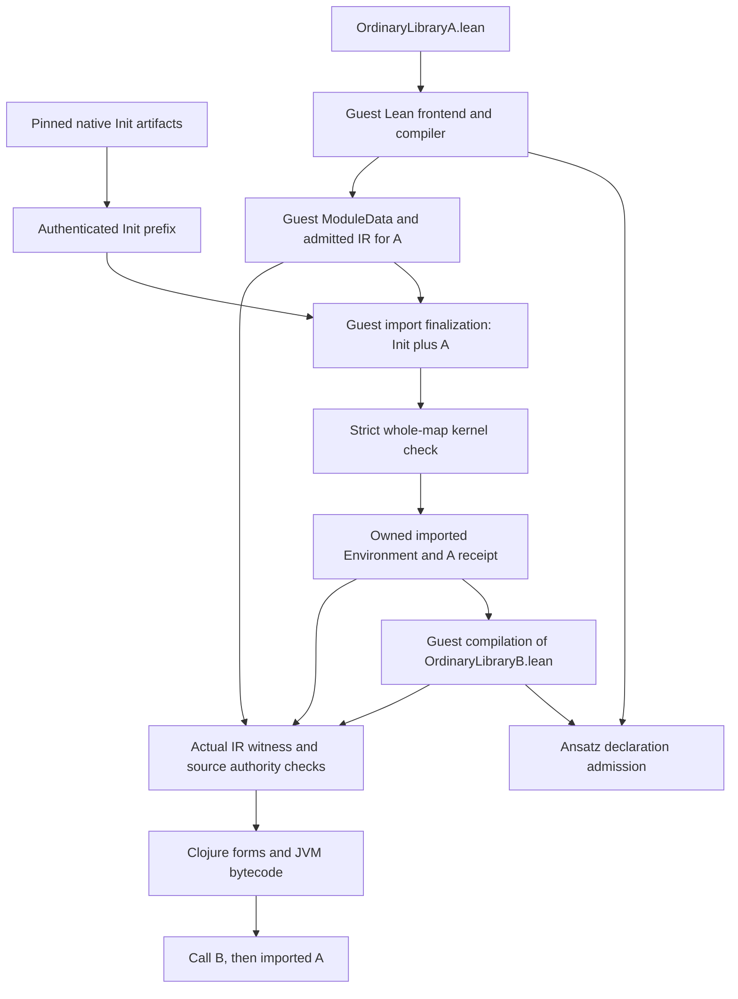

# Loading a second hosted source module

The ordinary two-file import experiment now passes: the hosted frontend compiles
`OrdinaryLibraryA.lean`, exports its actual ModuleData, finalizes Init plus A, and
compiles `OrdinaryLibraryB.lean` against that fresh environment. The JVM function
calls A's admitted implementation and returns both a Nat and a Unicode String.
The complete imported map contains 65,995 strictly checked constants; source
installation additionally requires A's exact checked-declaration receipt and
actual interpreter witness. See the [recorded B gate](../measurements/hosted-ordinary-library-b.json).

Native artifacts prepare the runtime and Init prefix. A and B are compiled inside
Ansatz without a native per-input compiler. This diagram covers the observed
classic two-file case; it does not establish a general package loader.

An earlier prelude-only slice exported a compiled classic module and finalized
its owned ModuleData into a fresh imported Environment. That experiment
strictly checked all four constants of
`PreludeIdentity` (three compiler markers and `answer`). The actual guest compiler then compiled `PreludeSecond.lean`, importing that
module into a fresh Environment, and its JVM function returned 42. This remains
a bounded prototype, not a completed general source-module loader.

Pinned source: Lean 4.33.1, commit
`819816b2e0a3bf405af45ae5c7af2491d8f5bee6`,
`src/Lean/Environment.lean:1840–1900` and its import/finalization code.

`Lean.mkModuleData` is an actual guest-executable function. It exports extension
entries, obtains kernel constants through `foldStage2`, and constructs a
`ModuleData` containing the source module's header. The private level exports all
local kernel constants; exported levels filter them and sort deterministically.
`mkIRData` separately uses `lean_ir_export_entries` and IR extra names. Those
extern symbols are exports of existing Lean functions, so the first step is
exact alias linkage to their guest bodies, rather than a new native algorithm.
Serializing a full Environment would bypass these rules.

The source loader should:

1. Parse the actual header and resolve the exact ordered imports and flags.
2. Finalize those imports into a fresh guest Environment, preserving native
   extension reconstruction and private/exported visibility.
3. Compile commands using the existing file helper and strict declaration
   admission callback. On diagnostics, return the real partial Environment and
   publish no successful loaded-module handle.
4. Produce local ModuleData and IR extension data through pinned guest helpers.
   Keep these owned guest objects in a snapshot-local source-module registry;
   native `.olean` serialization is not required for an in-memory import.
5. When another file imports the module, assemble the complete transitive module
   graph from native verified sources and hosted ModuleData. Pass that graph
   through actual guest finalization. Detect cycles and conflicting module
   identities before running initialization effects.
6. Execute the module's admitted initialization plan in native phase/order once
   per world. Local compilation and import initialization are different events.
   Do not infer native initializer symbols by concatenating strings; use the
   pinned symbol construction and package metadata, or the actual guest fallback.

Current projection reuse preserves authenticated Java constant projections but
strictly rechecks the entire map. Any future reuse of checking itself would
require exact constant references and protected immutable provenance. Matching names or a
module filename is insufficient. A finalized import map may be a new map with
identical checked constants; that requires a validated map-association operation,
not the current header-only map-identity shortcut.

Decisive cases are A defining a function, B importing/calling it; a macro defined
in A and used in B; a source initializer with an observable once-only effect;
changed A in independent forks; failed and cyclic imports; and module-system
public/meta/import-all visibility. The ordinary A-to-B function case now passes;
the other cases remain integration gates. The earlier owned prelude finalization
below records the first reconstruction step without native module transport.

## Concrete next gates

The following audit is against the pinned source and current experimental APIs.
It records the original requirements; the owned finalization slice below is
implemented, while general multi-file loading remains incomplete.

### Export actual guest module data

`Lean.mkModuleData` computes persistent extension entries by calling their real
guest export callbacks. For a classic module, native `writeModule` writes the
private-level ModuleData including full IR entries. A module-system file instead
uses exported/server/private parts and separate IRData: its `.olean` entries can
replace non-meta function bodies with extern/opaque declarations. Keeping only
the public constant table would therefore lose interpreter and macro state.

The two required IR aliases in `Compiler/IR/CompilerM.lean` are:

| Native export symbol | Actual guest declaration |
| --- | --- |
| `lean_ir_export_entries` | `_private.Lean.Compiler.IR.CompilerM.0.Lean.IR.exportIREntries` |
| `lean_get_ir_extra_const_names` | `_private.Lean.Compiler.IR.CompilerM.0.Lean.IR.getIRExtraConstNames` |

Both actual bodies were verified in
`target/frontend-export-body-inventory.json`. The first consumes one object;
the second consumes one object plus two UInt8 flags. The Environment-side
private extern declarations must redirect to these exact names through verified
export metadata. An old CompilerM module-plan artifact contains only one export
and must not be mistaken for the complete alias inventory.

`exportIREntries` emits sorted local IR, private regular-initializer attribute
entries, and private module-package extension metadata. `mkIRData` adds the
corresponding extra constant names. A source registry must retain these owned
guest objects, module identity, exact import flags and visibility parts.

### Introduce an authenticated guest-module origin

The current `module-import` and `import-capabilities` paths intentionally require
verified native v2 transport data: exact profile/commit, native source IDs, RC0
roots, and validated region/file metadata. An ordinary guest-created ModuleData
has none of that provenance. It needs a separate source-module capability, not
synthetic native-region metadata or relaxed native verification.

Passing A's final Environment to B after changing its module name is also
incorrect: A's constants and extension entries remain local stage-two state.
B must receive an Environment reconstructed through actual guest finalization
of A's published module data and the complete transitive import graph.

### Authorize the local-to-imported IR transition explicitly

`eval_const` deliberately rejects an admitted `sourceLocal=true` row when a
later interpreter witness selects it as imported. This protects forks against
reusing stale function bodies. Publishing A and then importing it in B needs an
explicit receipt containing A's identity, unit digest, exact ModuleData/IRData
references, admitted IR rows and executable function identities.

The witness should additionally report the actual module owning an imported
declaration, obtained from `getModuleIdxFor?` and `env.header.modules`. Reuse can
then compare that selected provenance plus full IR and ABI against A's receipt.
Changing a boolean or matching only the function name is insufficient. Preserve
the existing strict check for unrelated environments and forks.

### Coordinate actual import initialization

The current explicit `eval_const/run-initializers` records completion evidence
and synthetic global readiness, but does not update the guest
`interpretedModInits` reference. Consequently running that operation and later
allowing genuine import fallback can replay an IOUnit initializer effect.

Pinned `Compiler/InitAttr.lean` first tries native module initializer symbols,
then checks/inserts the module in `interpretedModInits` **before** executing
fallback effects. It combines ordinary and IR initializer entries, filters
runtime entries by phase, invokes IOUnit entries through `evalConst`, and invokes
value-producing entries through `lean_run_init`. That last primitive is not yet
implemented in the audited runtime. Native `ir_interpreter.cpp` calls the
initializer, propagates IO errors, and on success marks its result persistent
and installs the declaration's global value.

The existing module-init capability only reports availability for explicitly
trusted producer plans whose complete guard closure is already initialized; it
does not execute or manufacture completion. Extend that authority for published
source modules using actual completion evidence, or make the real guest fallback
the sole source-import initializer path. Test both IOUnit and value initializers
with observable effects across repeated imports, explicit load followed by
import, failure, and fork. Local compilation must continue to avoid these future
module-load effects.

Finally, reconstructed constant maps require strict Java kernel association.
The existing header-only association shortcut requires the identical checked
constant-map reference and quotient flag; a newly reconstructed map cannot use
it merely because its names or size agree. Exact already-checked constant
references may support a future authenticated optimization, while the present
full constant verification remains the safe path.

## First export slice implemented

`lean/SourceModuleExport.lean` now provides
`SourceModuleExport.exportClassic : @& Environment → @& Name → IO (ModuleData × String)`.
It checks the exact non-anonymous main module and rejects module-system files,
then invokes the genuine `mkModuleData env .private`. Its descriptive metadata
includes exact structured import flags, local constant names, extra IR names,
and extension names/counts. The helper itself does not execute initialization or
serialize/finalize an Environment. Compilation success, declaration admission,
and authority to publish the module remain separate caller obligations.

The source-local artifact is `target/source-module-export-source.jsonl` (73 rows,
zero initialization actions), SHA256
`6ceba2be15b28ed2668dc7832f62e579abc69ba14e799dac9fe47be0df4b0a2f`.
Its standard `_boxed` entry consumes Environment, expected Name, and erased world;
the underlying function borrows the first two inputs.

`prototype.source-module/export-classic` borrows the caller's input owners,
invokes that entry, and returns a separately owned `:module-data` plus descriptive
`:metadata`. It verifies profile and metadata against the actual guest object
layouts and preserves an owned IO error or diagnostic checkpoint on failure.
It creates no native transport provenance, initialization receipts, or checked
kernel association. Release the returned ModuleData owner when no longer needed.

`with-ir-export-aliases` adds the two exact CompilerM aliases above using the
existing deferred ABI/body checks. Previously linked trap wrappers must be
relinked explicitly: `target/prepare-source-module-export.clj` provides a
preparation function that replaces just those two extern wrappers and loads the
helper closure while retaining unrelated existing function objects. The script
only defines a function; it does not execute guest code or modify ready-world
variables.

`lean/SourceModuleExportOracle.lean` compiles A with `sourceAnswer := 42`, exports
its private ModuleData through the helper, checks constants/imports/IR entries,
then uses native disk import as an independent A→B oracle. B's ordinary classic
`import SourceOracleA` and `sourceAnswer + 1` evaluate to 43. Wrong or anonymous
module names and module-system exports are rejected. The native log and metadata
are `target/source-module-export-native.log` and
`target/source-module-export-native.jsonl`. This native oracle does not claim
that hosted source-module import/finalization is already implemented.

Focused boundary/ownership/ABI tests passed: four tests, 49 assertions, at a
256 MB JVM limit (`target/source-module-tests.log`). The helper's actual hosted invocation against a successfully compiled file has
subsequently passed, as has owned source import finalization described below.

## Owned source finalization validated

`SourceModuleImport.assembleClassic` constructs the real pinned ImportState and
ImportedModule layouts around owned ModuleData. Its region value is an ordinary
logical guest resource with zero native addresses, not a serialized or native
CompactedRegion. `finalizeClassic` runs the genuine guest finalizer with
`leakEnv=false`, extension loading enabled, and private classic visibility.
The native oracle `lean/SourceModuleImportOracle.lean` compiled A, exported its
ModuleData, reconstructed a fresh Environment through this path, and compiled
B importing A; its result was 42. No native module-file read was involved.

`prototype.source-import` separates this origin from verified native sources.
Registration exports the data inside a compatible descendant compilation world
and checks the original immutable unit receipt, executable identities, protected
kernel association, and guest Environment lineage. Registries own ModuleData,
compiled Environment, and live logical region anchors in the world. Numeric Ref
IDs or matching module names do not authorize transfer from another fork.

The first slice accepts only a classic module with no imports and no initializer
actions. Native initializer lookup reports unavailable and permits the genuine
guest fallback; it creates no completion receipt. Explicit logical region free
releases its owners without invalidating other live ConstantInfo owners. It
rejects persistent regions and makes no claim to reclaim RC0 graphs.

The actual hosted `PreludeIdentity` import passed strict checking of all four
ConstantInfos. Native finalization sets the quotient-initialized flag whenever
imports are nonempty, even for a prelude module without quotient primitives.
The explicit finalizer attestation verifies the actual header requests and guest
flag after all constants are checked. Java `Env.enableQuot()` then represents
that flag without adding any primitives; default native transport checks remain
strict. See `target/frontend-finalize-owned-source.log` for this experiment.

Source-local to imported IR reuse additionally requires the actual interpreter
witness's module origin, exact IR/ABI and executable identities, and a source
finalization receipt whose strict Java ConstantInfos are inherited by the actual
target Environment. `authorize-imported-row` checks the trusted root helper
before invoking it and does not reclassify admitted local rows globally.
Independent authorization tests passed four tests and 86 assertions, including
foreign roots, replaced helpers, stale units and changed ConstantInfos.

The source helper artifact `target/source-module-import-source.jsonl` contains
43 rows and **one existing value initialization action**, SHA256
`d6bfbb219bf981f17c7975892ab49cdb14c1c78e31fb0bb5669ac22778719506`.
That action targets `SourceModuleImport.finalizeClassic._boxed_const_1`, whose
`runtime.role` is `value`: its emitted IR boxes UInt32 zero. It is not source
module IO initialization. The earlier zero-action description was incorrect.
A compatible appended hybrid-helper export must preserve all old rows and the
exact manifest, including this action. The relevant guard is **zero new actions**,
not an empty action list; native helper/export validation alone would not establish
successful ordinary source import.
The actual imported-origin witness artifact is
`target/runtime-compile-shim-source-module.jsonl`, SHA256
`632aef00b22b4144aa78cc54e3e3e34533fdd3bab72f3cea8177f647933100db`.
Its five changed ordinary functions must be upgraded together because their
ownership ABI changed; all existing closed and ground constants are unchanged.

For the retained-world reproduction, load `scripts/source-import-probe.clj` and
call `(finalize-owned-source-probe compiled-A exported-A)`. Both arguments must
come from the same compatible compiled world. The script expects the source
helper artifact above, the actual `HostedFileProbe.preparePrelude` Options
factory already in that world's catalogue, and the source-export IR aliases
already linked. It returns owned imported Environment and Options plus its
source-only session and catalogue; it does not mutate resident baseline vars.
`measurements/hosted-source-finalization.json` records the actual four-constant
result without serializing references. After adding the exact UInt32 comparison primitive, B compiled successfully
and its boxed polymorphic `second` function returned 42.

After the final registry, helper-checking and projection changes, the focused
source import, source authorization and module import suite passed 18 tests and
197 assertions at a 256 MB JVM limit (`target/source-import-final-focused.log`).
The reusable driver also loaded successfully in that run. The subsequent actual B run passed and published its measurement only after
the compiled call returned the expected result.

## Actual hosted A → B result

`fixtures/hosted/PreludeSecond.lean` contains an ordinary classic
`prelude; import PreludeIdentity` header and defines polymorphic `second` by
calling A's `answer`. The actual guest frontend compiled it against the freshly
finalized owned-source Environment. The new file installer obtained genuine
interpreter witnesses for the original selected roots, checked the imported
source-module receipt and full IR/ABI, retained existing executable identities,
and installed five new functions. Calling the boxed `second` with erased type
and value 42 returned 42 on the JVM.

`measurements/hosted-source-import.json` records the successful path without
references; `fixtures/hosted/PreludeSecond.ir.jsonl` is the actual emitted B
bundle. The resident reproduction log is
`target/frontend-run-source-second.log`. Load `scripts/source-second-probe.clj`
and call `(compile-owned-second-probe finalized-A)` to repeat the compile/call
from the compatible finalized A result; it returns the compiled file handle and
call result without changing resident baseline vars or rerunning initialization.
The header requests, strict four-constant certificate and three compiler marker
policy are part of this bounded test. Transitive imports, source initializers,
source macros, module-system visibility and loading the full native Init closure
remain separate gates.

`prototype.hosted-source-output-test` separately replayed the captured A and B
bundles on reference, mutable and JVM backends: one test, 24 assertions passed
at 256 MB (`target/hosted-source-output-tests.log`). It checks preservation of
existing A function identities, no pending initialization, and identical owned
object results across independent forks. This is emitted-code regression
coverage, not a substitute for actual guest import provenance. The compiler
optimized B's identity call, so the captured executable alone does not prove
module reconstruction or source authorization; the actual hosted run does.
Both reusable driver definitions loaded successfully at 256 MB.

## Bounded ordinary A → B over the full Init import

The bounded hybrid API, actual guest finalization and strict whole-map kernel
association have passed. The dependent OrdinaryLibraryB also passed authenticated
installation, initialization and calls returning 42 and Unicode String after a
reviewed header-association fix. This establishes the bounded ordinary Init-plus-A
imported-by-B profile, not arbitrary dependencies or package loading. This profile concerns
classic files with implicit Init, not Lean's `module` visibility system, arbitrary
dependency discovery, plugins or general package loading.

[OrdinaryLibraryA.lean](../fixtures/hosted/OrdinaryLibraryA.lean) already passed
hosted compilation/call with result 42 and no diagnostics or pending initializers
([measurement](../measurements/hosted-ordinary-library-a.json)). Its actual
[genuine ModuleData export](../measurements/hosted-ordinary-library-a-export.json)
contains the exact ordinary+meta Init imports and its source extension/IR entries.
A's actual local initialization action list is empty.

The [live assembly measurement](../measurements/hosted-ordinary-hybrid-assembly.json)
records B's actual parsed `[Init, meta Init, OrdinaryLibraryA]` header, a verified
631-module native Init prefix, 12,741 local prefix-witness nodes, and 89 new linked
functions. Native ModuleData remains in the verified immutable source; the local
witness does not copy that graph. The JVM session retains its shared code cache,
fuel 2,000,000,000 and threshold 64, and preserves native module-initializer
capability identity. The record is explicitly `authenticated-import-assembly-only`;
it did not run the long finalizer or compile B.

The [hybrid helper export validation](../measurements/source-import-hybrid-helper-export.json)
pins `target/source-module-import-hybrid-source.jsonl`, 56 rows, SHA256
`70fc78e688eb5d237aadc97fff4c6fc64f45d694b6541d4929435fe45436928d`.
All 43 old rows and the old manifest are identical; 13 rows were added, with ZERO
new initialization actions and ONE unchanged value action (the UInt32 zero box
described above). Focused hybrid/source/module validation passed 37 tests / 365 assertions.
Those checks establish helper compatibility and guarded orchestration, not B's
actual hosted import result.

### Completed guest finalization and whole-map checking

The [actual finalizer completion](../measurements/hosted-ordinary-hybrid-finalization.json)
reached guest step 920,855,277. It records 320,635,990 total guest steps in this
finalization, including 138,465,856 after the reviewed checkpoint 782,389,421.
Its 463,774.471405 ms timing covers the resumed segment only, not a fresh complete
import. Finalization was not replayed and no native per-input compilation was
used. Its `strict-host-check-completed=false` describes the boundary BEFORE
strict checking; it is not the current combined status.

The separate [strict kernel result](../measurements/hosted-ordinary-hybrid-kernel.json)
then checked all 65,995 constants under the existing policies, with 15 declared
axioms remaining explicit assumptions. This 122,020.048528 ms checking run preserved
all native CI references and recorded a source-only receipt for A's one constant
under the actual checked whole-environment anchor.

The run reused authenticated immutable Java projections, not checking results or
a pre-seeded Java Environment. Eligible old projections require exact old CI
references, the identical singleton open Store and no local source-range shadows;
replaced/local objects project normally. Every constant was strictly rechecked
from a fresh Java Env under the current policy. Neither a heap storage hint nor
native finalizer acceptance supplies kernel authority. This observation establishes
actual hybrid finalization and whole-map admission only.

B's guest compilation completed at cumulative guest step 947,201,719. Final output
installation then rejected `ordinaryLibraryIdentity._redArg` with
`Source import lacks checked module installation authority`. The returned
header-only kernel root lacked an association; existing checked roots still
preserved the source JavaCI identity. This original failed gate is retained as
history rather than hidden by a new compilation.

The reviewed fix uses the existing strict header-association operation: check the
trusted root/map/quotient helper closures, require exact protected constant-map
identity and quotient state, and associate the derived header root with that same
checked Java Environment. Source authorization still verifies the actual witness's
module, original unit/executable identities and inherited receipt CI identities.
It does not accept a name/count match or rewrite the source-origin receipt.

The [actual B result](../measurements/hosted-ordinary-library-b.json) records
accepted `ordinaryLibraryIdentity._redArg` source-origin authorization for
OrdinaryLibraryA, results `[42, "Imported source: λ 🦉"]`, no diagnostics,
initialization state `ready`, zero pending initializers and each returned owner
released once. Its 1445.772123 ms covers COMPLETION/installation/initialization/calls
only, after the earlier guest compilation; it is not fresh whole-file latency.
No guest compilation/finalizer replay or native per-input compilation occurred.

The [post-fix full experiment regression](../measurements/hosted-source-header-regression.json)
passed **691 tests / 58,784 assertions**, zero failures/errors, in 159.944 seconds
at 256 MiB. All 192 source/test hashes remained unchanged. Parent Ansatz source,
AOT/JAR and Mathlib-dependent validation are separate from this experiment result.

The actual A fixture defines one noinline polymorphic identity, exercised at Nat
and String; B contains `import OrdinaryLibraryA` and calls that definition. This
profile has no source IO initializers and requires the actual A unit to have no
local initialization actions. Simple source syntax alone does not prove that
arbitrary constants generate no actions.

1. Compile A through `hosted-file/run-file` from the actual, strictly associated
   full-Init prepared context. Use explicit `:initialization :run`, preserve its
   backend, fuel, threshold and shared code cache, and require successful command
   and kernel/code admission. Keep the returned world/session/environment.
2. Call `hosted-file/export-module` in that same compatible world. The existing
   `SourceModuleExport.exportClassic` calls genuine `mkModuleData env .private`;
   it already exports dependency-bearing classic data, including actual imports,
   local constants, IR and persistent extension entries. The owned result is not
   native serialized data, an import receipt or initializer completion proof.
3. Parse B through `frontend/inspect-file-header`. Pinned `Lean/Elab/Import.lean`
   `HeaderSyntax.imports` prepends TWO imports when `prelude` is absent:
   ordinary Init and meta Init. Therefore ordinary `import A` requests exactly
   `[Init, meta Init, A]`, in that order. The Init records both have
   `importAll=false` and `isExported=true`; their `isMeta` values are false and
   true respectively. Classic ordinary A likewise has `importAll=false`,
   `isExported=true`, `isMeta=false`. Preserve both requested Init records and
   their exact flags; do not invent a list from file names.
4. Assemble a fresh import state containing the already verified Init dependency
   closure and A's authenticated owned part, then run genuine guest finalization.
   Check and associate the entire resulting constant map, and record a source
   receipt for A against that actual checked root.
5. Give B the returned imported Environment and its matching world/session/options.
   Compile and call admitted boxed roots through public hosted-file APIs. Require
   success, expected results, no diagnostics or pending local initialization,
   and actual source-origin witness/receipt validation. Preserve actual failures
   and ownership evidence; do not automatically replay import or user effects.

A's original Environment has header `[Init, meta Init]`. B's header is
`[Init, meta Init, A]`.
`RuntimeCompileShim.compileImportedFileState` compares exact imports and mode
before processing commands; passing A's Environment directly must fail this
check. Stripping Init, editing the header, or continuing commands without a real
`import A` would test a different operation. Refs must stay in their compatible
world lineage; never merge A's numeric Ref IDs into an independent pre-A fork.

### Actual upstream reuse boundary

These source anchors refer to pinned Lean 4.33.1, commit
`819816b2e0a3bf405af45ae5c7af2491d8f5bee6`, rather than an unrelated checkout:

- `Lean/Environment.lean:2055–2076` defines ImportState and permits
  `ImportStateM.run` with a supplied prior state.
- `importModulesCore` at 2107 updates that state. Its existing-module path around
  2195–2230 reuses parts unless effective flags, visibility or IR requirements
  require loading/bumping the dependency closure. Preserve those actual fields;
  do not extrapolate flags from the old one-module prototype.
- `finalizeImport` at 2307 takes ImportState, not a prior Environment. It rebuilds
  constant/module-index maps and initial extension states from all selected data.
  `setImportedEntries` at 1931 installs per-module entries; the persistent
  extension finalizer at 1975 invokes each extension's `addImportedFn` over them.

Thus retaining an actual Init ImportState prefix is a performance opportunity:
retain an owner before its consuming finalizer call, and reuse immutable state
in a compatible fork. A small pinned guest append helper could also assemble the
fixed, validated Init-plus-A profile without filesystem discovery. Neither is an
incremental import onto an existing Environment. No such Environment-append API
was found in this pipeline. If no prefix was retained, reconstruct one from the
already verified native part descriptors/Refs, without repeating native export
or decoding the entire transported graph.

The already verified native Init prefix is the exact ordinary-file profile,
including the meta Init request. Its `needsIRTrans=true` follows from that meta
import; it is not evidence that the prefix is broader than the requested header.
The effective module closure can merge the two Init requests into one module
entry while the requested header must retain both records. Do not deduplicate
header imports by module name or erase the meta requirement when reusing a prefix.

Fresh finalization still processes the full closure and extension imports; the
current strict checking entry also projects/checks the full selected CI map.
Do not promise cheap incremental checking. Reusing verified native ModuleData,
completed runtime initialization guards, code/cache and lazy immutable source
storage is legitimate; skipping extension import callbacks or manufacturing a
full certificate from A alone is not.

### Implemented bounded-profile checks

The original `register-compiled`/`assemble`/`finalize` API still admits only its
dependency-free profile. The separate over-Init API preserves those guards and
requires exact implicit Init dependencies, authenticated native prefix and source
publication, and zero local source actions. Its checks include:

- A's successful unit digest, exact executable identities and compatible checked
  compilation Environment; classic mode; actual header/manifest/ModuleData
  imports exactly `[Init, meta Init]` with the flags above; and initially zero
  local actions.
- The complete verified native Init part closure, source identities, part order,
  dependency chains and effective import/IR fields, plus A's actual owned data.
  Use real guest ImportedModule/ImportState constructors. Never forge a native
  transport manifest or native allocation provenance for A.
- The final certificate covers the whole actual selected Init-plus-A map.
  Reconcile duplicate/subsumption behavior only under an explicit supported
  policy. A's receipt records its exact selected CI references and projected CI
  subset under the protected final checked root; mismatches fail. It must not
  compare the whole certificate to A alone or silently replace its constants.
- Actual interpreter witnesses carry A's `:sourceModule`, selected IR/ABI and
  executable closure identities. Keep `authorize-imported-row`'s protected-root
  and inherited projected-CI identity checks. Rebuild explicit trusted bindings
  when reviewed executable implementations change; do not rewrite old local
  receipts into imported provenance.

Region and initializer capabilities require deliberate composition. Blindly merging
`source-import/make-bindings` replaces native read/free handlers and replaces
module-initializer availability with an empty mapping. Route authenticated source
keys through the current world's source registry, and native paths through the
verified native registry with its exact dependency checks. Do not disguise source
regions as native compacted memory. Retain the existing capability that recognizes
completed Init module/phase guards; this prevents replaying completed module IO.
A's empty local plan does not justify claiming a native initializer symbol exists.
Real extension import callbacks still run as part of constructing the new imported
Environment. New source initializers or dependency profiles remain separate work.

The bounded implementation uses `SourceModuleImport.finalizeClassic` for genuine
finalization, followed by `module-import/finish-finalization` and exact header
attestation. Their actual long-run acceptance gate now passed whole-map checking
and receipt validation; B's later authenticated installation/calls also passed. No
replacement kernel Environment, header shortcut or per-input native compilation
is part of this path.

### API ownership and staged completion

All functions below are in `prototype.source-import`. Keep the latest matching
world/session after every invocation; imported extension callbacks may link code.

- `register-compiled-over-init [world invoke compilation module-name]` borrows a
  successful compatible compilation and guest module Name. It exports inside that
  world and establishes registry owners for source ModuleData and Environment.
  Returned entry references borrow those registry owners; arbitrary pre-exported
  data does not authorize registration. `unregister` releases registry owners only
  when no region anchors remain; persistence is not a reclamation guarantee.
- `prepare-init-prefix [loaded invoke checked options?]` reassembles the prefix
  from the exact already attached native Store and protected checked Init result.
  The world registry owns its ImportState; returned `:prefix` is a borrowed opaque
  receipt. It witnesses local scaffold content, exact native source identity/range
  and checked anchor, without walking/copying the full immutable native DAG.
  `release-init-prefix` releases this world's registry owner, never another fork's
  owner or the shared Store. No native export or finalization occurs here.
- `make-hybrid-bindings [native-bindings]` routes source keys to this world's
  authenticated source registry and native paths to the existing verified native
  handlers. Native module-initializer availability is preserved by identity.
  Unknown reserved source paths fail rather than falling through to native IO.
- `assemble-over-init [world invoke prefix module module-name requests]` borrows
  the authenticated prefix/publication and appends the source using the pinned
  guest helper. Exact parsed requests are required. On `:ok`, `:state` and
  `:imports` are owned and the world registry holds the extra source region
  anchor. The prefix owner remains available for independent compatible branches.
  On `:io-error`, retain the actual owned `:io-result` for explicit handling.
- `finalize-over-init [assembly invoke options-ref options]` consumes assembly
  state/imports through the real guest finalizer once, borrows Options, and then
  performs strict checking/association and receipt creation. The certificate must
  equal the exact union of prefix and source CI references; native-name overlap
  is rejected rather than subsumed. The source receipt contains A's checked CI
  subset under the actual protected whole-environment anchor.
- `finish-over-init [assembly world result invoke options]` is the staged path
  for an ALREADY completed genuine finalizer IO.Result. It does not invoke or
  replay finalization. Pass its actual world, still-owned result and compatible
  active session/invoke, plus the original authenticated assembly. Do not release
  the IO wrapper before finishing. The common finalization layer extracts an
  owned Environment while checking all constants and exact header quotient state;
  errors retain checking/finalizer alternatives and any source-receipt failure
  retains `:source-finalization-result`. These are inspection evidence, never
  permission to rerun effects or release owners in multiple alternatives.

The live experiment retained raw finalizer completion and then passed the staged
strict finisher. B's subsequent authenticated installation and calls also passed,
establishing this bounded ordinary Init-plus-source import path end to end.
The earlier prelude result remains independent; broader dependency profiles and
source initializer effects are still outside this profile.
