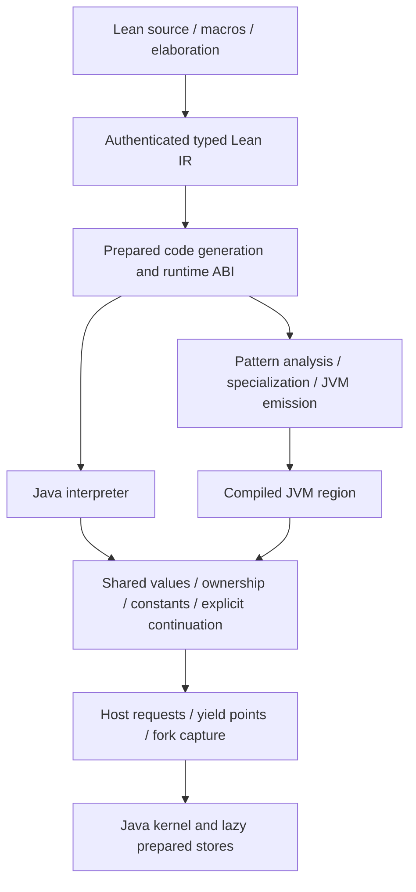

# Compilation above the Java Lean runtime

Design direction, 2026-10-29. The Java runtime is the shared execution substrate
and correctness reference. It is not yet a JIT, and no general advantage over
native compiled Lean has been measured. Frontend execution and a usable retained
REPL take priority over a new compiler implementation.

## What carries over from the earlier compiler

`prototype.typed-tail` and `typed-tail-execution` already separate region
analysis, preparation/emission, code-generation identity, guards and execution.
Their dispatcher can compile on demand, cache code, and fall back before entering
an unsupported region. Their executable entry currently expects the older
Clojure mutable machine and its register/fuel/statistics protocol. Reuse the
analysis, original IR validation, Pattern passes and emission ideas; port the
runtime entry adapter rather than inserting a World conversion into every call.

The Java engine already prepares IR into typed control/expression nodes, resolves
direct targets, separates object and primitive register lanes, and implements
ownership and explicit continuations. Those are useful inputs to compilation.
The target is JVM code operating directly on this runtime's representations,
not JVM code that repeatedly invokes the interpreter's instruction dispatcher.

## One semantic boundary, several execution tiers

Start with a closed, type-supported function or region. Validate the original
IR and exact executable generation, then compile it eagerly or when first used.
Both are scheduling choices for the same compiler pipeline. Later invocation/
backedge profiles can select hot regions and specialize dynamic calls or layouts.
Do not add profiling-driven guards for information already established by Lean
IR types and the validated runtime ABI.

Low-level IR retains machine categories such as object and unsigned scalar
lanes, not every useful source-level dependent type or constructor fact. Retain
compatible elaborator/kernel metadata or use an earlier typed IR when those
facts justify specialization. An erased object lane alone does not establish
Nat, a particular constructor shape or exclusive ownership.

Compiled code must share these contracts with the interpreter:

- **Values and layout:** identical constructor tags, packed scalar offsets,
  object fields, closures and Nat/String carriers. Nat arithmetic needs correct
  arbitrary-precision promotion; unsigned machine types preserve their wrap and
  comparison behavior. An inferred `Nat` alone does not justify unguarded signed
  `long` arithmetic.
- **Ownership:** preserve borrowed/owned parameter and result conventions,
  aliases, moves, constant roots and RC0/RC1 semantics. Optimization may eliminate
  proved redundant RC work or allocations inside a closed region. Physical
  mutation remains valid only under the runtime's actual ownership contract.
- **Code identity:** key compiled artifacts by prepared generation/function
  identity, ABI, relevant host capabilities and specialization assumptions.
  A Name alone is insufficient after REPL edits or forks. A shared native/JVM
  code cache does not publish branch-specific executable declarations globally.
- **Effects and results:** preserve the original host request, return convention
  and owned result publication. Never restart interpreted execution after a
  compiled region has performed effects or consumed owners.
- **Control:** entry, normal return and yields have explicit register/control
  mappings. Instruction-budget behavior must be defined rather than treating
  one compiled invocation as an equivalent number of interpreter instructions.

The first tier can reject unsupported code before entry and run that entire
function through the interpreter. Deoptimization after partial execution is a
later contract: it must reconstruct the exact current continuation and owner
state at a prepared safe point. This need not be implemented before useful
closed functions compile.

## Forking and compiled execution

The current pause-and-copy fork is the first capture implementation. A compiled
region may run mutably without copying each update. It must either return at a
bounded boundary or poll and publish a resumable explicit state at chosen safe
points, especially loop backedges and host calls. A long-running compiled region
with no polls would postpone fork requests indefinitely.

Do not promise capture of arbitrary active JVM frames. Initially use atomic
closed calls; where latency requires it, emit resumable state-machine regions
whose yield packet maps to the same runtime continuation used by interpretation.
Compiled code, immutable metadata and derived profiles may be shared; live
registers, mutable nodes, constants and branch-selected code state follow the
fork contract. A fork copies execution state, not compilation work.

## Near-term implementation seams

1. Typed, once-only host suspension/completion in the explicit Java driver,
   including calls through closures and forked pending requests. This supports
   frontend callbacks and future compiled-region yields without executing host
   effects in the dispatch loop.
2. Branch-pinned executable linking and initialized globals/constants. The
   current fixed Program cannot simply be swapped under live closures. Preserve
   old code identities while making new declarations callable in a child view.
3. A small retained REPL facade for prepare/start/advance/request/resume/fork/
   result/close, then original frontend parsing and one checked declaration.
4. Later, an explicit compiled-entry ABI and one differential compiled-function
   probe using the same Java values. Compare supported computations with the
   interpreter, JVM loops, Lean `--run` and native compiled Lean, separating
   cold compilation/startup from warm throughput, allocation and fork latency.

Matching or exceeding native compiled Lean is a workload-dependent research
objective. Dynamic specialization, JVM optimization and scalar/escape analysis
offer opportunities; runtime dispatch, boxing, allocation, ownership bookkeeping
and unavailable whole-program information are costs. Lean already performs
erasure, specialization, RC optimization and native compilation. Establish
representative comparisons rather than assuming a nested JIT will win.
