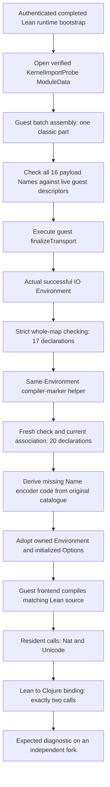
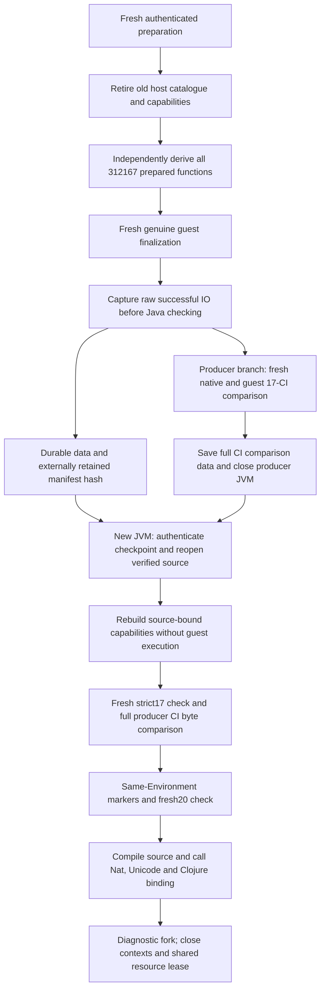

# Genuine import finalization to resident source: accepted small profile

The 2026-10-18 REPL experiment successfully ran the pinned Lean guest finalizer,
strictly checked its actual returned environment, and used that same environment
to compile and call Lean source on the JVM. The retained
[measurement](../measurements/kernel-probe-genuine-source-acceptance.json) records
pins, executed script hashes, assertions, cleanup and the process envelope.
The harnesses remain local REPL prototypes, not a shipped Ansatz API.



The input is the original 516-node native `KernelImportProbe` fixture, with one
classic data part, no IR parts and an actually empty import array. Its 17
constants cover all eight ConstantInfo variants, an explicit axiom `A`, an unsafe
definition, complete inductive/recursor groups, and canonical Eq/Quot primitives.
The existing full Lean bootstrap initializes the runtime descriptors normally.
No invented initializer guards, empty extension registry or transported native
Environment substitutes were used.

This distinction matters: pinned Lean silently skips extension payloads whose
Names have no registered descriptor. Before finalization, the probe checked all
16 exact structured payload Names against the 195 actual guest registrations.
Finalization then executed 991,402 guest instructions and returned IO success.
Fresh strict replay compared the complete 17-entry checking shapes against the
independently checked native ModuleData. All matched, including the exact axiom
set and quotient state. Registration coverage and constant equality do not prove
native equivalence of reconstructed extension state.

The next helper consumed this actual checked Environment and admitted precisely
`lcAny`, `lcErased` and `lcVoid` through normal declaration admission. A fresh
20-entry check preserved all original checking shapes, required three exact unsafe
Sort1 axioms with no universe parameters, and matched the current inherited
checked association. Its axiom inventory includes `A` and the three markers.
It did not call `preparePrelude` or replace the imported Environment.

The Name encoder was missing from the original bootstrap's host-call roots. Its
23-function closure was independently completed from the original retained
catalogue and trusted functions. Every existing executable and binding identity
was preserved; no candidate-only code gained authority, no guest instructions or
owner changes occurred, and evalConst bindings were not recaptured. Actual and
trusted sessions were reopened against their respective registries. The explicit
100M fuel setting applies per synchronous raw invocation, including its nested
calls; it is not a whole-file instruction or wall-time bound.

The source input was:

```lean
prelude
import KernelImportProbe

def checkpointAnswer.{u} (α : Sort u) (x : α) : α := x
```

Its header matches the actual imported environment. The guest frontend compiled
it, actual file initialization ran, and resident calls returned Nat42 and the exact
Unicode string. The interop input used the existing polymorphic identity extern
fixture body with this same explicit header. A pre-authorized application binding
received exactly two calls and returned both values unchanged. An independent
fork compiled a deliberately invalid matching-header file, produced one diagnostic
and no executable handle, and closed its own returned/input contexts.

No native compiler ran for these source inputs. Native compilation was used
beforehand to capture the pinned bootstrap, transport and additive helper IR.
Superseded Contexts were retired explicitly after their successors returned;
independent Contexts briefly coexist in separate immutable worlds. The retained
source Context became a closed historical handle after interop transferred
execution to its new Context. Cleanup
closed the final resident context, discarded the diagnostic world alternatives,
explicitly closed the shared source, and exited successfully. The 2GiB-heap
process peaked at 2,503,127,040 bytes RSS under a 2.5GiB guard. Its 820.89-second
lifecycle includes restoration, experiments and interactive idle time; it is not a
source-compilation benchmark.

This acceptance does not establish full Init hosting, ordinary implicit-Init or
macro acceptance, source-module A→B importing, all-extension parity, or checkpoint
restoration. The separate full Init attempt reached 883 recorded evalConst calls
with zero recorded failures before the system-memory guard stopped it; its active
state was discarded with the process. The subsequent checkpoint gate below used a
fresh successful raw finalizer event and an independently pinned reconstruction
factory for this small profile. Scalar result JSON is evidence of a completed
run, not restoration authority.

## Fresh-process checkpoint acceptance

A subsequent pair of guarded JVMs completed capture and restoration of the genuine
raw finalizer result, followed by fresh checking and the same source/interop tests.
The [separate measurement](../measurements/kernel-probe-checkpoint-source-acceptance.json)
pins both process records, the executed harnesses, approved preparation, producer
comparison data and externally retained manifest digest.



Before retiring the original host roots, the producer checked that its independently
captured preparation session and candidate world shared the original function map,
both assembly roots were live, and the same open native Store was attached once.
After releasing the old catalogue/session/binding roots, reconstruction authenticated
the pinned bootstrap and artifacts, independently derived every one of the 312,167
prepared functions, and required their exact canonical objects, binding signatures
and ordered manifest digests. The factory completed in 101,419.6 ms without guest
steps, root changes or initializer replay. This is one measured reconstruction;
it does not establish general startup or source-compilation performance.

Fresh guest finalization then returned a successful raw IO Environment. Capture
streamed and round-trip checked each row against that producer, without building a
second whole runtime. The resulting 431,022,247-byte data file contains 312,167
functions, 131,018 heap nodes and 50,380 globals. The producer-returned manifest
SHA256 was saved independently as
`a87a7015f8b23f25d232e13420e9b4d0e3009cdb9eb6c072e00a42153f7cfed6`.
An independent producer branch freshly checked all 17 native/guest declarations
and saved full binary Ansatz/Java ConstantInfo encodings as comparison data. It then discarded
its worlds, closed the source and exited successfully.

The new JVM received that explicit manifest hash and independently approved
preparation; neither was discovered from checkpoint contents or a latest-file
convention. Its trusted launcher authenticated the 244 inventoried source/class
inputs before loading; the factory also checked selected actual kernel classloader
resources. This is an explicit fresh-launch trust assumption, not proof of arbitrary
JVM bytecode. No namespace reload or redefinition occurred. Restoration reopened the
original verified source at base 352,932 and preserved next ID 366,239, guest steps
23,954,795 and the recorded function/heap counts, with zero Java kernel associations.
Initialization and finalization were not rerun.

Fresh `finish-finalization` checking matched the complete native 17-CI map, all eight
variants, axiom inventory and quotient state. Every full CI encoding also matched
the separately pinned producer reference exactly. Only then did the same-environment
marker helper, fresh 20-CI check and resident adoption run. The actual Lean guest
frontend compiled the matching-header source and returned Nat42 and the exact
Unicode value; interop made exactly two host calls, and the diagnostic fork returned
one diagnostic with no executable handle. No native compiler ran per input file.

The restore JVM closed its final resident Context, discarded the alternative helper
worlds and closed the shared resource lease last. Both processes exited 0 with no
guard stop. Producer and restore peak RSS were 2,506,948,608 and 2,483,163,136 bytes,
respectively, under 2GiB heaps and 2.5GiB RSS guards. Their 631.38- and 316.68-second
lifecycles include interactive idle and later checking/source tests; they are not
isolated restore or compile timings. A review found a cleanup-callback failure path
that should retain the prior diagnostic snapshot in the next driver revision. This
run retained that snapshot externally until successful cleanup; loaded code stayed
unchanged.

This establishes the standalone small fixture's checkpoint-to-source path. It does
not establish full Init, ordinary implicit-Init files, macros, source A→B imports,
native extension-state parity or a shipped checkpoint/provider API. The next full
Init retry was held before launch: 4,683,156 KiB available was below the existing
5GiB admission requirement. No heavy process was started by that preflight.

These limits apply to this fresh, pinned small-profile campaign. Earlier
2026-10-17 low-level hosted-file observations recorded a completed Init finalizer,
65,994-constant admission, ordinary definition/macro/interop and bounded
Init+A→B execution; see the [historical full Init evidence](hosted-frontend-next.md#full-init-import-and-first-ordinary-file-success-2026-10-17).
That long-lived development run used reviewed continuations/runtime upgrades,
larger explicit fuel budgets and an earlier checker. It is not a reproduction
under the current safety-fixed fresh-launch and callback-budget profile. The
8,052 bootstrap initialization actions initialize the Lean runtime and its
descriptors; they are distinct from finalizing the default Init Environment.
