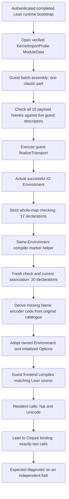

# Genuine import finalization to resident source: accepted small profile

The 2026-10-18 REPL experiment successfully ran the pinned Lean guest finalizer,
strictly checked its actual returned environment, and used that same environment
to compile and call Lean source on the JVM. The retained
[measurement](../measurements/kernel-probe-genuine-source-acceptance.json) records
pins, executed script hashes, assertions, cleanup and the process envelope.
The harnesses remain local REPL prototypes, not a shipped Ansatz API.



The input is the original 516-node native `KernelImportProbe` fixture, with one
classic data part, no IR parts and an actually empty import array. Its 17
constants cover all eight ConstantInfo variants, an explicit axiom `A`, an unsafe
definition, complete inductive/recursor groups, and canonical Eq/Quot primitives.
The existing full Lean bootstrap initializes the runtime descriptors normally.
No invented initializer guards, empty extension registry or transported native
Environment substitutes were used.

This distinction matters: pinned Lean silently skips extension payloads whose
Names have no registered descriptor. Before finalization, the probe checked all
16 exact structured payload Names against the 195 actual guest registrations.
Finalization then executed 991,402 guest instructions and returned IO success.
Fresh strict replay compared the complete 17-entry checking shapes against the
independently checked native ModuleData. All matched, including the exact axiom
set and quotient state. Registration coverage and constant equality do not prove
native equivalence of reconstructed extension state.

The next helper consumed this actual checked Environment and admitted precisely
`lcAny`, `lcErased` and `lcVoid` through normal declaration admission. A fresh
20-entry check preserved all original checking shapes, required three exact unsafe
Sort1 axioms with no universe parameters, and matched the current inherited
checked association. Its axiom inventory includes `A` and the three markers.
It did not call `preparePrelude` or replace the imported Environment.

The Name encoder was missing from the original bootstrap's host-call roots. Its
23-function closure was independently completed from the original retained
catalogue and trusted functions. Every existing executable and binding identity
was preserved; no candidate-only code gained authority, no guest instructions or
owner changes occurred, and evalConst bindings were not recaptured. Actual and
trusted sessions were reopened against their respective registries. The explicit
100M fuel setting applies per synchronous raw invocation, including its nested
calls; it is not a whole-file instruction or wall-time bound.

The source input was:

```lean
prelude
import KernelImportProbe

def checkpointAnswer.{u} (α : Sort u) (x : α) : α := x
```

Its header matches the actual imported environment. The guest frontend compiled
it, actual file initialization ran, and resident calls returned Nat42 and the exact
Unicode string. The interop input used the existing polymorphic identity extern
fixture body with this same explicit header. A pre-authorized application binding
received exactly two calls and returned both values unchanged. An independent
fork compiled a deliberately invalid matching-header file, produced one diagnostic
and no executable handle, and closed its own returned/input contexts.

No native compiler ran for these source inputs. Native compilation was used
beforehand to capture the pinned bootstrap, transport and additive helper IR.
Superseded Contexts were retired explicitly after their successors returned;
independent Contexts briefly coexist in separate immutable worlds. The retained
source Context became a closed historical handle after interop transferred
execution to its new Context. Cleanup
closed the final resident context, discarded the diagnostic world alternatives,
explicitly closed the shared source, and exited successfully. The 2GiB-heap
process peaked at 2,503,127,040 bytes RSS under a 2.5GiB guard. Its 820.89-second
lifecycle includes restoration, experiments and interactive idle time; it is not a
source-compilation benchmark.

This acceptance does not establish full Init hosting, ordinary implicit-Init or
macro acceptance, source-module A→B importing, all-extension parity, or checkpoint
restoration. The separate full Init attempt reached 883 recorded evalConst calls
with zero recorded failures before the system-memory guard stopped it; its active
state was discarded with the process. The next checkpoint gate needs a fresh
successful raw finalizer event and an independently pinned reconstruction factory
for this small profile. Scalar result JSON is evidence of the completed run, not
restoration authority.
