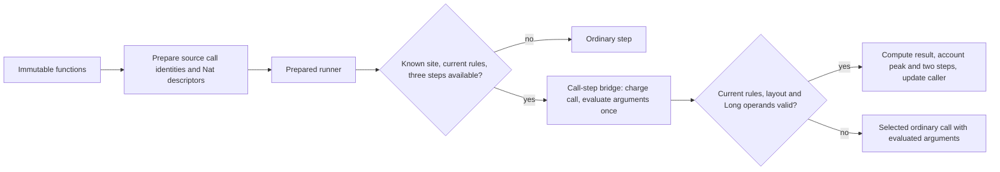

# Prepared native call regions

The earlier [register experiments](REGISTER_CAPTURE_PROBES.md) reduced allocation
without improving CPU. This iteration removes a control-transfer boundary: a
direct call to a canonical two-argument Nat extern wrapper, its runtime `:let`,
and its return can execute as one guarded region.

`prototype.native-call/open-program` and `run!` are additive low-level APIs in the
optional Lean runtime. Ordinary interpreter and file-loader defaults are unchanged.
Execution does not replace global Vars or load the Pattern compiler or LLVM. It uses no
program-specific `eval`, or generated guest bytecode in this tier.



## Execution contract

Preparation recognizes exact immutable wrapper shapes and static source `:call`
identities. Parameter IDs must be distinct, nonnegative bounded Long/Integer IDs;
continuations and operands must have canonical containers. It never interns a
runtime continuation or scans literals as code. Mutable/custom function tables
and unsupported shapes simply produce no eligible sites. Plans are code facts,
not kernel admission authority or serializable guest state.

The numeric tier supports nonnegative Long inputs for `lean_nat_add`,
`lean_nat_sub`, `lean_nat_mod`, `lean_nat_dec_eq` and `lean_nat_dec_lt`. Addition
overflow, Integer/BigInt/native carriers, references, negative/invalid values,
changed registries and unknown operations decline to the existing runtime.
Subtraction saturates at zero; modulus by zero returns the numerator. These rules
were checked against Lean's runtime `src/include/lean/lean.h` implementations and
the existing persistent/mutable execution oracles. There is no native ABI change.

`mutable/call-step-with!` owns the ordinary running check, call-step charge and
operand resolution. It selects the ordinary call function before argument reads.
The dispatcher can decline after those reads without reevaluating operands or
selecting a newer fallback function. Definition-owner checks cover the private
call/evaluator, register, control, counter, bridge and driver helpers and compose
the existing transitive layout/walker guards. Checks run before the bridge and
again after arguments; old rule generations and invalidated arithmetic withdraw.
Layout namespace generations also change the call token, invalidating existing
plans even when the replacement layout rules remain valid. The token cache holds
only one layout witness and one opaque token, without guest or code data.

Fusion requires three available instructions. With one or two remaining, ordinary
execution exposes the callee's partial state. The successful region consumes
call/let/return, preserves caller locals/joins/continuation, and accounts for the
logical callee frame peak while avoiding its physical frame, registers and join
map. Heap, globals, resource authority, logical RC and guest allocation/store
counters are unchanged. Explicit layouts, incompatible private layout caches,
nonordinary storage and covariant caller arrays decline.

The primitive prepared driver tracks consumed instructions independently from
guest statistics. Extra nested native work cannot consume fuel merely by changing
a statistics counter. It only calls the dispatcher at prepared sites; ordinary
instructions retain the existing step path. It withdraws before its extra PC read
if instruction/control rules have changed. This runs one mutable Machine per
execution; it does not promise transactional concurrent global code redefinition
or asynchronous capture inside an atomic region.

## REPL use

Use the functions and initial World from the same loaded code basis:

```clojure
(require '[prototype.native-call :as native]
         '[prototype.mutable :as mutable])
(def program (native/open-program (:functions initial-world)))
(def result-world
  (mutable/freeze
    (native/run! program (mutable/thaw initial-world) 100000)))
```

Reopen for a different function-map identity; source edits never silently reuse
an old plan. Fork and resume through ordinary immutable Worlds. The five-argument
runner form is an internal profiling control, not a new interop or Java API.
Loader selection, adaptive policies and compiled-region integration are later
campaign steps; this does not claim current hosted frontend acceleration.

## Bounded performance evidence

Original native-exported RBMap build/fold, 16 reachable runtime functions. Five
wrappers and eight source call sites prepare; size 300 fused 3,983 calls. Result
30, 116,872 guest steps, 3,659 guest allocations, 7,920 field stores and maximum
15 logical frames agree completely with the reference World.

Final fresh 384 MiB JVM, Java 25.0.1/Clojure 1.12.4, alternating modes, 40 size-100
and 10 size-300 warmups per mode, seven measured samples per size:

| Size 300 | Median thread CPU | Allocated bytes |
| --- | ---: | ---: |
| Ordinary mutable | 41.858 ms | 49,845,360 |
| Prepared driver, fusion disabled | 43.270 ms | 47,040,632 |
| Prepared native calls | 34.175 ms | 39,137,176 |

This is about 18% less CPU and 21% less allocation versus ordinary execution, or
21% and 17% versus the same disabled driver. It combines callee-state elimination
and guarded arithmetic specialization; their individual CPU contributions have
not been isolated. This is neither native Lean parity nor a full-image speedup.
Current-thread allocation is cumulative, not retained heap or required capacity.
Seven samples and different JIT histories do not establish precise general ratios.

Initial scoped prototypes used global `with-redefs`; those remain research-only.
An early additive driver dispatched on every instruction and performed a boxed
variadic budget comparison. Fresh-process controls exposed its overhead. The
final driver selects sites before dispatch and uses primitive binary comparisons.
The final matched table above, rather than those early controls, supports the
implementation decision. Raw final samples are in
[native-call-regions.edn](../measurements/native-call-regions.edn).

## Validation and packaging

- Bounded CI contract gate: 89 tests and 10,746 assertions, including 45 arithmetic
  scenarios with fuel/error/carrier comparisons; tail/closure/native/reference
  fallback; malformed code, layouts and caches; code identity; helper, registry
  and generation withdrawal; overflow counters and nonrunning starts; nested
  caller/join state, every suspension/host-resume fuel prefix and independent forks.
- Compiler/coherent regression gate: 91 tests and 23,794 assertions.
- Optional package inventory: 70 sources; three audit tests and 20 assertions.
- Built a pinned core jar (`0.2.448`) and the source-loaded optional module. An
  isolated jars-only consumer fused all five operations and matched 30 fuel
  prefixes. Source hashes inside the jar match the three runtime files. Core-only
  loading does not expose or load this optional namespace.
- Independent source review found no remaining blocking issue. No full Init,
  Mathlib, hosted frontend or unchanged-project file-loading campaign was run.

`native-call-clean-probe.clj paired` reproduces the matched measurement on an
already resolved experiment classpath. Single-mode `ordinary`, `driver` and
`fusion` controls are also available. Keep one small retained REPL for exploration;
fresh bounded processes are acceptance controls, not the iteration loop.
