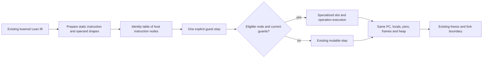

# Interpreter-first preparation experiment

This is opt-in research over the existing mutable interpreter, not a replacement
backend or a claim of general Lean project performance. No production runtime
default changes. See [SCI study](SCI_INTERPRETER_NOTES.md) for source evidence
and [hosting campaign](LEAN_HOSTING_CAMPAIGN.md) for the broader objective.

## Representation and execution

Preparation visits static code positions only. It does not walk literals as code,
cache dynamic continuation bodies, generate Clojure with `eval`, or store guest
heap references in a separate execution stack. Named host node classes are shared
between guest expressions. Program/function-map identity must match the machine.
Every prepared instruction still consumes one guest step and updates the normal
PC. Calls, jumps, RC, effects and unsupported expressions use existing execution.

The tiers are deliberately separate:

- `prepared-interpreter.clj`: prepared `:let` expressions and fixed argument shapes.
- `prepared-fused.clj`: fuses literal and project-from-local expressions; primitive
  Long fuel driver. Other fuel representations retain the original path.
- `prepared-runtime.clj`: five exact binary small-Nat runtime operations with
  constant/local operands; removes repeated generic numeric decoding and argument
  vector construction on eligible calls.
- `prepared-native-ops.clj`: source-owned helper/registry identity guards. Overflow,
  non-Long/negative inputs and invalidated owners decline into the ordinary runtime.
  Descriptors hold weak identities for watched values, not old registry roots.

This is much narrower than Lean compilation. It does not change memory ownership,
native layouts, arbitrary foreign calls or the kernel/admission boundary. SCI's
GC-managed values and quiescent world forking do not establish our Lean RC or
active-continuation semantics.

Only exact `PersistentVector` code is eligible; subvectors and custom containers
fall back. Sequential host-hook changes are checked at their ordinary observation
points. Concurrent Var redefinition and namespace/class reloading are outside this
research contract; identity checks do not provide atomic concurrency isolation.

## Bounded measurements

Java 25.0.1, Clojure 1.12.4, maximum heap 384 MiB. Native-exported RBMap fixture,
16 reachable functions; build a tree, fold it in the same private mutable machine,
freeze once at the end. No hosted frontend or Init. CPU and allocation are measured
on the execution thread through JVM management counters; full World equality with
the persistent reference is checked outside timed sections.

Resident REPL, alternating paths, eight warmups per path, seven measured samples:

| RBMap size 300 | Median CPU | Median thread allocation |
| --- | ---: | ---: |
| Ordinary mutable, runtime-tier comparison | 39.42 ms | 46.67 MB |
| Primitive-fuel control | 39.59 ms | 43.86 MB |
| Prepared binary runtime tier | 37.20 ms | 37.02 MB |

Separate JVM per mode, 40 size-100 and 10 size-300 warmups, seven samples per size:

| RBMap size 300 | Median CPU | Median thread allocation |
| --- | ---: | ---: |
| Ordinary mutable | 48.66 ms | 45.06 MB |
| Primitive-fuel control | 52.64 ms | 47.04 MB |
| Prepared binary runtime tier | 46.83 ms | 39.05 MB |

MB denotes decimal bytes; these are cumulative allocations, not retained heap
sizes or required JVM heap capacities. The final runtime tier improves this bounded
case by roughly 4–6% CPU and 13–21% allocation. Separate JVMs still have different JIT histories;
these are diagnostic samples, not a statistically controlled performance promise.
The fuel control's allocation benefit did not reproduce in the separate JVM.
The generic prepared tier was slower in the resident comparison (45.60 vs
39.00 ms); literal/project fusion alone was also slower (41.21 vs 38.20 ms).
Protocol nodes alone are therefore insufficient evidence for replacing dispatch.

All 73 eligible lets are prepared, with five specialized binary runtime sites.
Preparation is excluded from hot execution timing; the final fresh runtime process
reported 4.17 ms, including descriptor/helper work. The resident initial
generic plan reported 0.66 ms; these differ in work and warmup and are not directly
comparable. An earlier fresh runtime sample before hook-observation refinements
reported 45.68 ms/35.40 MB and 35.53 ms preparation; it remains in the raw evidence,
but the tables above use final source. Raw samples are in
[prepared-interpreter-probes.edn](../measurements/prepared-interpreter-probes.edn).

The diagnostic RC census at size 100 counted 401 scalar releases, 201 immortal
roots and 191 destroyed roots; no top-level release left a positive RC. Recursive
release worklist children are excluded. A positive-RC decrement shortcut would
not address this particular workload.

## Reproduction and next decision

Use the existing small experiment REPL; load the benchmark, runtime feasibility,
controls and prepared files in dependency order. Load each prepared class namespace
once; do not reload `prototype.mutable`. Invoke `interpreter-controls/compare-prepared`
with the existing context and prepared program. The check harness accepts explicit
`:prepare-program`, `:step!` and `:run!` functions, without redefining provider Vars.

`prepared-clean-probe.clj` takes `ordinary`, `primitive-driver` or `prepared` as its
first argument. Use the experiment's already resolved classpath and a bounded heap;
run one mode per JVM. It prints an EDN result after any JVM startup warnings.

`prepared-check-runner.clj` runs all three tiers in a fresh bounded JVM. The final
source passed 17 basic exact-step/error samples per tier, multiargument hook
changes, helper selection, unsupported/dynamic code fallback, captured-frame and
join fork/resume checks. The runtime tier also passed arithmetic/carrier boundaries,
registry and evaluator invalidation, captured fallback ordering, Long/BigInt/invalid
fuel cases and two forks that execute a prepared native operation after resumption.
No full Init, source-loader or hosted frontend campaign was rerun.

Before default promotion: broaden the corpus beyond RBMap, measure preparation
amortization, assess generic-node regressions, and profile the remaining heap/RC
and call cost. Preserve exact fuel prefixes, error checkpoints, dynamic helper
observation order and fork/resume equality. The compiler remains necessary for
typed primitive loops and substantial progress toward native Lean throughput;
this experiment provides a cheaper interpreter tier while that work continues.
