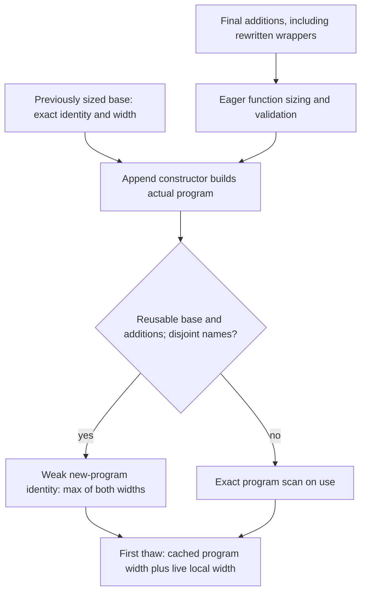

# Program register sizing experiment

This experiment reduces repeated sizing of large immutable program maps. The
matched standalone frontend workload now passes with the new consumer. The direct host probe in the preceding build
measured roughly 363 ms when alternating two retained programs and a negligible
immediate repeat. That establishes sizing/cache behavior, not call-time attribution.

The global cache now retains at most 16 weak program identities and scalar widths.
It never hashes code, stores a parent/delta chain, or grants executable, source, or
kernel authority. Explicit `(program-slots functions (cache))` retains the original
one-entry cache contract. Live local/frame sizing is unchanged.

`append-functions` constructs the actual program from its base and additions.
Only a previously validated exact base identity, disjoint names, standard maps,
and reusable immutable function graphs permit width propagation. Custom persistent
collections and SubVector views are sized exactly without reusable proofs. Arrays,
ArraySeq, and mutable Java collections retain their rejection. Replacements,
removals, and missing base proofs require exact program sizing on use; an old
maximum cannot incorrectly survive removal of its widest function.

Every final addition is eagerly sized, including malformed trusted lowerer output,
regardless of cache state. This deliberately makes such invalid installations fail
before execution, consistently for cold, warm, and evicted bases. Unexpected
exceptions and resource failures are not swallowed. Normal admission, ABI,
protected-name, initialization, and ownership checks remain independent.

The compiled-unit installer keeps the small final addition map, including global
and IO initializer wrappers after all rewrites. It passes that map to the append
constructor and returns it as `:new-functions`. No arbitrary old/new/width
attestation or metadata hint is accepted. A post-install first call can therefore
reuse a width even when the newly constructed program has never executed.

The identical synthetic script measures append plus sizing after base validation,
using two warmups and five measured additions in separate 512 MiB JVMs:

| Function count | Original median | Candidate median |
| --- | ---: | ---: |
| 56,125 | 29.28 ms | 0.070 ms |
| 334,755 | 315.69 ms | 0.068 ms |

Cold base validation is excluded from those medians and recorded separately:
627.28 → 704.64 ms and 2,295.53 → 2,442.55 ms respectively. This is synthetic
host sizing, not frontend performance, native Lean parity or an exclusive
attribution of resident call time. The [measurement record](../measurements/program-slot-cache-optimization.json)
contains every sample, source pins, guards and failed development attempts.
Run [the benchmark script](../scripts/program-slot-append-benchmark.clj) under
each corresponding source tree to compare the same workload.

Focused tests cover exact custom-cache behavior, weak retention and eviction,
branch alternation, append propagation, replacement/removal, cache-independent
invalid additions, nested custom views, deep unhashable code, native compiled
fixtures, and final global/IO wrappers. The final focused set passes 62 tests /
1,144 assertions; the complete experimental suite passes 861 tests / 89,557
assertions. A genuine closed constructor probe also passed for the new consumer.
The earlier memory-deferred launch remains recorded as a historical attempt.
A later genuine archive restore, standalone A→B frontend acceptance and matched
warm profile passed with consumer `ed0640a7…`, without changing producer bytes.
The workload used two warmups and three measured independent forks. All five
trials passed, with 24,451,226 guest steps, 30 created Contexts closed, no
initializers, and the base Context unchanged.

| Public operation, measured median | Original | Globals overlay | Plus register sizing |
| --- | ---: | ---: | ---: |
| Fork | 10.47 ms | 12.87 ms | 9.43 ms |
| Publish A | 6,015.83 ms | 5,227.46 ms | 4,197.57 ms |
| Prepare source import | 4,114.89 ms | 3,696.20 ms | 3,468.52 ms |
| Load B | 5,130.87 ms | 4,018.80 ms | 3,858.52 ms |
| Call Nat | 364.02 ms | 387.10 ms | 16.39 ms |
| Call Unicode | 71.51 ms | 20.82 ms | 16.54 ms |

Complete five-trial controller wall time was 79.018 → 66.089 → 58.752 seconds,
including warmups, bookkeeping and Context closure. Each Nat/Unicode operation
executes eight guest steps and allocates zero guest nodes. These are separate
sequential JVM runs with three measured samples each: JIT, GC and machine
conditions differ. They support the practical latency improvement, not a
statistical guarantee, exclusive cost attribution or native Lean parity claim.
The [frontend measurement record](../measurements/resident-import-program-slot-cache-profile.json)
retains the new raw receipt, all three measured samples per stage/build, source
pins, archive identities and guard results.

The held JVM was later terminated with exit 143 when global available memory fell
below 1 GiB. Its guard lifetime was **564.89 seconds**, including restore,
acceptance, warm work and subsequent hold; that is separate from benchmark wall
time. The successful warm receipt precedes termination. Closing the 30 warm
Contexts does not establish native Source lease closure, complete semantic
cleanup or graceful process disposal. This standalone profile also does not
establish full Init checking or the future over-Init import API.

The candidate's closed restore profile is `/2`, with exactly the reviewed
`slot_count.clj` and `program_install.clj` substitutions in addition to the
previous globals change. Producer recipe and archive bytes remain unchanged;
this is a new consumer identity, not a relabeled producer build. Earlier
validation records describe their explicitly pinned consumer builds.
