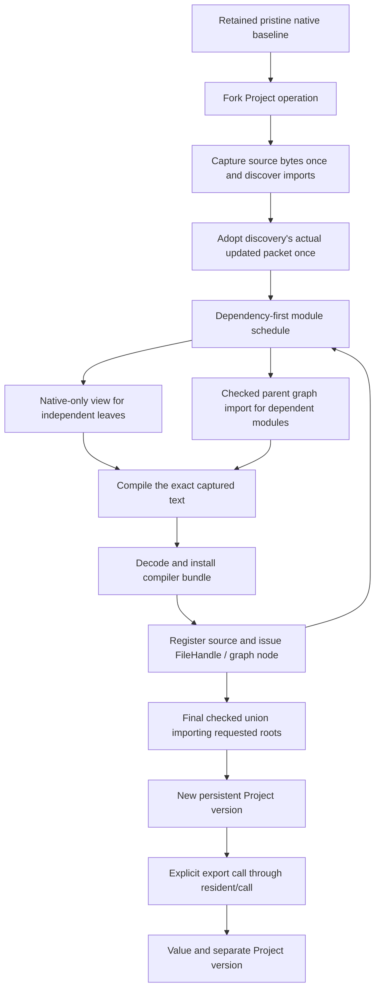

# Captured Project loading

`prototype.project-loader` is an optional experiment outside Ansatz's library
source and AOT paths. It orchestrates the existing resident frontend, source
publication, checked graph imports and native Init base operations. It does not
bootstrap a Lean frontend or provide a production JVM Lean distribution.

The first integration tests use fixed header/compiler/export/witness/finalizer
transport and producer-authentication models. The coordinator, persistent World
operations, guest constructors, Java kernel admission, frontend bundle decoding
and installation, source registration, typed graph nodes/receipts, resident
FileHandle issuance and resident calls execute through their actual APIs.
Genuine parser/compiler project acceptance is separate evidence.



## API and identity

`open-project` takes an already prepared pristine resident Context and explicit
configuration, issued prefix/profile/readiness, source provider, descriptive
native module names, bounds and stage policies. The wrapper forks baseline and
current Context owners. Source resources remain borrowed. Opening the wrapper
is not itself a certificate of native readiness; existing protected operations
check their actual capabilities and current packets when used.

`load-file` identifies a source module through the provider; it does not infer
module identity from a filename. The export table explicitly covers **every**
captured source module, including `[]` for intentionally unexported modules.
Java `Name` values describe exported functions; they are not issued authority.

```clojure
(require '[prototype.project-loader :as project])
(import '[ansatz.kernel Name])

;; `baseline` and `options` come from an independently prepared resident setup.
(def p (project/open-project baseline options))
(def loaded
  (project/load-file p
    {:module ["str" ["anonymous"] "Example"]
     :exports [{:module ["str" ["anonymous"] "Example"]
                :roots [(Name/fromString "answer")]}]}
    {:max-operations 1 :wall-ms 100}))

;; ABI is explicit; this example exports a polymorphic identity function.
(def called
  (project/invoke (:project loaded)
    ["str" ["anonymous"] "Example"] (Name/fromString "answer")
    [nil 41] {:arguments [:erased :nat] :result :nat}))
(:value called) ; 41
```

`prepare-load`, `advance-load!` and `finish-load!` expose the same cooperative
state machine. Each slice advances at most its requested operation count and
wall-clock target. A compiler, checker, filesystem operation or host handler can
run beyond that target; this is not preemptive cancellation. Successful finish
is consumed once. Failure is terminal and retains the actual diagnostic packet,
private child operation and Context ownership evidence. There is no public
failed-child cleanup or resume API in this iteration.

## One lineage, independent retained versions

Discovery threads the actual packet after every header call. Compilation uses
its captured text without reopening the source file. Each parent import,
independent-leaf native reset, compilation, source registration and final graph
import continues in that operation's accumulated World. There is no heap merge
or reconstruction from descriptive discovery records.

Every load starts from a fork of the retained pristine baseline. Reload therefore
rebuilds the selected source closure rather than replacing code inside an older
World, selecting an older checkpoint after discovery, or reusing source nodes
from a different lineage. Earlier Project versions remain independent. `invoke`
also returns a separate Project version; it does not mutate or close its input.
Close each issued version with `close-project!`. Borrowed Sources/Stores and
other versions remain caller-owned.

The final import view is generated automatically from the requested source root
names. Each string segment is quoted using the pinned Lean parser's escaped
identifier syntax. Closing `»` cannot be represented by that syntax. This loader
also excludes CR/LF and the provider's path-unsafe segment subset. UTF-8 byte
bounds are checked before constructing the header. The captured native renderer
oracle is data; using those observations in tests does not execute a guest parser.

## Current profile and limits

- Classic source modules with implicit ordinary/meta Init imports and no source
  initializer actions. Explicit native imports, including explicit `import Init`,
  are rejected instead of silently changing import identity or flags.
- Source roots only. A descriptive native skip list does not grant permission to
  import Std, Lean, Mathlib or another native module through this loader profile.
- Dependency-first source compilation, shared captures and independent leaves.
  Discovery deduplicates scheduling; publication retains exact raw imports.
- Explicit export roots and call signatures. No automatic ABI inference, Java
  facade, implicit initialization or Clojure callback registration is added here.
- Module/source/name/header/output/operation/owned-Context bounds and individual
  child fuel policies. No aggregate Project-wide fuel or filesystem transaction.
- No prefix cache reuse, changed-function in-place replacement, cancellation,
  rollback of completed suboperations, or implicit LLVM dependency.

## Evidence

The protocol tests exercise orchestration and ownership with modeled graph/native
callbacks; they do not issue genuine graph authority. The empty integration
passed one test / 156 assertions across reference, mutable and JVM backends using
actual graph/native/publication/registration APIs and modeled guest transport.
The expanded three-test integration passes 264 assertions across all three
backends, including actual kernel admission and Project invocation. The complete
optional suite remains pending; these focused results do not replace it. Comment-only identity rebuilds establish retained version ownership and
unchanged callable behavior, not changed function semantics or performance.
