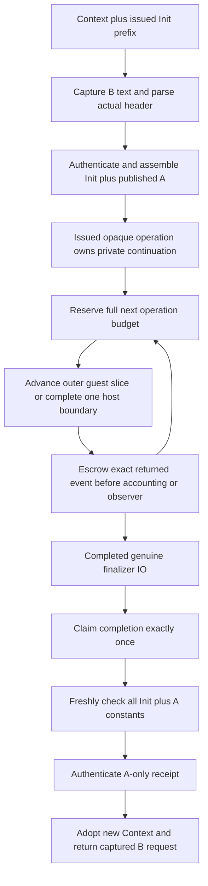

# Staged resident source import over checked Init

The optional `prototype.resident-init-prefix` namespace adds a staged operation
for preparing B's imports from one published over-Init module A. It builds on the
[checked prefix boundary](RESIDENT_INIT_PREFIX.md). This is separate from loading
B: successful completion returns a Context and captured request that can then be
passed to `resident-frontend/load-source`.

```clojure
(def operation
  (prefix/prepare-source-import-over-init context request issued-prefix
    {:kernel-policy {:allow-axioms? true :allow-unsafe? true :fuel 20000000}
     :budgets {:outer-fuel 2000000
               :helper-fuel 20000000
               :attempt-fuel 500000000}}))

;; Repeat slices while progress is :running; :assembled has not started finalization.
(prefix/advance-import! (:control operation)
  {:max-operations 1000 :wall-ms 10000
   :observe! (fn [progress] (println progress))})

;; Once a slice reports :io-completed, finish exactly once.
(def prepared (prefix/finish-import! (:control operation)))
(def loaded (resident/load-source (:context prepared) (:request prepared)))
```

`request` has the ordinary deferred resident source shape: exactly one UTF-8
`:path` or immutable `:text`, file name, explicit Lean `Name` module name and root
vector, and `:initialization :defer`. Paths are read once; completion returns the
captured text, so later compilation does not reopen a changed file. Calls and
unknown request keys are rejected.

Preparation validates independent prefix configuration, authenticated helper
closures and bindings before guest execution. It parses the actual classic B
header and requires exactly `[Init, meta Init, A]`, in pinned Lean 4.33.1 order and
flags. A must be an authenticated publication with the over-Init profile, both
implicit Init imports and no initializer actions. Existing lower assembly checks
the exact Source, checked anchor, native closure, unchanged prefix scaffold and
unshadowed native address range. Assembly returns before finalization starts.



The empty operation object is issued through a private weak identity registry.
Its continuation, original certificate and configuration stay private. There is
no public checkpoint/certificate getter, caller-supplied continuation, or
replacement configuration. A descriptor/progress map cannot reconstruct an
operation. The original prefix constructor remains a trusted host boundary for
the provenance of the original successful checking result.

The aggregate attempt budget covers completed finalizer execution operations.
Before an outer advance, the operation reserves its full `:outer-fuel`; before a
host completion, it reserves the full `:helper-fuel`. If the remainder cannot
reserve the next operation, the operation fails terminally even if the numerical
step limit has not been reached. Outer charges use actual guest-step deltas;
handler charges use the maximum of that delta and the raw helper-step receipt.
Negative, oversized or otherwise invalid charges are rejected after retaining
the actual completed event. Nested synchronous helpers share the raw host
completion's aggregate helper budget.

Slice `:wall-ms` is checked between operations. It cannot interrupt a running
handler, native work, compilation or checking. `:max-operations` limits the
number of outer advances/host completions in that slice. Both are explicit
positive integers. Optional observers receive scalar progress only; an observer
exception terminally poisons the operation after its event is retained.
Concurrent and reentrant control use cannot replay an event. Preparation and
post-IO checking helpers use the explicit helper-fuel bound per raw call; checker
fuel comes from the allowlisted kernel policy. Those setup/checking calls are
outside the finalizer attempt counter and require external process guards.

Completion calls `source-import/finish-over-init` on that operation's exact
completed IO without invoking finalization again. Every Init+A constant enters a
fresh Java Environment and is checked under current policy. Only immutable
native projections can reuse the privately retained original certificate. The
caller cannot supply `:projection-certificate`. The source receipt covers A's
exact constants only; an otherwise valid checked Init map missing A cannot earn
that receipt.

Success releases the encoded A Name and prior Environment only in the new branch,
then adopts the newly checked Environment with inherited Options and prefix
registry owners. Input Context and independent forks remain unchanged. The raw
session preserves backend/cache/binding identities and restores its original
execution fuel for the returned Context. This operation runs no source
initializers and closes no borrowed Source or native Store.

Any assembly, finalizer, budget, observer, checking, receipt or adoption failure is
terminal. Diagnostics retain exact entry, assembly, current event/session, owned
IO, completed checking result, ownership stage and adoption packet as available.
The private ledger retains the exact failure wrapper and cause; later control
calls rethrow that same terminal failure without executing anything. Nested helper
checkpoints take precedence over fallback outer snapshots. These
packets are alternatives for diagnosis, never permission to splice state, retry
callbacks or infer cleanup. Keep the borrowed Source lease open for retained
Contexts, operations, failures and descendants.

Validation: the new import tests pass **11 tests / 197 assertions**; together with
the unchanged prefix tests, the focused set passes **17 tests / 288 assertions**.
The full experimental suite passes **878 tests / 89,845 assertions**. The final
focused and full jobs exited 0 under a 512 MiB heap and 1 GiB RSS guard. The full
suite took 174.36 seconds with 906,067,968 bytes peak group RSS.

Focused fixtures use a small verified native Store, actual fresh Java checking
and explicitly modelled guest helper bodies on reference, mutable and JVM
backends. They cover fresh whole-map admission/native projection identity,
A-only receipts, current-policy rejection, header flags/order/duplicates,
callback budget reservation, opaque one-shot control, observer/reentrancy and IO
failures, exact child checkpoint/session retention, postchecking adoption
failure, captured paths, closed leases and independent branch ownership.
Independent Astra source/test/ownership review found no blocking issue.

The [validation record](../measurements/resident-init-import-validation.json)
retains source hashes, guards, command/driver and additive experiment-loader
checks. The existing native Init prefix is separately exercised by the
[actual prefix acceptance](../measurements/native-init-prefix-runtime.json).
Genuine end-to-end B-over-Init+A acceptance remains a separate pending gate;
these model-helper tests do not replace it.
