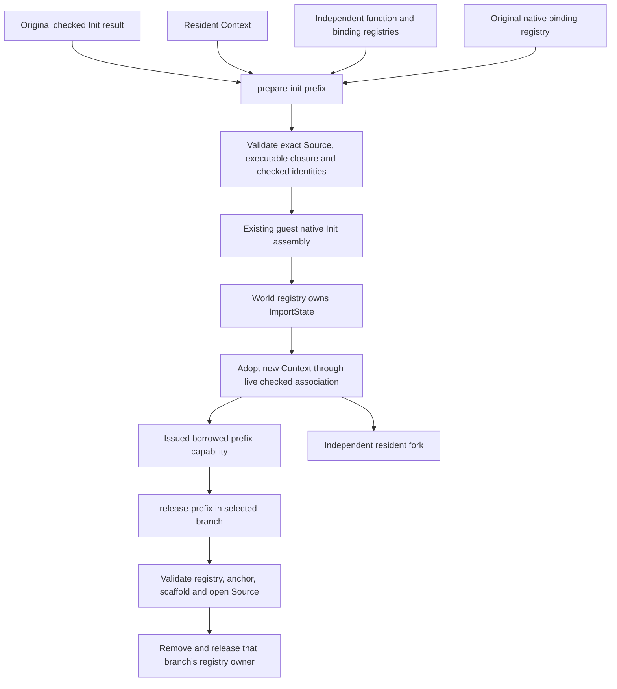

# Resident checked Init-prefix preparation

`prototype.resident-init-prefix` exposes preparation and release of the existing
checked native Init prefix. It does not yet load source files over that prefix.
The standalone resident publication/import APIs remain separate.

The original successful Init checking result must come directly from trusted
host orchestration. This constructor intentionally trusts that provenance; an
opaque prefix is not proof that a caller-created result map came from checking.
Restored runtime state, a descriptor, and a later Context snapshot do not replace
the original result.

```clojure
(require '[prototype.resident-init-prefix :as prefix])

(def prepared
  (prefix/prepare-init-prefix context original-checked-init
    {:configuration independently-captured-resident-configuration
     :native-bindings original-native-bindings}))

(prefix/descriptor (:prefix prepared)) ; descriptive scalar/count receipt

(def released
  (prefix/release-prefix (:context prepared) (:prefix prepared)))
```

Both operations return a new `:context`. Preparation also returns `:prefix` and
`:receipt`; release returns `:receipt`. The input Context stays open and unchanged.
The capability is a process-local issued zero-field object. Copying its public
receipt, or constructing an empty object of the same class, grants no authority.
The original certificate and configuration stay in the private issued-object
registry for future use by an over-Init import boundary.



Preparation checks the original Env/guest ConstantInfo mapping and exact attached
native Source, then delegates native provenance, dependency closure and checked
anchor validation to `source-import/prepare-init-prefix`. All native assembly,
future hybrid assembly, finalization and checking helper closures must already be
authorized by the independent configuration. The prepared hybrid binding registry
must match that configuration by identity. Native bindings are original captured
capabilities; this operation neither replaces bindings nor replays initializers.
In particular `lean_run_mod_init_core` keeps its original identity.

The world registry owns one ImportState root in each immutable branch. The
capability borrows that root. Forking a Context inherits its branch-local owners,
with no artificial retain/drop adjustment to a shared global count. Releasing a
prefix creates a new branch with its registry owner removed. The input and its
other forks can still release their own owner. A released descendant cannot reuse
that prefix. Release revalidates the checked anchor, exact open native Source,
unshadowed native range, and unchanged local scaffold through the existing lower
release operation.

Native Stores and catalogues remain externally borrowed. Closing a Context does
not release prefix registry owners or close the native Source. Keep the lease
open while retaining any Context, capability, failed packet, future, or descendant
that needs it. Capabilities are process-local and not checkpoint serialization
formats. Their issued-object registry assumes trusted host code; reflective or
private-Var mutation is outside this boundary.

Failures are terminal. Exception data retains the entry, latest checkpoint and
session, phase, completed preparation or release packet, and last returned raw
helper packet. Completed preparation remains owned if subsequent adoption fails.
Nested helper/adoption checkpoint data takes precedence over the outer fallback;
there is no implicit retry, cleanup authority, native lease closure or rollback.

The focused tests use a small verified native Store and actual fresh Java kernel
checking, with explicitly modelled helper bodies through raw transport. They
cover all three backends, independent branch release, forged capabilities,
pre-execution checking and registry rejection, altered scaffold/native-range
rejection, closed Sources, and adoption failure with owned evidence. They do not
claim to execute Lean's full Init assembly/frontend. Genuine full-Init acceptance
and the future over-Init import API require separate campaign evidence.

Validation: the focused set passes **6 tests / 91 assertions** across reference,
mutable and JVM backends. The complete experimental suite, including the optional
consumer, publication/import, fork and register-sizing tests, passes **867 tests /
89,648 assertions**. Both jobs exited 0 under a 512 MiB heap and 1 GiB RSS guard;
the full suite took 192.47 seconds with 890,556,416 bytes peak group RSS. The
[validation record](../measurements/resident-init-prefix-validation.json) retains
source hashes, command/driver and guard receipts. Independent Astra source,
ownership, test and documentation review found no blocking issue. Separate
[genuine native Init-prefix acceptance](../measurements/native-init-prefix-runtime.json)
now passes: fresh checking of 65,994 constants, native assembly of 631 effective
modules, two independent branch releases, and closure of all three test Contexts
while preserving the original Contexts and borrowed Source. End-to-end source
loading over Init+A still requires separate acceptance.
