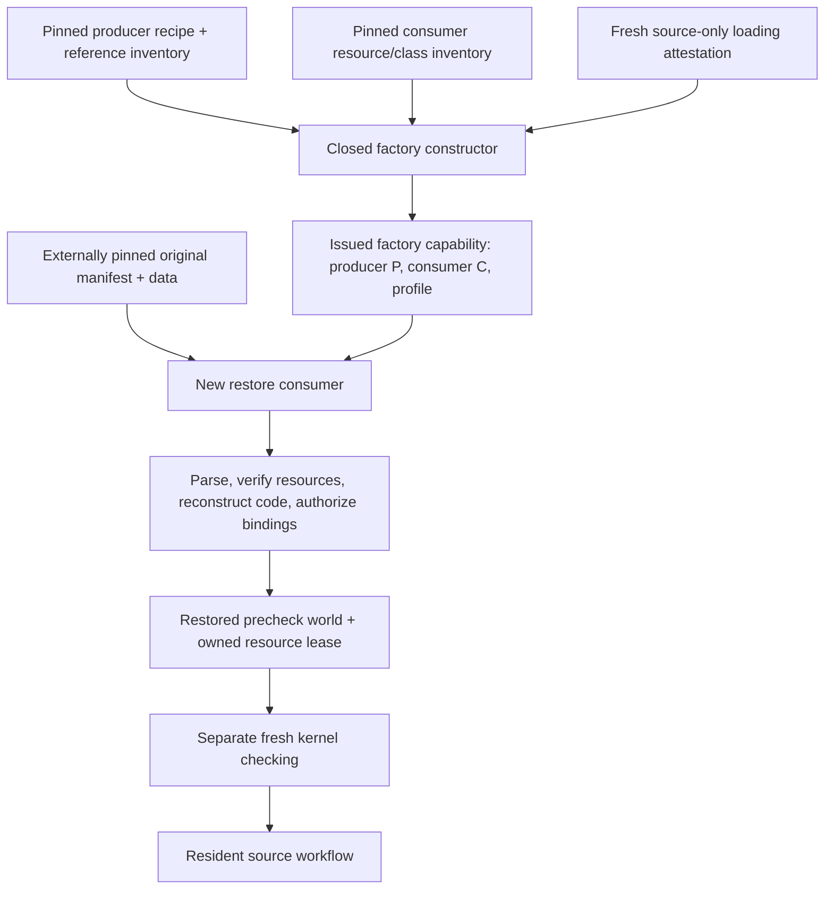

# Explicit checkpoint producer and consumer identities

The archived checkpoint was produced under host implementation `50f...`.
The globals optimization changes the interpreter, so it is a different consumer
implementation. The old restorer's `:implementation-sha256` retains its original
meaning. This experiment introduces separate APIs while preserving the original
manifest, wire format, factory and restorer.

`prototype.globals-consumer-factory/make-factory` authenticates the exact original
recipe, original producer references and independently approved consumer
inventory. It returns an issued capability whose descriptor and reconstruction
callback live in a private weak registry. An arbitrary function, map, or plain
instance of its public zero-field class is not an issued factory.

`prototype.restore-consumer/restore!` accepts that capability, an external
manifest digest, the producer preparation, expected consumer identity, resource
resolver and explicit mutable backend/fuel. It retains the original bounded
parser, descriptor/data verification, resource-lease cleanup, canonical function
reconstruction, binding signatures and executable-authorization checks. It returns
`:status :restored-precheck` and `:strictly-checked? false`, with separate
`:producer-preparation`, `:consumer-implementation-sha256` and
`:compatibility-profile` fields. Restoration does not install a checked kernel
Environment or run guest initializers.

## First globals consumer: profile `/1`

The original producer inventory has 242 rows. The first globals consumer selects 255:
the original entries except the two legacy factory/restorer sources, the approved
`mutable.clj` substitution, and fixed additions for the compatibility APIs,
existing optional consumers, Java provenance and selected runtime classes.
Its selected support directory contains exact copies of only
`bootstrap_archive.clj`, `checkpoint_wire.clj` and `declaration_store.clj`.
The adapted seed uses the new factory's constants, so the old factory/restorer
need not be available on its classpath.

The additional class rows include both `GlobalsOverlay` and its nested `Hint`,
all three existing `HeapOverlay` classes, and `TypedLongMemo`. Java source paths
and the exact five producer build scripts record filesystem provenance; they
are not classpath namespaces. Actual selected class resources are independently
hashed.
Clojure source/resource URLs must match the selected classpath. The inventory
means reviewed available project resources, not that every namespace executes.

A trusted fresh launcher must validate selection before loading namespaces,
reject project `__init.class` shadows, capture the original recipe/resolver bytes
under their external pins, and prohibit namespace reloads or Var replacement.
The public constructor cannot infer that history from current disk hashes. The
consumer digest is externally pinned so compatibility source files can be
included without a self-hash cycle. Driver/controllers have separate captured
source pins.

The results recorded below belong to that explicitly pinned `/1` consumer.
The subsequent [program register-sizing experiment](PROGRAM_SLOT_CACHE.md) uses
profile `/2` with two further exact source substitutions and a new consumer
digest. The older measurements remain evidence for their original build.

## Validation boundary

The focused suite exercises closed-profile rejection, parser/envelope shapes,
forged capability rejection and real canary Store failure cleanup. Read-only
private helper tests are isolated white-box checks, not a fabricated successful
archive reconstruction. The corrected focused suite passes 13 tests / 124 assertions.

The first genuine constructor probe stopped during pre-project loading because
five build scripts were incorrectly treated as classpath resources. It opened
no checkpoint, acquired no native lease and ran no guest code. The corrected
profile checks those exact script files as provenance, keeps namespace/class
resource checks strict, and receives a new consumer implementation identity.
The corrected genuine host-only constructor probe passed in 10.03 seconds with
442,605,568 bytes peak process-group RSS and no guard stop. It created an issued
factory capability after authenticating all 255 inputs; it did not invoke the
factory, open a native lease, restore a checkpoint or execute guest code.
The full archive run is a separate gate, completed below.
The existing narrow checkpoint has a different producer contract and is not
silently accepted as a small positive fixture for this full `/2` profile.
The complete runtime regression suite now passes 848 tests / 89,380 assertions
with the selected support overrides. The actual externally authenticated archive/seed/public-file workflow also
passed: 334,467 functions, 776,060 local heap entries and 56,125 globals restored
as unchecked state with zero kernel associations; a fresh three-marker seed
then supported A publication, actual B import preparation with four freshly
checked constants, and calls returning Nat 42 and `Resident publication: λ 🦉`.
Retained A returned 43 and the input Context stayed unchanged. The standalone
workflow took 14,191.68 ms in this run; that single run is not a warm benchmark.
The native source lease remains borrowed/open; semantic lease cleanup is not
claimed by this acceptance.

This layer remains an optional experiment rather than a published `ansatz.lean`
API. Its three support overrides need the explicitly configured experimental
classpath; default Ansatz packaging does not provide that staging directory.
The [validation receipt](../measurements/restore-consumer-validation.json) records
runtime source pins, selected inventory and the focused/full test results.

## Real frontend performance

The same two warmups and three measured trials passed under both runtimes.
All 30 trial-created Contexts closed, the borrowed base stayed unchanged, and
both campaigns executed exactly 24,451,226 guest instructions. Stage medians:

| Public operation | Original | Globals consumer |
| --- | ---: | ---: |
| Fork | 10.47 ms | 12.87 ms |
| Load and publish A | 6,015.83 ms | 5,227.46 ms |
| Prepare B's import | 4,114.89 ms | 3,696.20 ms |
| Load B | 5,130.87 ms | 4,018.80 ms |
| Call Nat | 364.02 ms | 387.10 ms |
| Call Unicode | 71.51 ms | 20.82 ms |

The complete five-trial campaign took 79.018 s originally and 66.089 s under
the globals consumer, including controller bookkeeping. These are exploratory
separate-process measurements with three measured samples, not native Lean
comparisons or universal speedup claims. The Nat and fork medians increased.
The [raw profiles and all samples](../measurements/resident-import-globals-profile.json)
retain the tradeoffs. The guarded process exited 0 with no guard stop and peak
RSS 3,581,124,608 bytes; its 655.37-second lifecycle includes restore, preparation,
REPL idle time and the separate probes, not just frontend work.

A host-only probe after the benchmark alternated the actual 334,755- and
334,761-function maps through `slot-count/program-slots`. Median sizing times
were 362.53 and 363.91 ms; repeating the second map took 0.007236 ms. No guest
execution or new Context was involved and borrowed snapshots stayed identical.
This exposes a cache-miss cost, not an exact attribution of the Nat call.

The first call after deferred B loading also has a genuinely new function map:
final bundle installation extends code after frontend execution, and no guest
call sizes that final map before return. A multi-program cache helps revisits
but cannot by itself remove this first sizing pass. The next experiment should
propagate independently validated register widths through authorized program
installation, preserving validation, replacements and weak retention.

The next integration feature is the separately reviewed
[checked Init-prefix plan](RESIDENT_INIT_PREFIX_PLAN.md). It remains planned.
