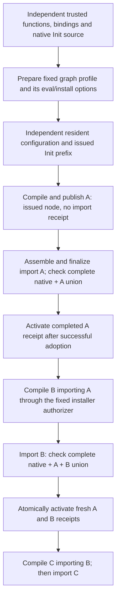

# Completed source graph imports

The optional resident runtime can publish initializer-free classic source modules
and reconstruct a checked import from their issued graph nodes. Publication and
completed import are separate operations. Publishing B after importing A does not
itself grant permission to reconstruct B's functions through `evalConst`.

The runtime uses the actual guest compiler through `resident-source` in normal
operation. Its staged integration tests model compiler serialization, post-check
publication and finalization; those tests do not establish that the real Lean
frontend has completed an A → B → C chain on this graph path.

## Protocol

The [resident graph implementation](../src/prototype/resident_init_prefix.clj)
owns these operations and their issued capabilities.

`prepare-source-graph-profile` must run before constructing the independent
resident configuration and prefix. Its `:eval-binding` and `:install-options`
share one completed-only authorizer. Both use the selected exact witness and
witness format. Installation requires deferred initialization. Readiness rejects
a missing or replaced authorizer before starting compilation.

`publish-source-graph-node` accepts an explicit captured request and ordered
issued parent nodes. It checks the actual guest header, parent receipts, current
checked union, source registration, unit/declaration/function correspondence and
owned ModuleData before issuing a node. Node descriptors and content digests are
descriptive data; copying them does not issue a capability. All selected source
units must have empty initialization actions.

`prepare-source-graph-import` accepts ordered nonempty roots, an explicit kernel
policy and execution budgets. It resolves their issued dependencies, validates
the exact source/prefix/profile lineage, checks the captured header and invokes
the pinned G1 graph assembler. It does not start the finalizer.

`advance-source-graph-import!` runs the finalizer in cooperative slices. The wall
slice applies between operations; it does not preempt a host checker call. Proof
helpers and finalizer execution share the aggregate attempt budget. A known
helper failure retains its exact charged steps; an unknown failure retains its
reservation and makes the operation terminal.
Java checking uses its separate kernel policy, and resident adoption uses
independent per-call fuel. Publication's aggregate budget likewise covers its
proof helpers; compilation and adoption retain separate per-call limits.

`finish-source-graph-import!` checks the complete selected union and verifies its
header, private view, module order and constant/extra-name attribution. Immutable
native projections may reuse the original exact source certificate. Local A/B
projections are fresh. All receipts share the complete fresh checked Java
Environment and anchor; each additionally records its node-local projection
subset. The new World replaces each selected node's latest receipt.

All candidate receipts share an initially false activation flag. The public
finish activates it only after checking, registry insertion, owner releases,
resident adoption, result construction and the common finish cleanup succeed.
A partially inserted batch can remain in diagnostic state without authorizing
any row. A successful control keeps a small exhausted tombstone; failed controls
retain their exact packets and cannot retry effects.

## Persistence and ownership

Compilation and imports accumulate in one World lineage. Retained input Contexts
remain unchanged and can keep their previous completed receipts. A new import
does not merge heaps from independently compiled branches. Parent compilation
requires receipts belonging to the current checked Environment, including the
exact local Java projections, rather than a receipt with matching names alone.

Logical owned regions retain their actual guest ModuleData and backing owners.
They are not native serialized `.olean` regions. Context closure does not close
borrowed native Stores. Failed operation packets are diagnostic alternatives,
not cleanup or resumption capabilities.

Replacing the latest per-node receipt does not remove previous kernel anchors
from the World. This change makes no claim that all previous Java Environment
containers have been reclaimed or that retained-memory costs are bounded by the
latest receipt count.

## Evidence and remaining work

The corrected staged chain gate passes three tests and 94 assertions. It covers
real JVM kernel admission of B, the actual frontend decoder/file installer
importing completed A, actual G1 assembly and complete Java union checks, public
A/B calls returning 41, repeated fresh local projections and retained old calls
on the reference, mutable and JVM backends. A reference-backend negative inserts
the first receipt before failing the batch, then checks public denial under the
same registry. Compiler serialization, post-check publication, finalizer,
header/index and witness helpers are explicit models in this gate.

A separate reference-backend public-lineage gate passes one test and 47
assertions. It rejects stale receipts after real kernel readmission, independently
issued sibling versions, foreign issued profile/prefix/Source/configuration
combinations and descriptive copies before compilation or import guest work.
The [validation record](../measurements/source-graph-runtime.json) identifies the
exact source pins and execution scopes.

The integrated optional suite passes 978 tests and 93,234 assertions with no
failures or errors. The first full run stopped at its 1152 MiB RSS ceiling before
a summary. A separately reviewed run with a 1280 MiB ceiling, unchanged 512 MiB
heap, deadline and free-memory guards passed in 216.45 seconds at 1,224,167,424
bytes peak combined RSS. Both outcomes remain in the validation record. These
are test-process measurements, not genuine frontend performance results.

Earlier failed gates are retained: diagnostic execution identified test metadata
stored in a custom World field that the mutable backend omits. The corrected
fixture owns bounded metadata inside its modeled Environment. Production runtime
checks were unchanged by that correction.

Genuine graph-chain frontend execution, shared-A diamond execution, type-only
nodes, edited siblings and project-level file loading remain separate acceptance
work. A second independent source leaf needs an explicit native-only preparation
operation: the current host import API requires nonempty roots, and G1 rejects
empty source parts. A general project loader also needs bounded public header
discovery, captured-text reuse and aggregate project budgets. Std/Lean/Mathlib
native prefix generalization, module-system imports and source initialization
are outside this fixed ordinary-Init profile.

The [native oracle](../measurements/source-graph-native-oracle.json) and
[rooted helper validation](../measurements/source-graph-module-roots.json) are
separate native evidence. The [sixth restore contract](RESTORE_CONSUMER_COMPATIBILITY.md)
authenticates selected runtime resources; it does not substitute for a fresh
whole-consumer capture, class attestation or genuine execution.
