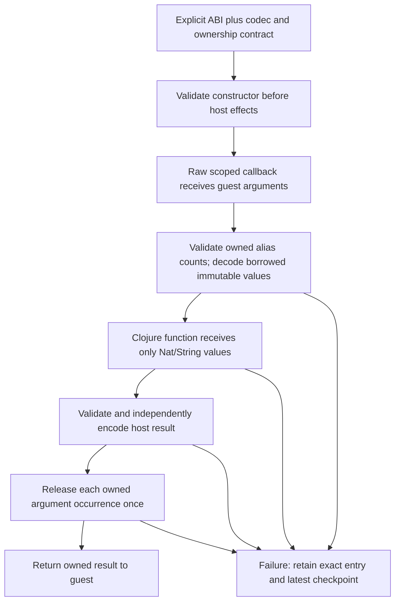

# Typed Nat/String host externs

`prototype.typed-extern/binding` builds an optional raw extern binding from an
explicit ABI, value codecs, argument ownership and trusted Clojure function. It
adapts values only: application admission remains the existing resident facade's
responsibility. No existing runtime, codec, prefix or import implementation is
changed by this namespace.

```clojure
(require '[prototype.typed-extern :as typed])

;; Use the exact type/borrow flags captured from the selected Lean extern IR.
(def add-one
  (typed/binding
    {:signature {:params [{:ty "object" :borrow false}]
                 :return-type "object"}
     :arguments [{:codec :nat :ownership :owned}]
     :result :nat
     :fn (fn [n] (inc' n))}))
```

The accepted specification keys are exactly `:signature`, `:arguments`, `:result`
and `:fn`. Each argument is exactly `{:codec :nat|:string :ownership
:owned|:borrowed}`. Ownership must match the explicit ABI's `:borrow` flag.
Parameter and result ABI types must be boxed `object`, `tobject` or `tagged`;
actual raw lowering subsequently requires an exact match to the selected Lean
extern declaration. Host function arity, semantic Lean types and ABI signatures
are not inferred from Clojure reflection. The explicit codecs are part of the
trusted host declaration contract; object IR alone cannot distinguish Nat from
String.

Only Nat and String are supported initially. The adapter rejects bytes, raw
Refs, closures, erased/world arguments, scalar unboxed ABIs, Option and IO codecs.
A Clojure exception aborts that guest invocation with retained diagnostics; it is
not converted into a Lean `IO.Error`. A future IO adapter needs an explicit world
parameter and correctly owned `IO.Result` construction.

## Genuine Project callback component, 2026-10-24

The [qualified hosted component run](HOSTED_COMPONENT_ACCEPTANCE_2026-10-24.md)
loaded actual Lean source and made four public calls through these value-only
bindings: two Nat and two String callbacks, with zero host callbacks during
compilation. It closed the four call children, both application Projects and four
owned Context wrappers. This is bidirectional value interop in the admitted
experimental profile, not typed IO or a general effect transaction. The same
session later failed in an unrelated chain harness; its whole-session receipt is
exit 1 and normal baseline shutdown did not complete. The
[portable record](../measurements/hosted-component-acceptance.json) separates those facts.

## Explicit application authority

The base checked native profile has no implicit application-symbol admission. Create a
new application branch explicitly after successful import preparation, retaining
the independently captured native preparation configuration:

```clojure
(def application-configuration
  (assoc independently-captured-native-configuration
    :application-extern-symbols #{"ansatz_app_add_one"}))

(def application-branch
  (resident/adopt-prepared
    (resident/snapshot completed-import-context)
    application-configuration))

(def configured
  (resident/with-externs application-branch
    {"ansatz_app_add_one" add-one}))
```

The original Context stays unchanged. Adoption revalidates the actual live
checked association, helper closures and original binding registry; this does
not rerun Init or infer authority from a serialized certificate. The original
configuration must come from trusted preparation, not a candidate snapshot
compared against itself. Adding the symbol allowlist is an explicit host policy
decision. `with-externs` then enforces that admission, rejects runtime/reserved
symbols and replacement of existing capabilities, and preserves the code cache,
function map and execution settings.

Compile the matching Lean extern and call it through the normal resident API.
The exact emitted extern ABI must match the adapter signature. The adapter runs
inside the current raw callback scope, preserving current frontend/kernel/module
state. It does not route calls through the older separate `prototype.interop`
session model.

The resulting application branch has additional live/protected bindings.
`with-externs` retains the original trusted preparation configuration internally;
subsequent explicit adoption or preparation must use a separately constructed
configuration that extends the original known registry with the exact admitted
application binding objects. Do not recapture arbitrary live bindings as their
own provenance.

Existing issued Init prefixes deliberately freeze their binding registry. They
do not authorize a later application extension: keep the original import branch
for further imports, and use the application branch for application execution.
A future application-enabled prefix can be prepared on a fresh branch with its
explicit application registry admitted and independently captured before prefix
issuance. It is a distinct profile, not a silent expansion of the old prefix.

## Value and owner flow



Decode borrows every input. The host function gets positional exact nonnegative
integers or immutable Java Strings, never the raw callback context, world or
guest Ref. It may retain those immutable host values. A heap-backed String's text
or MPZ's integer can be shared as an immutable host value without retaining its
guest header. Native immediate Nat words are converted contextually.

Result encoding happens before consuming inputs. Returning the same host value
as an argument encodes a new semantic result rather than transferring the original
input Ref. Current Nat/String encoding can share the immutable host integer or
String directly; there is no promise of fresh physical allocation or forced
copying. An owned input guest header may therefore be released while the
independently encoded immutable result remains valid.

Each `:owned` argument occurrence is discharged once, even if two positions hold
the same Ref. Two owned aliases require two owners; insufficient local RC is
rejected before the host function runs. Borrowed argument positions cause no
decrement of their own. An owned alias may consume the same header after all
arguments are decoded; borrowing creates no extra owner or promise that the
header survives return.
Persistent RC-zero and native Store-owned values follow the existing runtime's
no-op release rules. Encoding does not return an input Ref, so no accidental
borrowed-to-owned transfer or retain is needed for the result.

After encoding and after every successful owner release, the adapter publishes
its current immutable world through the actual scoped `:checkpoint!` callback.
The raw dispatcher supplies the canonical matching checkpoint/session on failure;
the adapter does not fabricate a session or overwrite a newer child packet.
Failure data additionally pairs `:typed-extern-checkpoint` with argument owner
stages, encoded result owner if available, entry packet, phase and original cause.
The binding itself is reusable; a failed invocation is terminal and never
implicitly re-executes the host function.

| Outcome | Input ownership | Result ownership |
| --- | --- | --- |
| Decode failure | Owned occurrences remain owned; borrowed inputs unchanged | No encoded result |
| Host function throws | Same; external host effects are not rolled back | No encoded result |
| Result validation/encoding fails | Same | Any completed result is retained if available |
| Input release fails | Recorded completed releases plus remaining owners, paired with latest world | Encoded result retained |
| Success | Owned occurrences released; borrowed positions cause no decrement | Transferred once to guest |

There is no finally-based cleanup. Failed packets are diagnostic alternatives,
not permission to splice worlds, retry effects or guess remaining releases.
Borrowed Source/Store lifetime stays external. Raw ownership references in failure
diagnostics are for host inspection, not values supplied to the typed function.

Bytes remain excluded. The current standalone byte codec validates/rebuilds an
immutable UInt8 vector; that does not establish a general deep-copy or borrowed
buffer lifetime contract for Java arrays, native buffers or future optimized
representations. Supporting those should choose explicit copying or an explicit
scoped borrowing capability first.

## Validation

Focused validation passes **11 tests / 221 assertions** on reference, mutable
and JVM backends. The complete experimental suite passes **889 tests / 90,066
assertions**. Both final jobs exited 0 under a 512 MiB heap and 1 GiB RSS guard;
the full suite took 176.35 seconds with 940,396,544 bytes peak group RSS.

Tests exercise actual raw transport, heap String/MPZ ownership, aliased RC1/RC2
and persistent inputs, malformed contracts, host/result failures, forged host
exception metadata, exact scoped child session preservation, reserved application
admission and shared cache/runtime binding identity. The public facade test uses
model compiler envelopes and coherently modified captured entrypoint IR, not
Lean's actual frontend. Independent Astra design/source/test/guide review found
no blocking issue.

The [validation record](../measurements/typed-extern-validation.json) retains
source hashes, guards, the complete suite driver and historical development
attempts. The [genuine callback record](../measurements/native-typed-extern-runtime.json)
now also passes: an ordinary `ResidentTypedC.lean` importing published A compiles
with zero diagnostics on an explicitly admitted application branch. Its actual
emitted extern ABIs match owned `tobject → tobject` for Nat and owned
`object → object` for String before any callback call. Lean wrappers invoke
Clojure callbacks for `41 → 42` and Unicode echo, once each. A separate Nat13
host exception runs once and retains canonical checkpoint/session and ownership
evidence. The original B Context remains unchanged and the borrowed Source stays
open; no initializers or cleanup run.

Hosted C loading took 45,673.835267 ms. The two positive calls together took
48.462143 ms, including controller checks. These are separate acceptance timings
in a retained warm process, not a native Lean comparison or per-call benchmark.

## Application-enabled prefix and Project composition

An application-enabled Project can use the existing APIs: adopt an independently
prepared Context with an explicit application-symbol allowlist, install the exact
binding objects with `with-externs`, then adopt again with a configuration formed
by extending the **original independent** registry with those same objects.
Prepare a **fresh** prefix using that configuration and the independently extended
original native registry. Do not authenticate a candidate by copying its live
registry, or reuse an older prefix whose registry excludes the application symbols.
Runtime/native initializer bindings and existing graph-profile objects remain exact.

`project-application-prefix-test` exercises this composition on a small verified
native Store across reference, mutable and JVM backends. Compiler envelopes and
Project stored-file state are explicit models; prefix preparation, adoption,
resident-issued FileHandles, typed extern lowering, callback execution and Project
invocation use the actual APIs. It checks exact independent binding identity,
old-prefix rejection, cache/parent preservation, reserved/replaced/mismatched
bindings, retained versions and a counted terminal host exception. This is neither
genuine frontend nor public Project source-loading acceptance.

Focused validation passed **35 tests / 1,074 assertions** across seven relevant
suites, including all four new composition tests. Fresh Java compilation and the
test JVM completed in 13.32 seconds with a 384 MiB test heap and
551,124,992-byte peak process-group RSS. All 345 input and 48 fresh class hashes
matched after disposal; both process groups were absent. The [validation
record](../measurements/project-application-prefix.json) retains exact source and
evidence hashes. No runtime implementation, application permission, prefix
contract or host-helper inventory was changed by these tests. Genuine Project
frontend/callback acceptance still needs its separately reviewed capture and
explicit host-helper admission; this model pass does not supply either.
