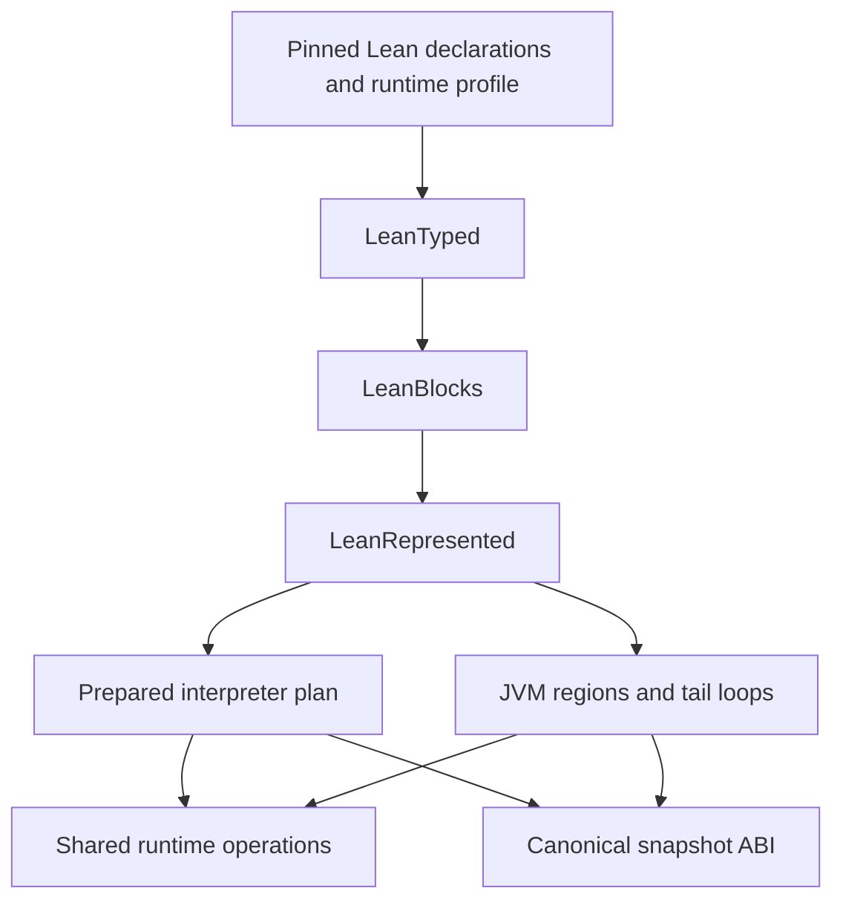

# Typed Lean IR lowering with Pattern

Draft compiler design for the experimental Ansatz Lean runtime. Preserve Lean's
typed and ownership information, lower it through explicit Pattern passes, and
derive both prepared interpreter operations and compiled JVM regions from it.
Canonical code and snapshots remain persistent; executable plans are disposable
derived objects.

The existing runtime has a persistent reference interpreter, a mutable register
interpreter, and a JVM region compiler that emits Clojure forms through `eval`.
A separate REPL prototype recognizes one internal scalar SUM loop and preserves
its exact fuel and snapshot behavior. The dialects and interfaces below describe
the proposed generalization. The accompanying
[executable fragment](typed-ir-pattern-example.clj) covers one typed instruction;
it is not the complete compiler.

## Pipeline and responsibilities



| Language | Retained information | Purpose |
| --- | --- | --- |
| `LeanTyped` | Source names, typed parameters and results, borrow flags, typed bindings and joins, constructor layouts, RC flags, instruction identity | Faithful semantic input |
| `LeanBlocks` | Typed blocks and arguments, explicit calls and effects, lexical join context, source positions | Control flow and dataflow analysis |
| `LeanRepresented` | Logical types plus physical representations, guards, runtime dependencies and state reconstruction maps | Interpreter preparation and JVM emission |
| Executable plan | Resolved operations, register layouts, call targets and compiled methods | Execution without repeated decoding |

Pattern transformations run during preparation and compilation, never once per
executed instruction. Graph analysis supplies dominance, liveness and recursive
call groups; Pattern rules express local rewrites and lowering between languages.
Generic tree walkers must not recursively follow block or function IDs.

## Lean input and supported phase

The initial producer is pinned to Lean
`819816b2e0a3bf405af45ae5c7af2491d8f5bee6`. Its
[IR definitions](https://github.com/leanprover/lean4/blob/819816b2e0a3bf405af45ae5c7af2491d8f5bee6/src/Lean/Compiler/IR/Basic.lean)
contain 14 type constructors, 13 expression forms and 13 body forms.

The first execution profile accepts the expanded RC form. Lean's standard
[impure passes](https://github.com/leanprover/lean4/blob/819816b2e0a3bf405af45ae5c7af2491d8f5bee6/src/Lean/Compiler/LCNF/Passes.lean)
include borrowing inference, explicit boxing and RC, reset/reuse expansion and RC
coalescing. Validation must check the actual admitted form; a commit identifier
alone does not establish its compiler phase.

| Input family | Initial treatment |
| --- | --- |
| Scalar, object, tagged, erased and void types | Retain exact logical type |
| `struct` and `union` | Explicitly reject until their aggregate ABI is implemented |
| Constructor allocation, projections, boxing, literals and uniqueness | Retain typed operation and layout |
| Full, partial and closure application | Retain distinct application kind and signature |
| Raw `reset` and `reuse` | Reject in the expanded profile; never silently drop them |
| Bindings, joins, jumps, cases and returns | Retain types, lexical scope and stable instruction identity |
| Field/scalar/tag stores, inc, dec and del | Explicit ownership operations |
| Unreachable | Explicit trap |

No new inference pass should reconstruct types that the producer already supplied.
The current importer drops most local and join types and ordinary parameter borrow
flags; the first implementation change is to retain them. Existing extern signature
validation already checks types and borrowing and should supply this contract.

An IR type is not a dependent Lean source type. In particular, Int64 and UInt64
operations can share the IR carrier `uint64`. Signedness and arithmetic behavior
come from the operation's semantic contract. An `object` or `tobject` parameter
does not establish that its value is a Nat; that requires an operation contract
or other validated information.

## Persistent data and identity

Canonical nodes use persistent data. Names are immutable Lean names, and variable,
join, block and instruction IDs are scoped to their declaration or code image.
Logical information belongs in explicit fields, not only Clojure metadata.

During migration, the typed representation can be a companion to the current
normalized instruction image. It must be bound to that exact image and producer
profile. Existing World snapshots keep their current body, local and frame
representation; reconstruction maps translate typed positions back into it.

The following is a proposed `LeanBlocks` shape, not an existing public API:

```clojure
{:name ["str" ["anonymous"] "twice"]
 :params [{:id 0 :type :uint64 :borrow? false}]
 :result-type :uint64
 :entry 0
 :blocks
 {0 {:params []
     :ops [[:at 0
            [:bind 3 :uint64
             [:intrinsic :uint64/add [[:var 0] [:var 0]]]]]]
     :term [:at 1 [:return [:var 3]]]}}}
```

Function parameters are defined at entry. Block parameters define values at join
entries. A separate origin table connects each `:at` position to its reference
instruction and any required call/continuation context. Types and origin mappings
that affect execution or reconstruction participate in plan identity.

## Pass contracts

| Pass | Transformation | Required semantic checks |
| --- | --- | --- |
| Admit input | Producer declarations to `LeanTyped` | Supported phase/types, well-scoped variables, signatures, layouts and borrow flags |
| Resolve operations | Known runtime operations to semantic intrinsics | Exact extern identity, ABI and implementation dependency; unknown operations remain calls |
| Form blocks | Typed bodies and lexical joins to `LeanBlocks` | Dominance, block arity, lexical captures and parallel argument transfer |
| Select representations | `LeanBlocks` to `LeanRepresented` | Logical type preserved; range/tag guards and exact slow paths available |
| Prepare execution | Represented operations to interpreter plans | Resolve static operands and calls once; retain reference positions |
| Form compiled regions | Hot blocks and tail groups to regions | Bounded emission, supported effects, fuel accounting and complete reconstruction |
| Emit JVM code | Regions to Clojure forms initially | Correct primitive operations, call ABI, guards and exit behavior |

Each pass validates its input and output. Pattern dialect validation checks
structure. Separate validators check typing, scope, effects, ownership and
reconstruction completeness. A dialect arrow does not prove semantic equivalence.

## Pattern dialects and rules

Use `def-dialect` for a language, `def-derived` when changing only selected forms,
and `defpass` with rule functions for compiler transitions. Ordinary Pattern rules
can implement an individual lowering within a pass. Side tables hold analyses;
rules consume their results instead of independently rediscovering them.

The executable fragment defines source and target dialects for this transition:

```clojure
;; Typed operation inside a block
[:bind 3 :uint64
 [:intrinsic :uint64/add [[:var 0] [:var 1]]]]

;; Representation selected; logical UInt64 remains explicit
[:bind 3 [:repr :uint64 :long-bits]
 [:jvm-op :ladd-wrap [[:var 0] [:var 1]]]]
```

The source validator requires variables 0 and 1 to be defined UInt64 values.
Logical-type validation and a separate representation environment require the
target inputs to use long-bit lanes. They reject undefined variables, incompatible
types and missing or incompatible representations even when the Pattern grammar
accepts the structural shape.

`:ladd-wrap` is an internal semantic operation, not an instruction to call generic
Clojure `+`. Its emitter must produce wrapping 64-bit addition. Exact positive
UInt64 values at interpreter and interop boundaries are converted to and from the
signed JVM bit pattern by typed adapters.

The fragment runs in an experiment REPL with Pattern available. Its optional
dependency can be pinned to the fork without adding LLVM:

```clojure
{org.replikativ/pattern
 {:git/url "https://github.com/replikativ/pattern"
  :git/sha "6d0242ee589d88b336f7dd6f820efa993d2b6f3b"}}
```

From the Ansatz repository root, with `experiments/lean-ir/src` on the classpath:

```clojure
(load-file "experiments/lean-ir/research/typed-ir-pattern-example.clj")
(typed-ir-pattern-design-example/verify!)
```

The example includes unsigned boundary comparisons against the existing runtime
primitive. It exercises a transformation contract; it emits no JVM method and
does not establish native Lean equivalence independently.
The [recorded checks](typed-ir-pattern-example-results.edn) cover 64 boundary
pairs and ten structural, logical, representation and input-stage rejections.

A rewrite changes an operation payload while preserving its instruction ID,
origin and analysis dependencies. A pass that deletes, duplicates or combines
instructions must explicitly replace the affected reconstruction information.

## Runtime operation contracts

Extend the existing runtime ABI and signature inventory with semantic descriptors.
Each descriptor names:

- Operand and result types, argument positions and borrow/ownership transfer.
- Allocation, mutation, resource release, external effects and failure behavior.
- Interpretation implementation and any guarded JVM specialization.
- Required capabilities, snapshot representation and code dependencies.
- Reference instruction boundaries and observable counter effects.

The registry distinguishes value purity from execution effects. An arithmetic
operation may allocate a large integer; a release may invoke resource behavior;
allocation identity and uniqueness may be observed. Optimization must preserve the
declared behavior rather than infer purity from an operation's name.

Start by specializing a runtime expression inside its existing extern wrapper.
Inlining an entire guest call is a later transformation: call entry, callee work
and return can represent several reference steps and change `:max-frames`.
Replacing them with one primitive must still reconstruct every permitted pause
and account for logical frame depth.

## Control flow and JVM execution

Join arguments are evaluated using the old environment before any destination is
written. Closure-convert lexical join context into explicit block arguments where
needed. Prepared jumps use resolved slots; compiled jumps use JVM control flow.

Compile a supported tail-recursive group as a loop with explicit control state and
primitive or reference locals. Ordinary calls retain explicit guest continuations
unless an optimization supplies reconstruction for the frames it removes.
Arbitrary guest recursion must not depend on the native JVM stack.

Prepared interpreter operations and compiled regions use the same logical value
and runtime contracts. They need not use identical physical representations.
Executable plans contain code and static layout facts, never a mutable Machine,
register array, heap, capability owner or borrowed Source.

## Fuel and state reconstruction

A region records how to recover the current reference body, locals, captured joins,
frames, status, pending host request and observable counters. Reconstruction also
preserves the entire canonical World: heap/global roots, next allocation ID,
ordered events, entropy, heartbeat/task state and other runtime context, together
with the ownership of changed storage. Physical allocation elimination cannot
skip or reuse logical allocation identities required by that state contract.

Compiler liveness and snapshot observability differ. A register dead for future
execution may still be present in the reference snapshot at the current
instruction. Reconstruction must recover all reference-visible local bindings
and captured join values, including those dead temporaries. A smaller snapshot
contract would require a separate explicit design change.

The SUM experiment fuses complete five-step iterations. If seven fuel units remain,
it executes one iteration, publishes five steps, reconstructs the next function
entry and lets the interpreter execute the remaining two steps. The terminal
three-step path remains interpreted. This is one valid policy, not a requirement
that all regions have fixed cost.

A general region can use bounded chunks or explicit checkpoints. If it cannot
finish a chunk within the remaining fuel, it exits before that chunk. Failed
guards exit before effects. An exception after effects must expose the correct
reference prefix; it cannot restart the region and repeat work.

Instruction fuel and allocation heartbeats are separate. The current hosted
heartbeat profile charges logical guest allocations, not JVM allocations.
Physical allocation elimination must retain charges required by that profile.

## Ownership and values

Keep Lean RC/borrowing, branch storage ownership and JVM GC reachability separate.
RC=1 does not authorize mutation of storage shared with a saved snapshot.
On first mutation, a machine acquires private node storage; subsequent RC/tag
updates can use private headers. Freezing publishes immutable changed nodes.
Imported RC0 Source nodes remain immutable.

Representations should be selected per logical type. Machine integers can occupy
primitive lanes; Nat and Int require exact large-integer fallbacks; object and
tagged unions require typed carriers or guarded lanes. Erased and void positions
remain explicit in the canonical ABI, even when a fast-call adapter omits them.
Float storage and transport must retain the existing bit-preservation contract.

Java/Clojure interop uses typed boundary adapters. Guest IDs are not native Lean
pointers. Optional native bindings need a separate marshalling/handle and lifetime
contract. JVM GC alone does not collect cycles retained by an explicit guest heap.

## Code reuse and REPL changes

A compiled artifact is bound to its typed code image, runtime ABI/intrinsic
generation, representation choices, target and relevant compiler options.
Inlining a callee adds that callee's semantic identity as a dependency.
The current fingerprint deliberately ignores Clojure metadata; typed compilation
must add explicit identity inputs rather than silently reuse its old key contract.

Old snapshots retain their code image. New definitions obtain new plans while
unaffected code may be reused. Dynamic host bindings remain live or have guards
that invalidate the specialization at a supported execution boundary. Optimization
caches are bounded or owned by a program; they do not confer execution authority.

## Implementation sequence and acceptance

1. Retain producer type/borrow/result information and add validators and identity
   inputs. Adapt to the current interpreter without changing its snapshot ABI.
2. Implement block formation and prepared fixed-arity transfers. Validate loops,
   lexical joins and simultaneous assignments.
3. Generalize the SUM loop emitter to typed blocks and tail groups.
4. Compile actual imported UInt64/USize programs, then Nat programs with promotion.
5. Add constructor and array operations with branch ownership and resource tests.

For each stage, compare native Lean value/ABI behavior, complete reference
interpreter states and optimized execution. Test every fuel prefix for small
programs, resume partitions, saved parents/siblings, code edits, wrong guards,
overflow/promotion, traps and resource effects. Measure preparation, compilation,
run time, allocation and snapshot publication separately in a reused REPL.

The main remaining decisions are the exact typed data encoding, how much join
context to make explicit, and the representation/carrier ABI for general object
values. The initial fragment and its validators can evolve while preserving the
pass contracts above.

## Sources

- [Pinned Lean IR types and instructions](https://github.com/leanprover/lean4/blob/819816b2e0a3bf405af45ae5c7af2491d8f5bee6/src/Lean/Compiler/IR/Basic.lean)
- [Pinned compiler pass order](https://github.com/leanprover/lean4/blob/819816b2e0a3bf405af45ae5c7af2491d8f5bee6/src/Lean/Compiler/LCNF/Passes.lean)
- [Current importer](../src/prototype/import_ir.clj), [mutable machine](../src/prototype/mutable.clj),
  [runtime ABI](../src/prototype/runtime_abi.clj), [fingerprint](../src/prototype/fingerprint.clj)
- [Pattern nanopass source](https://github.com/replikativ/pattern/tree/6d0242ee589d88b336f7dd6f820efa993d2b6f3b/src/pattern/nanopass)
- [Raster dialects](https://github.com/replikativ/raster/blob/aa65dea8ce58cedf83d7783961d402ce5ff7ef7f/src/raster/compiler/ir/dialects.clj)

Raster is guidance for dialect boundaries, effects and typed emission. LLVM is an
optional future target; this design does not require it.
