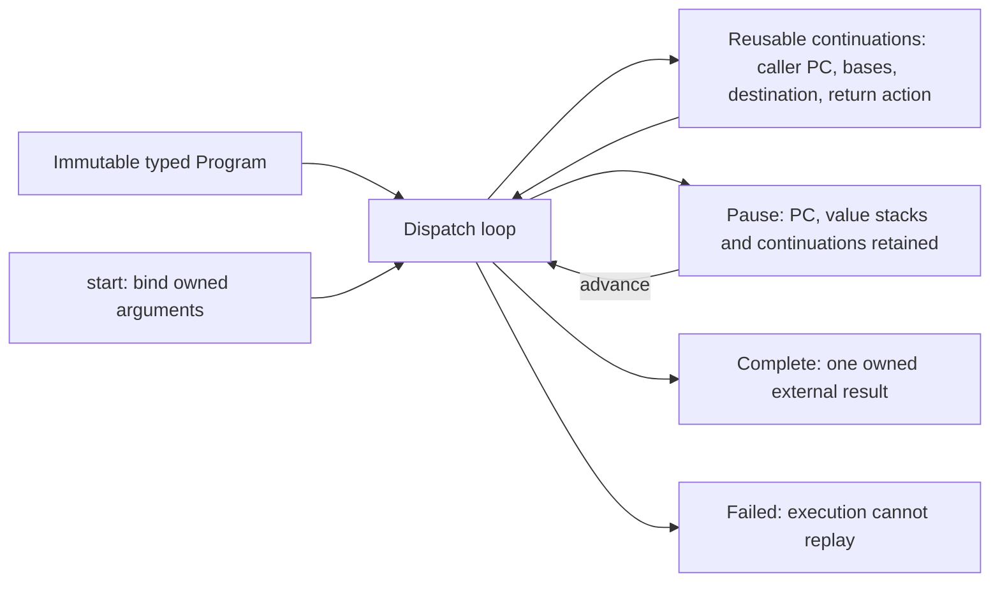

# Explicit continuations over the Java baseline

The recursive baseline remains the default and the control. The optional
two-argument constructor `Interpreter(program, true)` selects an explicit guest
call stack over the same prepared Program, Node representation and RC operations.
This is a research execution mode, not a new facade backend or heap snapshot API.

## Why the earlier modes stayed close in performance

The old mutable interpreter and generic compiler share the same costly execution
ABI. A guest reference resolves through a heap map; an RC update rebuilds node
metadata. Joins capture/restore register arrays. Generic operations decode source
vectors, build argument containers and repeatedly classify/check helper routes.
Compiling control flow leaves much of that shared work intact.

The Java port instead prepares code facts once, uses direct mutable node headers,
primitive scalar slots, reusable stack storage and lexical join targets. Matching
14,896 guest allocations and 32,752 field stores at RBMap1000 while reducing host
allocation from roughly 119 MB to 1.5 MB is strong evidence of representation cost.
It does not isolate a percentage for each change or establish a fundamental
Clojure language limitation. A matched Clojure implementation of these storage
choices has not been measured. The previous path also materializes a final World;
earlier probes found that boundary a small part of bulk RBMap allocation.

The old engines remain useful semantic and compatibility references. The new
engine does not make raw equality of dead/debug registers its execution ABI.

## State and return actions

Each continuation retains the caller function, return body/destination, previous
object/primitive/join stack bases and the necessary completion action:

| Action | Return behavior |
| --- | --- |
| Ordinary call | Restore caller and assign the callee's result lane |
| Cold nullary load | Publish cache ownership, then return a borrowed value |
| Closure application | Box scalar results where required; apply parked surplus once |
| External root | Publish completion and transfer one owned result |

Root completion and cold-cache completion compose. Nullary external roots acquire
the additional owned result reference; internal loads do not. Application surplus
already carries transferred argument ownership. Parking or clearing a continuation
does not add guest retains/decrements. Closure preparation executes once before
entering a callee, so pausing never replays its ownership changes.

Continuation records are reused by depth. Popped host reference fields are cleared.
Return values are saved before callee slots are cleared. Ordinary guest calls and
multi-stage overapplication use no recursive Java guest call frames. The existing
self-tail argument scratch transfer remains intact. Runtime helpers such as graph
destruction and preparation still have their own recursion limits.

## Pause and ownership contract

`start(function, args)` validates arity, scalar ranges and direct node/image
arguments, then binds a trusted typed external invocation.
`advance(budget)` executes at most that many body dispatches and returns whether
the invocation is complete. `takeResult()` transfers the completed owned result
exactly once. Starting another invocation requires the previous result to be taken
or the engine to be closed.

The Clojure REPL adapter exposes `start!`, `advance!`, `take-result!`, `phase`,
`depth`, `instructions` and `active`. It returns to Clojure between advances even
when guest calls are nested. No Java guest activation remains suspended there.

The new body-dispatch budget is **not** the legacy World fuel ABI:

- A calling VDECL consumes its instruction before entering the callee.
- Native intrinsics are atomic within that instruction.
- RET and administrative return/cache/application restoration complete together.
- Self-tail elimination consumes its VDECL and creates no deferred RET activation.
- Binding an external root and warm nullary completion execute no body instruction.
- Zero budget leaves running state unchanged; the failed attempted instruction is
  charged. Negative budgets reject. Budgets are not wall-time or memory quotas.

Phases are idle, running, complete and failed. A runtime failure poisons execution:
there is no resume, replay or result retrieval. Close rejects running/failed
executions because general ownership cleanup is not implemented. A paused run can
be resumed to completion and then closed. Closing a completed run releases an
unclaimed owned result before dropping cache ownership; a taken result remains the
caller's responsibility. This is not yet a managed cancellation API.

The heap stays mutable. Copying these control arrays would not isolate node RC,
fields or caches, so the experiment deliberately exposes no heap fork, control
restore or rewind. Branch-local storage and cleanup are the next separate step.

## Verification and reproduction

The isolated-jar runner executes the baseline suite in both modes, then the
continuation suite: 26 test executions and 1,331 assertions. This includes all
81 MCMC data declarations cold/warm and RBMap tree/result/guest-counter parity.
Additional tests cover every budget prefix through nested cold/warm object and
scalar caches, underapplication, scalar-returning closures, multi-stage surplus
application, zero budgets, result ownership, failure/lifecycle rules, intrinsic
entries/applications and 20,000 non-tail calls. Exported RBMap also resumes through
varied instruction slices, including single-step runs.

Use the compilation and jar-check commands in [README.md](README.md).
`benchmark-runner.clj` now alternates both modes over the same prepared Program
with separate warmed engines. Preparation remains outside timed batches.

Performance evidence and rejected/control probes belong in the accompanying
measurement receipt. Fresh C2 runs showed significant compiler-history sensitivity;
diagnostic logging itself changed observed timings. A local dispatch cursor did
not establish a speedup. Keep exact method/source revisions and report CPU and wall
separately; allocation equality alone does not establish equal throughput.

The retained loop separates lifecycle/failure handling from dispatch and keeps a
local cursor, publishing the attempted instruction for errors and the next PC at
pause. Two final ordinary C2 processes measured RBMap1000 recursive/explicit CPU
medians of 4.012/4.627 ms and 4.855/6.202 ms: roughly 15–28% extra CPU. Both modes
allocated 1.516 MB per run after warming their storage. Earlier driver versions
had 7.5–9.3 ms explicit CPU samples, while an instrumented unchanged version had
4.5 ms; these controls do not isolate one causal compiler optimization.

This is an opt-in control-stack experiment. Retain the recursive mode as the
performance control; do not infer full-image throughput or fork cost from it.
The final default JVMCI process measured recursive/explicit CPU at 2.898/3.625 ms
and wall at 2.911/3.634 ms, with the same 1.516 MB allocation. Raw samples and the
initial negative controls are in
[java-ir-continuations.edn](../../measurements/java-ir-continuations.edn).
