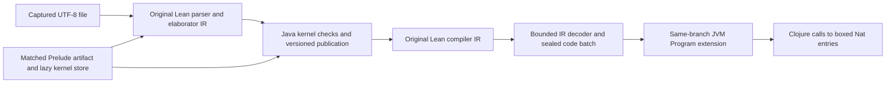

# Artifact-relative frontend research definitions

This package preserves the checked frontend and execution units from the retained REPL experiment
as tracked sources. It is a research package, not a standalone boot command or a
shipped project-loading API. Existing namespaces and opaque token registries are
preserved. `migration.json` records the reviewed source hashes and intentional
mechanical differences; generated artifacts and runtime receipts stay external.

The package contains the original finalizer lineage controller, byte-authenticated
Prelude ModuleData capability, guarded lazy Java base, artifact declaration
request authority, v4 strict declaration adapter and driver, borrowed IR node
decoder, sequential frontend probe, option proof, generated-code controller,
bounded filesystem session, and focused models. The executable corpus is
[HostedIdentities.lean](../../../lean/HostedIdentities.lean). Its two definitions
are elaborated, strictly checked, compiled and executed by the JVM-hosted Lean
frontend; loading this file does not launch the native Lean frontend.



The fixed source profile accepts the literal Prelude header followed by 1–16
independent unary Nat identity definitions. Successful execution of two definitions
and EOF is the current measured corpus, not evidence of general Lean-project
compatibility. Ordinary implicit `Init`, cross-file source imports, arbitrary
declaration/code profiles, IO programs and a public library API remain separate work.
The parser bound does not enlarge the prepared branch's explicit execution or
command budgets; the measured branch permits two definitions and EOF.

## Explicit load order

From `experiments/lean-ir`, first load the existing Java baseline and its catalogue,
kernel projection, source setup, composite-source-v4 and ModuleData graph helpers
using the parent research directory's explicit load convention. The prototype
Clojure sources and matching compiled Java classes must already be on the REPL
classpath. Then:

```clojure
(load-file "research/java-ir-baseline/artifact-frontend/loader.clj")
(ansatz.research.ir.artifact-frontend-loader/load!)
```

Loading defines functions and registries only. It does not resolve artifacts,
construct a Source/engine, call the guest, import a heap/store or authorize a native
operation. The loader rejects existing package namespaces before loading any unit:
never redefine deftypes or private registries under a live Run/ModuleLease/Base.
For a retained REPL with old namespaces already loaded, compare source/provenance
and validate the changed helper integration separately rather than invoking this
loader over the live session.

## External admission remains required

The caller must supply independently hash-checked inputs for the pinned Lean
`819816b2e0a3bf405af45ae5c7af2491d8f5bee6` source, accepted original code catalogue
and explicitly authorized source overlays, 534-global runtime companion, matched
Prelude paired artifacts, format-2 kernel store and live resource lease, compiled
layout/bridge receipts, actual original finalizer execution and native/host/export
policies. The fixed module's valid legacy source header is:

```lean
prelude
import Init.Prelude
```

Requested import flags are `[false,true,false]`; pinned Lean's private import
loading yields effective `[true,false,false]`. A genuine parser/header witness
must agree. Stored declarations, matching shapes, source hashes and module data
alone do not establish strict proof replay, guest environment association, finalized
lineage, generated IR authority or executable project loading. Runtime owners and
source/store leases must remain alive through explicit resumable cleanup.

## Authenticated demand injection

`ansatz.research.ir.authenticated-demand/attach` returns the actual driver with
explicit `:resolve-row!` and `:check-source!` policies. The resolver receives that
driver and exact typed Name, authenticates bounded raw original bytes/SHA/Name
against its accepted source and authorized overlays, and returns `:row`, `:sha256`
and `:source-binding` (the actual SourceBinding). The source guard enforces the
actual live source/receipt/resource authority on every lookup, including memo hits.
These callbacks are trusted adapter policy, not booleans supplied as evidence.
The helper itself does no selected-overlay discovery and reads no implicit target
paths. Existing admitted resolver logic can be wrapped explicitly:

```clojure
;; authenticated-resolve! and check-live-source! belong to the caller's
;; already admitted source policy; this package does not invent them.
(def demand-driver
  (ansatz.research.ir.authenticated-demand/attach actual-driver
    {:resolve-row! authenticated-resolve! :check-source! check-live-source!}))
```

The sequential probe preserves its `host-helper` call facade but dispatches only
to these namespaced functions, with no ambient `user` Vars. Header memo reuse
checks actual SourceBinding, CAS SHA, typed Name, full immutable raw declaration
(including extern entries/info) and evidence metadata. Body materialization uses
the existing actual CodeRequest and engine lineage checks. CodeRequest pause/resume
uses explicit mode; synchronous mode rejects this start API. This is code demand,
not permission to implement an extern or execute a hidden callback.

## Verification and limits

Load existing baseline, array and pointer check definitions, then call
`load-models!`. Each model namespace exposes `check!`; demand and node decoder checks take the
caller's actual compiled `basis` argument. Decoder checks use the existing
`fixtures/` directory when run from `experiments/lean-ir`. Model definitions do not execute tests on load.
They cover actual tiny explicit-mode Header/CodeRequest demand, synchronous
start rejection and memo rejection, issuance
refusals, lifecycle/owner transitions, base/domain/CI identity,
strict local branch checking and bounded borrowed decoding. Model capability
stubs grant no real source/Run/Module/Base or guest association authority.

Before integration, run all copied focused checks against the current compiled
Java basis, plus the actual retained source route through valid header parsing,
original finalization, strict checking, IR sealing/linking, JVM invocation, EOF
and complete owner retirement. The initial mechanical copy was source-only; the
coordinated tracked-source acceptance is recorded below. Loading definitions does
not replay that acceptance or provide a fresh standalone boot. Website
build/browser suites are unrelated to these research sources and were not run.

## Retained file workflow

After the trusted host has prepared the authenticated runtime, original import
finalizer, matched lazy base and strict adapter, supply their actual branch as
`prepared-branch`. The host owns the complete branch disposal hook; it must release
the frontend, all checked versions, finalizer and module owners before disposing
the engine. No host map substitutes for those capabilities.

```clojure
(def capture
  (filesystem-nat-source-profile-v2/capture-source!
    (prototype.project-source/provider ["lean"] 16384) ["HostedIdentities"]))
;; Prepare using (:text capture), (str (:path capture)), and (:module capture).
;; setup-prelude!'s fifth argument sets the real module through original helpers.
(def file
  (filesystem-nat-file-run-v1/open-file! prepared-branch capture
    {:layout-directory compiled-layout-directory :close-branch! dispose-branch!}))
(filesystem-nat-file-run-v1/load! file)
(filesystem-nat-file-run-v1/invoke-nat! file "hostedFirst" 42)
(filesystem-nat-file-run-v1/invoke-nat! file "hostedSecond"
  (java.math.BigInteger. "18446744073709551616"))
(filesystem-nat-file-run-v1/close! file)
```

Compilation uses the captured immutable text rather than reopening the source.
Each command authenticates the actual InputContext, FileMap, scope/options, main
module and original compiler callback, then owns the real command invocation,
strict publication, compiler diagnostics and IR readback. A batch must contain the
exact supported code and both executable entries before it can link. EOF is its
own authenticated transaction: it must preserve the checked version and IR map,
report no errors and return the genuine terminal result.

Mutable frontend references are inspected at stable boundaries. Native Lean's
`ST.Ref.take` deliberately empties a reference while a guest frame owns its value;
instruction-tick guards check live reference shells and protected immutable roots
without trying to read that transient value. This follows pinned
`src/runtime/io.cpp` lines 1477–1489 and the Java `REF_TAKE` implementation.

Only completed files can invoke their checked Nat entries. Invocation preserves
the exact linked Program/version, rejects negative or unsupported host carriers,
and accepts only final `Long` or exact-class `BigInteger` Nat values. Failed work
stays terminal with its actual pending owner packet available through
`owner-packet`; no failed unwind or retry is inferred. Active checked-session
forking is not implemented. The current seed fork precedes import and association.

## Measured acceptance and next scope

The tracked-source repeat used a retained 384 MiB JVM. The two-definition load,
including authenticated EOF and transaction retirement, took 10.961 seconds.
Transactions through sealing/linking took 5.949 s and 4.613 s; EOF took 0.362 s.
Their individual timings end before command-owner retirement, which is included
in the whole-load time. These are warm, small-corpus observations, not throughput
or native-parity benchmarks. Both entries returned `0`, `42` and `2^64` correctly;
the seed had no generated entries, and complete disposal released 14 extra owner
occurrences plus 534 runtime roots. The earlier 10.195-second repeat used the
equivalent target prototype rather than the tracked demand-injection facade.

The focused checks passed 49 tests and 277 assertions, including actual tiny
Header/CodeRequest and decoder tests plus explicitly modeled authority/ownership
checks. [acceptance.json](acceptance.json) pins the source inventory, runtime and
artifact inputs, corpus and external evidence digests. It is a recorded experiment,
not an issuance token or a standalone boot recipe. `migration.json` preserves the
older lower-unit migration record; it does not cover the newer leaves.

The library suite ran 1,337 tests and 11,488 assertions with no assertion failures;
five localhost-server tests were blocked by sandbox socket permissions. Their
complete namespace passed separately with socket access: seven tests, 56 assertions.
The full Mathlib-using library suite ran with a 1,536 MiB test heap; its initial
384 MiB attempt exhausted memory. Both hosted frontend repeats and the focused
checks used the retained 384 MiB interpreter JVM.

Continue by broadening checked declaration and generated-IR profiles to arithmetic,
calls and data structures; composing source modules through real ModuleData
export/import and checked associations; then supporting ordinary implicit `Init`
and a small project corpus. The earlier `prototype.project-loader` is a separate
World/NativeBase implementation and cannot directly replace these Java capabilities.
Larger runtime artifacts and bootstrap installation still need a reproducible,
explicitly supplied artifact path. LLVM is not required for this execution route.
# Versioned arithmetic extension (not yet runtime accepted)

`filesystem-nat-file-run-v1/open-arithmetic-file!` opts into the finite v3 source
profile. It accepts the old identity lines and `x + 1` / `Nat.add x 1` bodies,
with the same exact Prelude header, capture-once bytes, 1–16 command bound and EOF
transaction. Default `open-file!`, `parse-profile` and old identity acceptance
remain unchanged. Source hooks independently bind each actual command's operation.

The add-one controller requires this strictly published safe unary Nat definition,
the actual original compiler's two-row borrowed-root/owned-wrapper shape, and the
authenticated pinned current `Nat.add` native. It adds no initializer, ready global,
host specification or alias. Linking rechecks its exact dependency Header and uses
the same actual version/branch/Program custody. Generated code stays on the child.
Invocation checks the immutable Nat carrier and the selected operation's result.

`nat-arithmetic-v3.json` records bounded source deltas against the untouched v25
`acceptance.json`; it does **not** extend that earlier runtime result to arithmetic.
Six new model families cover source, original IR shape and result-domain gates.
The copied native export is an offline shape fixture, never an issued CodeBatch.
The parent ran the six structural model families in its coordinated retained REPL:
6 tests / 63 assertions passed. No worker JVM/native execution or fresh filesystem
arithmetic acceptance has run. The parent must still run fresh checked
compile/link/invoke/EOF/retirement.
