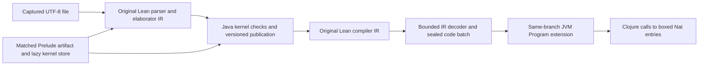

# Artifact-relative frontend research definitions

This package preserves the checked frontend and execution units from the retained REPL experiment
as tracked sources. It is a research package, not a standalone boot command or a
shipped project-loading API. Existing namespaces and opaque token registries are
preserved. `migration.json` records the reviewed source hashes and intentional
mechanical differences; generated artifacts and runtime receipts stay external.

The package contains the original finalizer lineage controller, byte-authenticated
Prelude ModuleData capability, guarded lazy Java base, artifact declaration
request authority, v4 strict declaration adapter and driver, borrowed IR node
decoder, sequential frontend probe, option proof, generated-code controller,
bounded filesystem session, and focused models. The executable corpus is
[HostedIdentities.lean](../../../lean/HostedIdentities.lean). Its two definitions
are elaborated, strictly checked, compiled and executed by the JVM-hosted Lean
frontend; loading this file does not launch the native Lean frontend.



The fixed source profile accepts the literal Prelude header followed by 1–16
independent unary Nat identity definitions. Successful execution of two definitions
and EOF is the current measured corpus, not evidence of general Lean-project
compatibility. Ordinary implicit `Init`, cross-file source imports, arbitrary
declaration/code profiles, IO programs and a public library API remain separate work.
The parser bound does not enlarge the prepared branch's explicit execution or
command budgets; the measured branch permits two definitions and EOF.

## Explicit load order

From `experiments/lean-ir`, first load the existing Java baseline and its catalogue,
kernel projection, source setup, composite-source-v4 and ModuleData graph helpers
using the parent research directory's explicit load convention. The prototype
Clojure sources and matching compiled Java classes must already be on the REPL
classpath. Then:

```clojure
(load-file "research/java-ir-baseline/artifact-frontend/loader.clj")
(ansatz.research.ir.artifact-frontend-loader/load!)
```

Loading defines functions and registries only. It does not resolve artifacts,
construct a Source/engine, call the guest, import a heap/store or authorize a native
operation. The loader rejects existing package namespaces before loading any unit:
never redefine deftypes or private registries under a live Run/ModuleLease/Base.
For a retained REPL with old namespaces already loaded, compare source/provenance
and validate the changed helper integration separately rather than invoking this
loader over the live session.

## External admission remains required

The caller must supply independently hash-checked inputs for the pinned Lean
`819816b2e0a3bf405af45ae5c7af2491d8f5bee6` source, accepted original code catalogue
and explicitly authorized source overlays, 534-global runtime companion, matched
Prelude paired artifacts, format-2 kernel store and live resource lease, compiled
layout/bridge receipts, actual original finalizer execution and native/host/export
policies. The fixed module's valid legacy source header is:

```lean
prelude
import Init.Prelude
```

Requested import flags are `[false,true,false]`; pinned Lean's private import
loading yields effective `[true,false,false]`. A genuine parser/header witness
must agree. Stored declarations, matching shapes, source hashes and module data
alone do not establish strict proof replay, guest environment association, finalized
lineage, generated IR authority or executable project loading. Runtime owners and
source/store leases must remain alive through explicit resumable cleanup.

## Authenticated demand injection

`ansatz.research.ir.authenticated-demand/attach` returns the actual driver with
explicit `:resolve-row!` and `:check-source!` policies. The resolver receives that
driver and exact typed Name, authenticates bounded raw original bytes/SHA/Name
against its accepted source and authorized overlays, and returns `:row`, `:sha256`
and `:source-binding` (the actual SourceBinding). The source guard enforces the
actual live source/receipt/resource authority on every lookup, including memo hits.
These callbacks are trusted adapter policy, not booleans supplied as evidence.
The helper itself does no selected-overlay discovery and reads no implicit target
paths. Existing admitted resolver logic can be wrapped explicitly:

```clojure
;; authenticated-resolve! and check-live-source! belong to the caller's
;; already admitted source policy; this package does not invent them.
(def demand-driver
  (ansatz.research.ir.authenticated-demand/attach actual-driver
    {:resolve-row! authenticated-resolve! :check-source! check-live-source!}))
```

The sequential probe preserves its `host-helper` call facade but dispatches only
to these namespaced functions, with no ambient `user` Vars. Header memo reuse
checks actual SourceBinding, CAS SHA, typed Name, full immutable raw declaration
(including extern entries/info) and evidence metadata. Body materialization uses
the existing actual CodeRequest and engine lineage checks. CodeRequest pause/resume
uses explicit mode; synchronous mode rejects this start API. This is code demand,
not permission to implement an extern or execute a hidden callback.

## Verification and limits

Load existing baseline, array and pointer check definitions, then call
`load-models!`. Each model namespace exposes `check!`; demand and node decoder checks take the
caller's actual compiled `basis` argument. Decoder checks use the existing
`fixtures/` directory when run from `experiments/lean-ir`. Model definitions do not execute tests on load.
They cover actual tiny explicit-mode Header/CodeRequest demand, synchronous
start rejection and memo rejection, issuance
refusals, lifecycle/owner transitions, base/domain/CI identity,
strict local branch checking and bounded borrowed decoding. Model capability
stubs grant no real source/Run/Module/Base or guest association authority.

Before integration, run all copied focused checks against the current compiled
Java basis, plus the actual retained source route through valid header parsing,
original finalization, strict checking, IR sealing/linking, JVM invocation, EOF
and complete owner retirement. The initial mechanical copy was source-only; the
coordinated tracked-source acceptance is recorded below. Loading definitions does
not replay that acceptance or provide a fresh standalone boot. Website
build/browser suites are unrelated to these research sources and were not run.

## Retained file workflow

After the trusted host has prepared the authenticated runtime, original import
finalizer, matched lazy base and strict adapter, supply their actual branch as
`prepared-branch`. The host owns the complete branch disposal hook; it must release
the frontend, all checked versions, finalizer and module owners before disposing
the engine. No host map substitutes for those capabilities.

```clojure
(def capture
  (filesystem-nat-source-profile-v2/capture-source!
    (prototype.project-source/provider ["lean"] 16384) ["HostedIdentities"]))
;; Prepare using (:text capture), (str (:path capture)), and (:module capture).
;; setup-prelude!'s fifth argument sets the real module through original helpers.
(def file
  (filesystem-nat-file-run-v1/open-file! prepared-branch capture
    {:layout-directory compiled-layout-directory :close-branch! dispose-branch!}))
(filesystem-nat-file-run-v1/load! file)
(filesystem-nat-file-run-v1/invoke-nat! file "hostedFirst" 42)
(filesystem-nat-file-run-v1/invoke-nat! file "hostedSecond"
  (java.math.BigInteger. "18446744073709551616"))
(filesystem-nat-file-run-v1/close! file)
```

Compilation uses the captured immutable text rather than reopening the source.
Each command authenticates the actual InputContext, FileMap, scope/options, main
module and original compiler callback, then owns the real command invocation,
strict publication, compiler diagnostics and IR readback. A batch must contain the
exact supported code and both executable entries before it can link. EOF is its
own authenticated transaction: it must preserve the checked version and IR map,
report no errors and return the genuine terminal result.

Mutable frontend references are inspected at stable boundaries. Native Lean's
`ST.Ref.take` deliberately empties a reference while a guest frame owns its value;
instruction-tick guards check live reference shells and protected immutable roots
without trying to read that transient value. This follows pinned
`src/runtime/io.cpp` lines 1477–1489 and the Java `REF_TAKE` implementation.

Only completed files can invoke their checked Nat entries. Invocation preserves
the exact linked Program/version, rejects negative or unsupported host carriers,
and accepts only final `Long` or exact-class `BigInteger` Nat values. Failed work
stays terminal with its actual pending owner packet available through
`owner-packet`; no failed unwind or retry is inferred. Active checked-session
forking is not implemented. The current seed fork precedes import and association.

## Measured acceptance and next scope

The tracked-source repeat used a retained 384 MiB JVM. The two-definition load,
including authenticated EOF and transaction retirement, took 10.961 seconds.
Transactions through sealing/linking took 5.949 s and 4.613 s; EOF took 0.362 s.
Their individual timings end before command-owner retirement, which is included
in the whole-load time. These are warm, small-corpus observations, not throughput
or native-parity benchmarks. Both entries returned `0`, `42` and `2^64` correctly;
the seed had no generated entries, and complete disposal released 14 extra owner
occurrences plus 534 runtime roots. The earlier 10.195-second repeat used the
equivalent target prototype rather than the tracked demand-injection facade.

The focused checks passed 49 tests and 277 assertions, including actual tiny
Header/CodeRequest and decoder tests plus explicitly modeled authority/ownership
checks. [acceptance.json](acceptance.json) pins the source inventory, runtime and
artifact inputs, corpus and external evidence digests. It is a recorded experiment,
not an issuance token or a standalone boot recipe. `migration.json` preserves the
older lower-unit migration record; it does not cover the newer leaves.

The library suite ran 1,337 tests and 11,488 assertions with no assertion failures;
five localhost-server tests were blocked by sandbox socket permissions. Their
complete namespace passed separately with socket access: seven tests, 56 assertions.
The full Mathlib-using library suite ran with a 1,536 MiB test heap; its initial
384 MiB attempt exhausted memory. Both hosted frontend repeats and the focused
checks used the retained 384 MiB interpreter JVM.

Continue by broadening checked declaration and generated-IR profiles to arithmetic,
calls and data structures; composing source modules through real ModuleData
export/import and checked associations; then supporting ordinary implicit `Init`
and a small project corpus. The earlier `prototype.project-loader` is a separate
World/NativeBase implementation and cannot directly replace these Java capabilities.
Larger runtime artifacts and bootstrap installation still need a reproducible,
explicitly supplied artifact path. LLVM is not required for this execution route.
# Versioned arithmetic extension

`filesystem-nat-file-run-v1/open-arithmetic-file!` opts into the finite v3 source
profile. It accepts the old identity lines and `x + 1` / `Nat.add x 1` bodies,
with the same exact Prelude header, capture-once bytes, 1–16 command bound and EOF
transaction. Default `open-file!`, `parse-profile` and old identity acceptance
remain unchanged. Source hooks independently bind each actual command's operation.

The add-one controller requires this strictly published safe unary Nat definition,
the actual original compiler's two-row borrowed-root/owned-wrapper shape, and the
authenticated pinned current `Nat.add` native. It adds no initializer, ready global,
host specification or alias. Linking rechecks its exact dependency Header and uses
the same actual version/branch/Program custody. Generated code stays on the child.
Invocation checks the immutable Nat carrier and the selected operation's result.

`nat-arithmetic-v3.json` records bounded source deltas against the untouched v25
`acceptance.json`. [The arithmetic acceptance](nat-arithmetic-runtime-validation.json)
records a separate fresh filesystem run: original parser, elaborator and compiler
on the JVM, one strict Java-kernel publication, two generated rows, same-branch
linking, actual EOF and normal retirement. With original code metadata warmed,
the definition and EOF took 10.79 seconds in the retained 384 MiB JVM. Calls
covered 0, 42, the small-Nat overflow boundary, 2^64 and 2^200. Retirement released
12 additional owner occurrences and 534 runtime roots; the parent remained idle
and did not acquire the generated entry. The copied native export remains an
offline shape fixture, never an issued CodeBatch.

Seven model families / 67 assertions cover source, original IR shape, SSA,
result-domain and frozen-description boundaries. The warm timing excludes
bootstrap, original-code discovery and child preparation. Cold discovery exceeded
the experimental one-minute file limit; its diagnostic completion was not accepted
as a file result. This finite profile still does not admit arbitrary commands,
source-module imports or general Lean projects.

## Observed general-command route: selected runtime smoke

`general-source-provider.clj` defines `general-frontend-source-provider-v1`. It
works with the separately admitted [observed frontend companion](../observed-frontend/README.md)
and a generic CommandReceipt controller; it does not change either accepted
finite Nat profile. Load definitions using the package loader, then explicitly
open a provider on a genuine idle prepared child and capture:

```clojure
(def source-provider
  (general-frontend-source-provider-v1/open-provider!
    child frontend captured-source {:layout-directory compiled-layout-directory}))
(def source-hooks (general-frontend-source-provider-v1/callbacks source-provider))
;; Supply source-hooks to the separately reviewed generic controller's trusted
;; source-captures constructor. No ambient user Vars or automatic gate reply.
```

Opening runs the existing genuine idle original-options and main-module getter
proofs through the frontend journal. Thereafter all seven hooks are read-only:
actual source lease, captured InputContext/FileMap UTF-8 extent/line starts and
byte boundaries, immutable protected options across scope records, compiler
reference/callback provenance, canonical companion/gate Header and unique FAP
site, parsed Syntax/state/log occurrence, and final Observation identities.
Guest counter/root stamps detect observer effects; no callback retains, releases,
advances, replies or installs code. The controller owns all borrowed-argument
retains, original parser-log error calls, reply and cleanup. The provider's private
GateReceipt is bound to this source/capture/request and cannot be reconstructed
from public summaries. Registry values carry a private issuer identity rather
than their opaque Provider key, avoiding a cross-registry key-retention cycle. Close the provider only to drop host metadata; it grants
no guest owner retirement or rollback.

The structural policy permits safe standard definition/theorem/axiom roots and
namespace/section/end, distinguishes eoi/exit/import, and traverses the actual
Syntax with node/depth/Name/source-range bounds. It rejects all set_option forms
and unlock_limits, attributes, unsafe/meta/partial and other unsupported effects
without inspecting source bodies through regexes. Strings or identifiers merely
spelling those words do not grant or remove permission. It preserves legitimate
namespace scope changes while requiring unchanged effective Options data and
empty section attributes/binders/open declarations in this first scope profile.
New custom command, attribute, initializer, plugin and option policies require
separate source evidence. This is not a universal proof about arbitrary imported
macro expansion; the initial imported Prelude/source/consumer policies remain
mandatory. Unsupported/custom effect paths must not acquire file capability.

The actual parser MessageLog is an independent controller-owned witness. Source
policy does not infer no parser errors from recovering=false or final messages.
A successful file additionally requires the controller's genuine parser and
elaboration hasErrors checks, strict publication history, map/version guards and
real eoi at the captured byte end. Imported association and executable IR remain
separate authorities.

Eight model families in `models/general-source-provider.clj` use tiny real Java
Nodes with deliberately modeled Syntax/scope layouts. They cover general bodies,
nested forbidden effects, typed Name spoofing, UTF-8/ranges/depth/cycles, namespace
options, unissued tokens and observer effect detection. They are not actual
parser outputs, valid source capabilities or a hosted frontend acceptance. Run
`general-frontend-source-provider-models-v1/check!` with the current compiled basis;
author has not launched a JVM. The separate runtime record below covers the
actual companion/gate on one arithmetic file; malformed recovery, protected local
options and the broader corpus still require coordinated runtime probes.


## General receipt and generated-code source layer

The new [M1/M2 specification](GENERAL_COMMAND_RECEIPTS.md),
`general-command.clj` and `generated-batch.clj` preserve the finite routes while
separating successful checked commands from optional executable batches. The
controller uses the separately authenticated observed companion and actual
pre-elaboration gate, original parser-log helper, real version-zero association,
zero/multiple publication journal, both diagnostic logs and genuine eoi. It
accepts complete compiler IR deltas without a definition-body recognizer. The
batch preparer stages canonical Headers for all ordinary generated fdecls/SCCs,
records AP/static frontiers and distinguishes unsupported execution from a
successful checked command. Source/branch/version, actual owner transfers and
failure quarantine remain mandatory; this is not a new declaration checker.

The [selected general-route runtime record](general-command-runtime-validation.json)
reports one 74-byte arithmetic file through actual parser/gate, strict publication,
two canonical linked IR rows, genuine EOF, five correct Nat calls and normal
12-extra/534-runtime-root disposal at 384 MiB. This is a selected smoke result;
the six-file corpus, malformed-source negatives, wider declaration kinds,
initialization, module reuse and ordinary project imports remain pending. The
producer-only companion manifest and earlier baseline record retain their own
historical scopes rather than being rewritten as general acceptance.

[general-command-v1.json](general-command-v1.json) layers explicit source changes
and a complete current inventory over the unchanged v25 acceptance and finite
arithmetic layer. The source verifier checks all three records and the exact
loader order; it never updates hashes. A new source edit requires an explained
layer update. Source verification and definition loading do not execute a guest,
replay proof checking or recreate the selected runtime result. Runtime resources,
raw ignored receipts and the source export bundle remain external prerequisites.
Do not reload opaque registries/types underneath live contexts or receipts.


## Finite and general checked-driver construction

`driver/open-driver` and `cohort/prepare-source-child!` retain the finite
sixteen-admission profile. General command callers explicitly use
`driver/open-general-driver` or `cohort/prepare-general-source-child!`, which
construct the512-admission session before its runtime closure is captured.
Never swap `:adapter` beneath an already constructed `:runtime-step!`. The
existing heartbeat/extra-service wrapper is shared; parser, command, instruction
and checker limits remain separate. The new factory/model source is prepared
for coordinated runtime validation and does not expand the accepted source
language. [API_CONSOLIDATION.md](API_CONSOLIDATION.md) specifies the subsequent
file, session, runtime-boundary and module integration slices.


## General file controller source checkpoint

`general-file.clj` defines `general-frontend-file-v1`. `open-file!` consumes an
explicit prepared `:child/:frontend/:admission` bundle, actual captured file,
authenticated companion/helper Headers, compiled layout directory and trusted
branch-disposal function. It opens its own original source provider, captures and
generated-code scope; do not attach a second provider to the same file/branch.
Preparation failures return a failed FileRun whose `owner-packet` preserves the
actual branch, active command, pending batch and invocation result slots.

`next-command!` and `load!` run actual commands until eoi or an explicit stop.
Zero/multiple publications are M1 history, not a guessed command count. Generated
`:empty`, linked and `:unsupported` code outcomes are recorded separately from
checking. Actual eoi yields `:ready` or `:unsupported`; exit/import and the command
limit produce `:stopped`, never EOF. The source provider still rejects privileged
or unsupported source forms; these states do not authorize module imports.
Failures are quarantined without retry/unwind. `close!` supports healthy idle
terminal files, revokes metadata, invokes the captured real retirement hook and
requires the actual engine to be closed before compacting the holder.

`invoke-nat!` accepts an exact typed Name of a linked owned unary boxed Header
from this file, at its final actual Program/version. It also inspects the actual
checked local safe monomorphic Nat-to-Nat ConstantInfo through the guarded base
view. Inputs/results are exact nonnegative Long/BigInteger values bounded to4096
bits; a BigInteger subclass is rejected before calling its methods. The selected
function's result is not predicted from its body. Code/Host boundaries use the
same source-demand and checked runtime routers. An unexpected result remains in
the failure owner journal. No new entry codec or source capability is inferred
from arbitrary ABI-compatible code.

The nine general-file model families are mocked structural/control tests, not
actual parser outputs or runtime acceptance. Coordinated definition loading,
model execution and fresh guest-file acceptance remain pending for this source
checkpoint. Earlier acceptance records are not changed by the new source files.


## Closed Base dispatch source checkpoint

`composite-base.clj` preserves the exact fixed Prelude Base operations. The
adapter and general-file controller use this closed dispatcher; the strict
`base.clj` store/Module/Run/domain checks are unchanged. Unknown maps, Java Envs
and public empty Base constructors still reach the fixed issuer's rejection.
There is no provider registration or arbitrary Env factory.

The source route names only `java-source-module-base-v1` and
`java-source-module-exchange-v1`. Their actual opaque issuer registries must
accept each token; a type name is only a dispatch hint. These future units are
not loaded or enabled by this checkpoint. Their post-cohort loader and complete
source/finalized-map proofs are a separate unit. The authority keeps all existing
protected root/map/quot/header checks and selects the exact expected finalizer
basis from the actual issuer class. Fixed Prelude Runs retain the original path.

Four closed-dispatch model families are prepared without guest execution.
The deferred source implementation cannot reuse a revoked fixed Base: old
adapter retirement revokes its Base, so reconstruction needs a freshly issued
strict Base against the same still-live ModuleLease/original Run/store. No
revocation or fixed Prelude check is relaxed for this purpose.


## Generated mutual declaration source checkpoint

[MUTUAL_DECLARATIONS.md](MUTUAL_DECLARATIONS.md) describes the separately gated
original tag5 group path. It uses the existing strict Java mutual checker and
the already authenticated original Shim publication helper, commits the whole
group in one version, and checks every original payload in full readback.
Permission is an actual active M1/parser-gate scope, not a broad unsafe option.
Unsafe/partial surface commands remain rejected; existing finite/safe-single
routes and unsupported declaration families are unchanged.

The eight new model families are prepared for coordinated execution. This source
checkpoint does not claim actual recursive-source or native publication success.


The source-module exchange and snapshot implementations are not included in this
landing. The closed dispatcher retains its deferred issuer boundary; this loader
contains only the 36 core definition/model units present in this package.
