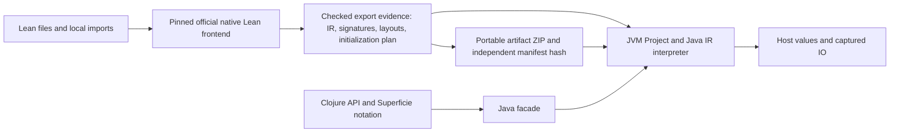

# Lean/JVM implementation layout

The production SDK owns one Java interpreter. Native source preparation, JVM
execution, maintained hosting research and historical evidence have separate homes.
The public Maven artifact split remains core Ansatz plus the optional Lean/JVM SDK.

## From Lean source to host calls

Direct source loading runs the frontend and opens a Project from the resulting
checked receipt. Build-time preparation exports that receipt as an artifact
without opening a Project. Later artifact loading requires only the SDK and its
ordinary Maven dependencies. It validates the independently expected manifest
hash, prepares code and executes supported initialization before returning the
Project. The native frontend remains necessary when compiling new source.

Optional [built Lake workspace mode](LAKE.md) checks a resolved workspace with
pinned Lake and reads compiled import headers. It freezes workspace-owned
products unchanged and compiles only an empty import adapter. Selected entries
can belong to imported dependencies. Existing producer checks authenticate their
signatures, implementation IR, layouts and startup plan. Official library
products retain the existing toolchain custody policy. This adds workspace
preparation without a second interpreter or a deployed Lake dependency.

The frontend supplies Lean compiler IR, rather than generated Clojure source or
LLVM code. The Java engine executes that IR and the supported runtime operations.
The JVM JIT can optimize the Java engine; this release does not provide a dedicated
Lean-to-JVM machine-code compiler or claim parity with compiled native Lean.

Type-directed codecs convert host arguments using checked signatures and native
constructor/layout witnesses, then convert results back to host values. Guest
objects and ownership obligations remain private. Lean's explicit RC operations
and reuse decisions are implemented on JVM objects; host garbage collection
reclaims the Java storage. Public Project forking is separate follow-up work.

The new v3 datatype path binds native defining-product origins, a canonical
logical type graph and independently checked compiler representation evidence.
An advisory origin inventory selects products for a new `/3` compilation cache;
it cannot upgrade an old cache. Compilation captures selected Init products and
all explicitly declared installed products, including optional-file absence.
Custody is rechecked around native evidence collection and before receipt issue.
This binds used defining-product identities; transitive implementation dependencies
retain the existing trusted immutable installed-toolchain policy, rather than a
claim of complete imported-environment attestation. Artifacts carry the checked
schema, product records and producer closure for native-free validation.

`LeanType`, `LeanTypeId`, `LeanName`, `LeanData` and `LeanBytes` describe detached
immutable values. Their storage has no Project, Program, engine or execution
lease reference. The first export validates/freezes the unique graph without a
payload copy; compatible certified-root import reads precomputed bounds without
a graph rescan. Clojure map/indexed views adapt this storage lazily. Explicit
materialization copies to ordinary host collections and bytes. All argument
preflight shares aggregate budgets outside the execution lease; IO success
freezes its pure payload and retires the envelope. V1/v2 codecs and artifacts
retain their established carriers. The [v3 producer archive](producer/README.md#datatype-v3-producer)
is published separately; use a coordinated SDK release containing this integration.

Ownership-sensitive sharing diagnostics check actual values in the canonical
engine. Managed objects and nonnegative immediate scalars are supported;
immutable Java String/BigInteger leaves have no logical RC and throw if reached.
This explicit runtime-domain contract replaces mandatory static provenance
analysis. Earlier guest effects may occur before a domain failure; the failed
branch is terminal. Full source/artifact/ABI authority remains independent of
this check, and no invented heap-leaf sharing counts are reported.

Core Ansatz supplies the kernel, elaboration DSL and stores in its own JAR. Both
JARs can coexist in one application or REPL, but executing a Lean module does not
import its declarations or theorems into the DSL's kernel environment. The optional
SDK's native checked evidence is not a Java-kernel verification receipt.

See [preparation](PREPARATION.md), [value conventions](VALUE_EXAMPLES.md), and the
[unchanged multi-file tutorial](examples/README.md) for the corresponding calls.

## Production boundaries

- `src-java/ansatz/lean/jvm/`: public Java facade and value carriers.
- `src-java/ansatz/lean/jvm/internal/exec/`: canonical lambda-RC execution engine
  and internal scalar/UTF-8/layout helpers. The engine and SDK use Java 17.
  Core kernel compilation remains a separate Java 11 contract.
- `src-java/ansatz/lean/jvm/internal/fs/`: bounded project-owned filesystem sessions.
- `src/ansatz/lean/jvm/`: Clojure API, codecs, actual runtime cohort adapters,
  initialization, artifact admission and explicit native compilation services.
- `test/`: focused Clojure contracts and active native capture fixtures.
- `test-java/`: actual Java engine ownership, resource and representation checks.
- `producer/`: supported bundle descriptors, packaging and release coordination.
- `../../tools/lean-producer/`: maintained native helper sources, including the
  supported v1 source. Moving these files does not change their admitted bytes.

The engine keeps Node/Header/Program identity, mutable execution state, pending
operations, ownership journals, suspension and fork commit points together.
Splitting those across classes is a separate ownership review, not a directory
cleanup. In particular, the adapters inspect declared fields; introducing an
engine superclass would change that contract.

`ScalarBits` and `Utf8Bytes` contain only mechanically extracted stateless
operations. Stateful intrinsic families can be extracted later with explicit
custody interfaces. Heap, IR, runtime-family and bridge packages should appear
when real implementations move into them, rather than as empty placeholders.

## Build and class inventories

`runtime-closure.edn` schema 2 lists disjoint Java engine and facade source sets.
Their union must equal the complete Java source tree. Every source is hash-pinned;
the sorted engine descriptors also have a closure digest. All source pins are
validated and their bytes captured before any Java source is staged or compiled.

The build emits `META-INF/ansatz-lean-jvm/java-classes.json`, binding each compiled
class to a captured top-level source and exact class-byte hash. Producer/consumer
checks compare it with the independently reviewed source inventory, reject unknown
or changed classes, and check runtime metadata against the interpreter and full
engine closure. No broad `internal/**` class wildcard grants packaging authority.

The JAR contains canonical runtime code; its POM declares ordinary Maven
dependencies rather than bundling their classes. Research loaders, native helper
executables and historical captures do not enter it.

## Explicit filesystem services

`Lean.open(HostServices)` captures immutable host configuration. Source and
artifact opens derive their required service profile from authenticated original
externs, then issue one fresh `FileSession` per Project. Exact ABI,
structural Name, source module and ordinary-role checks remain part of admission.
The artifact never stores a host root or executable service object.

The Java engine executes the original Handle/Stream code with real channels.
Handle Nodes carry per-engine kind metadata and ordinary guest RC; last-owner
release closes the channel. Each session independently owns a bounded resource
ledger. Failed branches use a distinct stopped-engine certificate to sweep that
ledger before dropping heap state. The existing pure-heap certificate still
rejects filesystem sessions. Filesystem operations are synchronous, initialization
and forks are refused, and session byte/operation budgets span repeated calls.
See [FILESYSTEM.md](FILESYSTEM.md) for the bounded Linux provider contract.

## Research boundary

The [host bindings](FFI.md) reuse the engine's host-request protocol and
existing detached value bridge. Producer evidence authenticates explicit
foreign imports and noinline reference replacements, including their pure or IO
effect; older evidence receives no new binding authority. The publisher validates
the full selection before invoking factories, materializing callers or starting
guest initialization. Per-Project callable identities remain fixed. The binding
guide records ownership, failure and proof-trust boundaries.

The former hosting experiments and unpublished World facade are preserved at
Git tag `lean-jvm-research-2026-11-01` (commit `4ace73f0`) and removed from the active
tree. Maintained runtime and kernel contracts live in [test-engine](test-engine/README.md),
with authentic fixture data and an explicit [coverage migration](test-engine/coverage.json).
Historical captures retain their original identities. They establish observations
of their recorded implementations rather than acceptance of the current SDK.

## Verification

The SDK gate builds one captured Java closure and tests the JAR, application
consumers, archive rejection, explicit ownership and resource limits. The broader
contract gate exercises the canonical engine's fork, graph, host, code-demand and
frontend foundations. The explicit source gate additionally checks the native
frontend cold/cache/edit/reload/artifact paths with a supplied supported toolchain
and bundle. See [release checks](RELEASE_CHECKLIST.md) for the acceptance sequence.
